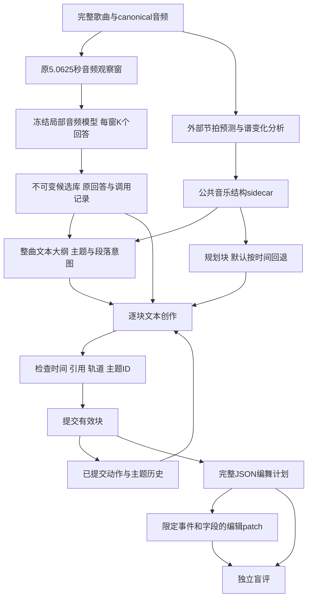

# 音乐文本编舞最新代码审查

审查日期：2026-11-05。审查对象为 `codex/music-choreo-benchmark` 的 `c1bba3c08edff60cbdc5b11bbc99c56685002256`，同步前为 `5c020af`。新增两次提交涉及23个文件，增加1938行、删除75行；当前远端main仍为 `abb8375`。下文代码行号均对应审查提交，不把随后新增的审查文档算作被验证的实现。

**当前版本已经具备冻结模型、整曲设计、逐块创作、受约束编辑和盲评交换的工程框架，可以用于真实pilot。它尚未证明整曲编舞质量优于局部拼接，也没有完成正式benchmark、自动语义修复或RSI。最值得优先做的是修正来源和评估问题，接入实际已训练checkpoint，再冻结配置开展独立评审。**

本次本机完整回归为 **487 passed、1 skipped**，耗时187.60秒；跳过项是Windows不允许创建测试符号链接。对应审查提交的 [GitHub Actions](https://github.com/Anachronism-N/H3-posttrain/actions/runs/41944468146) 为success。通过现有测试不代表没有逻辑缺陷：以下五项问题均另外使用合成fixture或模型stub复现，没有使用真实模型、真实评审数据或付费API。

**最新流程实际执行的工作**



这里有两个不同的输出机制。`index0/llm/scores` 选择已有整包回答，再按来源时间编译；`coordinated` 则允许文本模型创作新的动作和时间安排。后者的call_id表示“这段局部文本曾作为创作输入”，不能证明新动作与原回答语义相同或与音乐贴合。

| 环节 | 实现依据 | 实际能力与边界 |
|---|---|---|
| 局部专家 | [providers.py](../providers.py) 128–210行 | 保持音频输入合同；可使用已有合法checkpoint；不读外层计划或编辑答案 |
| 公共结构 | [music_structure.py](../music_structure.py) 53–97行 | 在预测重拍处比较左右3秒谱特征；标签unknown、repeat_group=null |
| 规划块 | [planning_units.py](../planning_units.py) 15–16、128–168行 | 默认meter_status=unverified，走10.125秒时间回退；短尾合并不等于动作时长约束 |
| 整曲设计 | [coordination.py](../coordination.py) 95–109行 | 所有局部候选和公共结构进入一次大纲调用，只输出主题和段落意图 |
| 顺序逐块创作 | coordination.py 112–158、309–323行 | 每块读取当前主题、局部候选、身体部位历史和最近事件；通过检查后才提交 |
| 编辑 | [edit_runner.py](../edit_runner.py)、[editing.py](../editing.py) | 精确版本绑定、显式目标/修复区、字段保护和撤销；无自由指代解析、事件增删 |
| 评估 | [evaluation.py](../evaluation.py) | 格式、覆盖、字面目标和保护检查；音乐性、语义和物理质量另评 |

因此harness的实质是外部状态、调度、工具证据、预算、验证和提交机制。大纲提前读取全曲候选，块也知道未来段落意图；顺序累积的是已提交历史，这不是在线音频因果生成。当前没有自动音乐critic、失败后的语义修复闭环或跨任务自改进更新；合同中也明确 `automatic_repair_loop=False`、`model_weights_updated=False`。

**真实实验记录说明了什么**

[VALIDATION_20261104.md](VALIDATION_20261104.md) 的2026-11-05新增记录比此前mock验收推进了一步：报告了真实GPU加载、整曲候选采集、文本服务生成和浏览器评审页面。原始运行目录不在当前工作树中，下面的实验数字属于仓库作者的留档，本次不能从原始响应独立复算。

最关键的区别是：**这轮真实验收使用原始Qwen3-Omni-30B-A3B-Instruct Thinker加固定任务提示，没有加载你们已有的编舞checkpoint。** `acceptance.py` 47–48行还显式拒绝带checkpoint的配置。已有checkpoint推理代码存在，但这轮结果不能替代它的验收，也不能说明你们训练好的模型没有价值或已经丢失。

三首完整开发歌曲的canonical时长约252.97、230.03、217.21秒；K=2共278次局部调用。它们被反复用于提示和参数调整，属于开发诊断，不能充当冻结测试集。

| 路径 | 文档记录 | 可得结论 |
|---|---|---|
| concat | 3/3合法，覆盖1.0 | 局部回答可以机械拼接，不能据此证明衔接或音乐性 |
| 旧global | 3/3合法，正文和排程逐字等同concat | 该配置没有表现出全曲组织收益 |
| 旧hierarchical | 2/3合法，一首大纲截断 | 必须保留失败歌曲分母；声明主题不等于主题编排有效 |
| 最后coordinated | 3/3合法，78/74/66个新事件 | 逐块创作接口可运行，结果与旧拼接不同 |
| 最后coordinated覆盖 | 0.968000 / 0.940998 / 1.0 | 仍有未编排区间，程序没有自动填rest |
| 最后coordinated短时长 | 8条事件不足1秒，最短0.0725秒 | 规划块短尾优化没有解决短动作问题 |
| 独立盲评 | 最后6条评分全null、audio_seen=false | 目前没有音乐贴合、连贯性或编辑语义的判优结论 |

单窗约59.39GiB CUDA reserved、111.89GiB加载期主机峰值，以及最后文本模型TP=2的资源配置，都是上述具体基座/环境的记录；不是已训练checkpoint、不同batch或另一台服务器的容量保证。部署估算见 [RESOURCES_zh.md](RESOURCES_zh.md) 第9–10节。

**五项已经复现的代码问题**

1. **空目标编辑可以得到成功标记，影响benchmark结果。**

   `evaluation.py` 128行对空目标返回rate=null，但134行通过 `all([])` 得到true，144行将没有语义目标的任务标成literal_pass。合法任务 `goals=[]`、`semantic_goals=[]`，且before与after完全相同，实际得到：

   ```json
   {"no_op":true,"literal_goal_satisfaction_rate":null,"literal_joint_success":true,"overall_status":"literal_pass"}
   ```

   这与 [PROTOCOL_zh.md](PROTOCOL_zh.md) 54、62行关于无目标和no-op不能自动成功的约定不符。应把无可评目标记为not_evaluable/NA，并将弃权正确性单独评估；不能把所有no-op都判失败，因为目标原本已经满足也可能无需修改。该问题是既有评估逻辑，不表示文档中那个带明确字面目标的真实编辑必然无效。

2. **结构分析会丢失合成标记，并将未知检测器命名为BeatThis。**

   `music_structure.py` 33–41行只核对检测ID、状态和音频哈希；82行硬写来源beatthis，91行只继承dataset.synthetic，93行允许模型哈希缺失。复现中dataset声明非合成，检测记录明确 `synthetic=true`，检测器名为fixture且无模型哈希，输出仍为 `synthetic=false` 和beatthis来源。

   下游 `public_structure.py` 会严格检查sidecar的dataset/音频绑定，但无法补回上游丢失的来源标记。应为检测文件定义版本化合同，保留真实detector、版本/模型身份和synthetic来源；任何合成输入都向下传播。身份无法核验时明确unknown，不能根据输出文件用途自动命名为某个真实工具。

3. **非原文诊断是固定true，不能作为反复制证据。**

   `coordination.py` 330–331行无条件写入 `new_actions_not_verbatim=True`。让stub把所引用整条raw response逐字写进event.action，运行完成后该标记仍为true。

   应改成能力声明“允许生成新提案”，或计算明确口径的逐字匹配诊断，并增加复制反例回归。即使文字不同，也不能把改写率当作动作创新、主题变奏或编舞质量。

4. **直接复用校验失败的NativeProvider对象时，可能跳过校验。**

   `providers.py` 182行先赋值self.adapter，185行才做加载状态校验。第一次校验抛错后adapter仍存在；调用者捕获错误并第二次调用generate时，会跳过load中的校验。stub复现为第一次报校验不匹配，第二次生成EOS，但verification=null且只校验过一次。

   应先验证临时adapter，成功后再发布为可用实例，或者把失败实例永久标为需重启。影响范围要准确：`resident.py` 已有requires_restart保护，正常baseline遇到此类基础设施异常也会停止；本次没有发现真实运行受该问题影响的证据。

5. **Windows评审音频的请求时身份检查依赖元数据，不能保证内容仍与启动哈希相同。**

   `review_server.py` 69行在启动时核验音频SHA，120–123行处理请求时检查fstat签名。在本Windows fixture上，音频内容不同但完整元数据签名相同，服务仍返回HTTP200，返回内容的SHA与评审包声明不一致。

   应服务经过验证的不可变音频快照，或者对实际读取的内容做相应哈希验证，并补充内容变化但元数据相同的回归。c1bba3c修复path stat/handle fstat语义不一致是有效的，但该修复本身不等于内容不可变保证。此复现不表示真实三首音频曾被修改。

上述五项的本地复现保存在Git忽略目录 `.choreobench-runs/review-c1bba3c-20261105/`：`reproduce.py/results.json`、`repro_structure_taint.py/structure_taint_result.json`、`repro_verbatim_flag.py/verbatim_flag_result.json`、`probe_native_initialization.py/result.json`。另有 `coordination-probe.json`，记录下一段的极短事件检查。这些文件仅含合成测试证据，没有真实音频、权重、私有评分或外部服务密钥；该目录不是GitHub资产。

另一个平台限制是 `acceptance.py` 6行直接导入Unix resource，并读取/proc；在当前Windows上连 `--help` 都无法导入。该入口应明确标为Linux专用，或实现平台分支。它不否定已记录的Linux验收，也不影响核心CPU命令的跨平台测试。

**距离编舞目标仍有的能力差距**

| 目标 | 当前差距 | 下一步应验证的内容 |
|---|---|---|
| 根据乐句编排 | 谱变化分段不是语义乐句；默认仍为时间块 | 同一候选、同一预算比较无结构/原始预测结构/打乱结构；独立评价段落贴合 |
| 降低动作复读 | 有主题声明和历史，没有动作语义去重 | 标注非预期重复与有意回归的区别，避免把所有重复都惩罚 |
| 连续动作 | entry/exit由控制器置空；轨道不冲突不等于身体过渡可行 | 跨块过渡评审；若增加计划状态，明确其为提案而非观测真值 |
| 合理动作时长 | 只要求整数start<end，每块最多若干事件 | 按动作粒度设开发校准的时长规则，保留短accent与复合短语的区别 |
| 精准自然语言编辑 | 需要预先明确事件/时间/段落范围；不支持增删 | 先做范围明确的编辑集，后做自由指代、增删和跨段依赖 |
| 质量评估 | 覆盖、词面重复、主题ID计数都是字面诊断 | 完成人工听音盲评，分开音乐贴合、动作明确性、发展、过渡和编辑语义 |
| RSI | 没有跨任务选择/验证/固化新策略的循环 | 定义改进对象、开发任务与冻结验证集、版本准入和全部搜索成本 |

主题检查只验证motif ID获当前段落允许，允许所有事件的motif_id都为null；它不验证动作是否符合主题描述、主题是否回归或变奏。大纲提示中的ending同样是软指令，没有独立结束目标或终态验收字段。

极短动作可以独立复现：让每个规划块仅生成一条长度为1采样点的事件，16kHz下为0.0000625秒，当前仍可得到 `all_songs_succeeded=true`。该字段表示整曲结构流程成功，结果同时正确报告低覆盖；它从未表示动作质量合格。问题在于缺少动作层约束，不能靠更改成功字段或缩短提示解决。

**建议的实施顺序和验收门槛**

1. **先修评估与来源正确性。** 为上述五项增加独立反例测试；保留当前已通过的正常路径和失败分母。将“软件合法”“语义通过”“音乐质量通过”保持为独立结果。

2. **验收实际已训练checkpoint，不先补训。** 使用既有portable加载路径准备基座、完整checkpoint、原配置和匹配的冻结源码；已有 `training_source_dir` 不会自动切换实际执行代码。先验证单个真实5.0625秒窗的身份、EOS和双窗格式，再采集整曲候选。现有base-only acceptance入口需另扩展或增设checkpoint验收，不能只替换一个目录名便声称通过。原始基座+提示应保留为对照。

3. **把时间表达从大整数算术改为可编译的候选边界。** 可在新协议中让模型输出局部boundary_id和duration_ticks，由控制器映射到canonical采样下标。拍点可靠时使用节拍网格；未知计量时使用公开、明确标记的时间网格。按动作类型设置经开发集校准的时长条件，严格拒绝并记录不满足的提案；不偷偷拉长动作或填满缺口。正式测试前冻结这些规则。

4. **先完成当前三首的独立盲评，再增加冻结新歌。** 对比当前同结构index0与coordinated，单列短动作、缺口、语义复读和编辑失败。此轮结果只用于诊断。新歌分组、近重复和授权完成后，冻结音乐证据、模型、提示、K、预算和评审量表，再开展正式测试。

5. **使用能回答机制问题的消融。** 同一专家候选库比较：无大纲/有大纲、无历史/有历史、无结构/原始预测结构/打乱结构、严格选择/自由合成、原始基座/已训练专家。原始预测结构不等于人工真值，若增加人工核验结构应单列信息条件。报告首次采样和新增外层成本；不能给一种方法更大搜索预算后把差异全部归因于harness。no-audio是必要的诊断之一，但不能替代音频模型直接处理整曲的对照。

6. **再扩展编辑和自改进。** 第一阶段明确到某段、某时间、某身体范围，检查目标、保持和衔接。之后增加自由指代与事件增删。若要称RSI，必须实现开发集上的策略改进、独立验证、版本准入和可回滚记录；推理时改写一次输出不足以支撑这个名称。

按这个顺序，近期资源主要用于实际checkpoint的一次采样、文本模型推理和独立评审，不需要先启动新的SFT/DPO/RL。局部采集完成后可以停止音频模型；全曲设计、逐块创作和编辑可共用文本服务，CPU层完成编排与日志。正式benchmark所需的新歌、编辑任务和评审数据仍需准备。

本次同步与审查没有修改以上实现，五项问题在审查提交中仍然存在。本文记录的是当前能力、已复现缺陷和后续验收方案，不把修复建议写成已完成工作。

后续实现已针对以上五项加入修复和回归；本文仍固定描述c1bba3c历史快照。新功能、验收边界与服务器计划见 [NEXT_STEPS_20261105_zh.md](NEXT_STEPS_20261105_zh.md)，不要把旧三首实验结果自动归到新版本。
