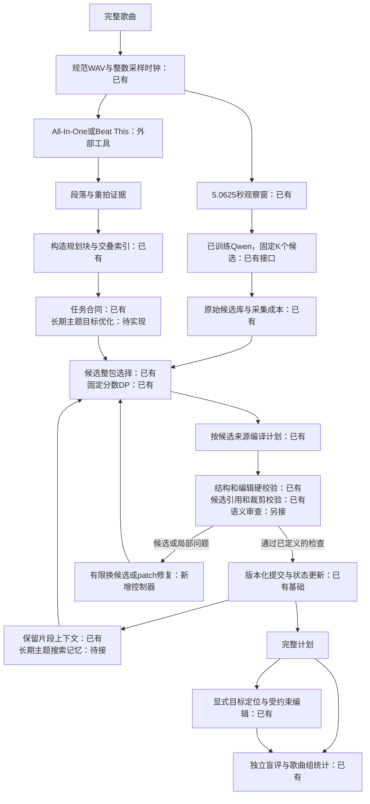

# 音乐编舞 Harness 的执行设计与迁移方案

目标是把局部音频动作提案扩展成可评测的整曲计划与受约束编辑。已接通规划块、整包选择、固定分数DP、来源编译、常驻局部服务、全曲设计→逐块创作→验证后提交的coordinated模式，以及独立的有预算诊断/重听/action-only修订。局部提案可来自合法已训练专家，也可来自明确标记的原始Omni＋固定任务提示。模型冻结，不启动训练；global保留一次性生成对照。经独立校准的语义修复、长期搜索和自由指代仍待实现。

**阅读当前实现请直接看末节“当前实现详解（2026-11-10）”。** 前半保留首版设计/参考迁移，其资源与模块状态不是今天的完成情况；末节核对实际源码、v11初稿及v21/v22修订。验收结果统一见VALIDATION_20261104.md。

## 当前划分与三个时间尺度

`audio.make_windows` 仍只生成完整的5.0625秒观察窗；原 `baseline._outer_plan` 按导入的 `music.sections` 逐段调用外层模型。新增 `planning_units` 可在计量结构经作者声明reviewed后按小节构造规划块，默认unverified走时间回退。两条路径均未实现真正音乐乐句检测。`prepare-audio` 默认只有一个全曲unknown段，原hierarchical不会自动细分；新run-harness可在该段内建立明确标记的时间块。

| 层 | 含义 | 当前或建议边界 | 是否可当真实动作边界 |
|---|---|---|---|
| 功能段落 | intro、verse、chorus等结构 | 外部工具预测，保留原始时间 | 否 |
| 规划块 | 控制候选组织、上下文和编辑范围的工程单元 | 建议先试四个完整小节；不完整部分单独记录 | 否 |
| 专家观察窗 | 现有模型实际读取的波形 | 固定5.0625秒，首版维持原采样配置 | 否 |
| 计划事件 | 输出中的动作及其排程 | 局部caption的名义时间与经过记录的ownership变换 | 属于提议的排程，非观测到的动作起止 |

“四小节规划块”不等于音乐学意义的乐句。真实乐句还依赖旋律、和声收束与重复结构；先用可复现的计量结构做工程分组，再用人工审查或额外模型研究语义乐句。没有必要把乐句检测作为首轮实验的前置依赖。

选择这一尺度的假设是：固定秒数不随速度改变，而按小节组织更便于安排段落对比、主题回归和局部修改。它是否提高编舞质量，需要比较固定时间块、四小节块、四小节加功能段落三种设置；共用候选、模型与调用预算。不得预先宣称最优。

## 整体执行流程

下图标出当前模块及仍待实现的修复。已实现的固定section生成路径仍保留作baseline。



Harness持有任务状态、可调用工具、预算、证据、版本和转移规则。局部Qwen提供动作提案；文本LLM提供有限判断或编辑提案；确定性程序执行来源、时间和权限检查。最终隐藏评估位于运行控制器之外，不能被用来搜索本首测试歌的最优答案。

## 音乐分析工具的实际接法

最小部署先采用一种完整计量结果，避免混合不一致的beats与downbeats。All-In-One可同时提供功能段落；Beat This可作为节拍对照或替换计量来源。

| 工具 | 已核验官方接口 | 输出与用途 | 必须保留的边界 |
|---|---|---|---|
| [All-In-One](https://github.com/mir-aidj/all-in-one#usage-for-python) | `allin1.analyze(wav, include_activations=True)` | beats、downbeats、beat_positions、segments；功能段落用于粗层组织 | 不输出真正乐句；默认[小节解码](https://github.com/mir-aidj/all-in-one/blob/main/src/allin1/postprocessing/metrical.py)限定每小节3或4拍 |
| [Beat This](https://github.com/CPJKU/beat_this#python-class) | `File2Beats(checkpoint_path="final0", device="cuda", dbn=False)(wav)` | beats与downbeats；变速情况下仍使用实际时间序列 | 无DBN路径避免其DBN的固定3/4拍配置，但仍可能错拍、漏拍；不输出功能段落 |
| [librosa](https://github.com/librosa/librosa/blob/main/librosa/segment.py) | `segment.recurrence_matrix`；[`sequence.dtw`](https://github.com/librosa/librosa/blob/main/librosa/sequence.py) | 后续给重复段落、近似结构对应提供声学相似性证据 | 相似不等于同一乐句，也不等于应该复用同一舞蹈；需要适配特征与校准 |

Python调用示意可在独立音乐分析环境执行：

```python
import allin1
from beat_this.inference import File2Beats

# 首轮可只运行All-In-One；两种结果用于对照时分开保存。
analysis = allin1.analyze("/data/canonical/song.wav", include_activations=True)
beats, downbeats = File2Beats(
    checkpoint_path="final0", device="cuda", dbn=False
)("/data/canonical/song.wav")
```

分析工具与Qwen必须消费同一canonical WAV。不要让一个工具解码MP3、另一个工具读取不同解码器产生的波形；[All-In-One说明](https://github.com/mir-aidj/all-in-one#concerning-mp3-files)特别指出这种做法可能带来时间偏移。保存原始结果、模型/版本、波形SHA与转换回执；秒只在导入时转换一次为整数采样点。

当前 `import-structure --format allin1` 只保留beats、downbeats和segments，不保留beat_positions或activations；这些额外证据先放独立sidecar，后续再版本化扩展合同，不能悄悄加入严格Song schema。标准结果没有已校准的“边界正确概率”，不要把logit或激活直接当置信度。

All-In-One代码为MIT；Beat This官方说明代码和发布权重为MIT。音频、训练数据与其他依赖许可仍按各自来源处理。首轮不需要重新训练这两个模型。

## 规划块的明确构造算法

首版参数建议为 `bars_per_block=4`、`max_unit_seconds=20`、`fallback_seconds=10.125`。这些是待消融的工程初值，不是论文已验证超参数。

1. 验证功能段落形成全曲分割，实际downbeat时间严格递增且落在音频范围内。重复时间、越界和缺失字段明确失败，不静默去掉。
2. 连续两个downbeat之间构成一个预测小节。使用实际downbeat序列，不以全局BPM从零秒外推。BPM可能变化，首拍也可能不在零秒。
3. 在每个功能段落内部，从第一个可用完整小节开始，连续四小节组成一个 `metrical_block`。不跨verse/chorus等段落边界。
4. 首个downbeat前的音频、末尾未封闭小节、段落切入的小节、剩余不足四小节，分别保留 `partial_fragment` 与具体原因；覆盖时间不能丢失。短碎片可被相邻任务读作上下文，但不重复写事件。
5. 对错拍、缺重拍或复杂拍号不能可靠解释的片段，记录 `meter_unverified`，改用明确标注的10.125秒 `time_block`，或进入人工审查。工具不提供可信的判错概率，首版先结合输出一致性检查和抽样人工复核；规则与阈值在开发集冻结。
6. 得到规划块后，再建立它与专家观察窗、ownership及名义caption区间的交叠索引。规划块只增加上下文和定位能力，不拉伸、补零或重切现有模型波形。

为限制上下文，四小节超过20秒时，在可用重拍处减少合并小节数并记录实际bars；单个预测小节也过长时进入time_block或人工审查，不强行解释为正常乐句。计量、时长和外层输入token上限都应由控制器检查。

例：假设120 BPM、4/4，downbeats为 `0.72,2.72,4.72,6.72,8.72,...`，四小节块为 `[0.72,8.72)`；`[0,0.72)` 是前缀片段。如果功能段落在7.90秒结束，保留该原边界，将剩余部分标为不完整，不能擅自把段落改成8.72秒。四小节在不同速度下时长不同；这也说明它不能替换5.0625秒专家窗口。

规划sidecar的字段摘录如下，完整绑定字段由plan-units或run-harness生成：

```json
{
  "schema": "choreobench.planning_units.v1",
  "audio_sha256": "CANONICAL_WAV_SHA256",
  "units": [
    {
      "unit_id": "chorus2-block1",
      "section_id": "s005",
      "kind": "metrical_block",
      "start": 512000,
      "end": 640000,
      "bars": 4,
      "boundary_source": "tool_downbeats",
      "semantic_phrase_verified": false,
      "window_refs": [
        {"window_index": 6, "observation_overlap": {"start": 512000, "end": 567000}, "ownership_overlap": {"start": 512000, "end": 567000}},
        {"window_index": 7, "observation_overlap": {"start": 567000, "end": 640000}, "ownership_overlap": {"start": 567000, "end": 640000}}
      ]
    }
  ]
}
```

示例假定16kHz、32–40秒，只展示部分字段，不是可替代完整sidecar的手写输入；fragment和fallback条目使用其真实kind和bars=null。

## 局部候选如何采集

保持当前输入合同：规范波形的完整5.0625秒，无大纲、前文、歌词、目标动作或编辑指令。模型每次返回原固定双窗caption。外层不能通过“更有力量”文字指令直接控制这个audio-only专家；需要从不同采样候选中选择，或另行训练条件输入。

首个pilot先试 `K=2`，再视候选差异与成本扩到4。固定seed派生、temperature/top-p、最大输出和checkpoint。每个候选保留原始回答、两个caption、实际观察窗、原始请求与停止原因。select_only必须整包选择一次响应的两段caption；混合A前半段与B后半段须另立新组合、记录父来源并重新检查，不能仍称为一次专家原始提案。

现有 `candidates_per_window` 与 `export-candidates` 已能完成采集和不可变保存。坏输出保留并进入失败分母；候选库不包含测试参考动作或人工终评答案。改变窗口/seed/K需新采集身份，不能在看到评测反馈后补采并假装同一预算。

## 规划块与观察窗不能硬对齐

例如一个规划块是32–40秒，现有两个相关观察窗可能为 `[30.375,35.4375)` 和 `[35.4375,40.5)`。它们保留原长度；选择器可同时读到它们与规划块的交叠情况。一个观察窗跨两个规划块时，全曲只产生一个候选选择，两块共享该选择，不能在边界两侧分别选两个冲突答案。

首版选择顺序仍沿专家window图推进；规划块提供组织目标与历史索引。提交和状态更新使用实际已提交的ownership时钟，不把“四小节末尾”当作模型已预测的动作结束。总谱显示可按规划块分组，跨块事件只引用同一稳定ID。

需要补验的现有语义问题是：`_concat` 将caption对应的名义区间裁到ownership，却原样保留整段动作文字。例如12秒音频的尾窗左移后，中间ownership可能只剩1.875秒，原两秒caption若写“转两圈”，裁完时间并不能证明动作仍完整。

新编译器应记录 `source_interval`、`scheduled_interval`、`partial_source`。完整包含的动作可保留；部分裁剪、次数动作和跨边界事件进入 `needs_review`，不能以格式合法当作语义保持。可选择保留跨块事件、做有依据的局部改写，或报告未解决区间；具体策略作为消融。不得把未知区间填成“休止”来提高覆盖率。首版也不把所有事件自动snap到拍点后再宣称同步改善。

## 外层模型只做明确的有限决策

先让程序生成每个规划块的合同：可见音乐结构、局部候选ID、前后可用上下文、用户要求、可变范围、受保护字段。主题回归或渐强是 `design_goal`；它们不是音频中已经观测到的事实。重复的chorus标签不能自动证明两段旋律相同；重复组需声学证据或人工核对，保留不确定状态。

当前run-harness的llm模式采用select_only原则，外层只返回choices中的window_id与candidate_index；动作文本与名义区间由程序从原候选读取。生成器不能在同一接口中擅自写新动作、改时间、改变身体轨道或抹除来源。比较理由、证据和不确定项可在后续版本加入独立审查合同，不是当前选择响应可附带的字段。

```json
{
  "choices": [
    {"window_id": "w006", "candidate_index": 1},
    {"window_id": "w007", "candidate_index": 0}
  ]
}
```

程序验证每个责任window恰好一个合法candidate，不能借空choices跳过窗口；非法输出记整首选择失败。scores模式合法分数下无完整路径时明确弃答并保留分母。需要新动作或修改时走单独patch接口，改后不再称为原候选逐字支持。

动作事实表可以作为第二阶段模块：从caption中提取部位、方向、动作和显式入口/出口，并附原文span；缺失为null。“抬右腿”不能自动推出“最后右脚支撑”。LLM提取结果仍是解释，不能直接变成硬性人体物理约束。当前concat通常只有body轨道与空entry/exit，生成可靠细粒度编辑前必须先解决事实拆分与审核。

## 候选选择如何计算

每个观察窗是一层节点，每个完整回答是一个节点。先使用相邻窗口图，计算本地偏好与相邻衔接；主题长期依赖确有收益后再扩为带状态beam search。

```text
dp[i,k] = unary[i,k] + max_j(dp[i-1,j] + transition[i-1,j,i,k])
```

`unary` 只来自明确的公开要求、已收集的独立偏好或经校准的评审；`transition` 表示文字动作的衔接判断。评分方向、缺评策略、平分时规则和权重在开发集冻结。这个搜索仅在给定分数上找路径，不会自动产生音乐理解能力。无可信音乐评审时，先报告“文字组织选择”，不能把文本LLM分数改名为音乐适配分。

transition比较的是ownership编译后真正相邻的片段，而不是重叠观察窗原始的“末句→首句”。部分裁剪尚未审核时，衔接保持unknown。若分数依赖历史主题或其他上下文，普通一阶DP不再保证完整目标最优；应扩展状态或使用预算内beam search。

硬约束由程序处理：候选存在、window唯一、时间身份、权限/保护、合法轨道与引用。动作语义、真实可执行性和音乐贴合由软审查或人工判断；未知状态既不自动通过，也不作为确定冲突剔除。

为控制成本，保存候选对评审缓存，缓存键包括源回答、时间编译策略、公开合同、所用上下文、rubric、评分器及提示版本；只有同一评价请求才复用。可以每个相邻window一次请求返回全部K×K比较，但必须对每项显式绑定候选ID且记录全部token。单次请求批量处理不等于少了评审工作量。改用局部beam时，保存被丢弃路径和原因，不仅保留最终赢家。

例：180秒、默认stride约36个window，K=2为72次局部采样；相邻候选对最多 `35×2×2=140` 项。若按相邻window批量返回则最多35次边界评审请求，另计组织、编辑、故障与独立终评成本。缓存复用避免再次跑Qwen，质量和实际延迟仍需pilot测量。

## Harness 的任务状态与有限修复

建议以现有journal为基础新增控制器，状态至少包括：

```text
prepared -> analyzed -> candidates_ready -> selection_proposed
         -> compiled -> checked -> committed
                          |
                          +-> repair_proposed -> compiled
                          +-> failed / abstained / needs_review
```

每次proposal记录父版本、输入哈希、公开合同、模型/提示版本、候选选择、检查结果和成本。只有检查完成后的版本才能更新已提交记忆。检查失败不覆盖前一版本，不偷偷增加随机重采。

首轮修复策略是先换已有候选，再考虑小范围patch；按问题所在window及明确批准的相邻修复区执行。`max_repair_rounds=2` 可作起始预算，另有整曲调用、输出token和墙钟上限。达到上限、无合法候选、连续版本重复或修改无可验证进展时，明确停止并保留失败/待审。超时且提供方结果未知时继续沿用现有禁止自动重发规则。

硬检查失败可以生成确定的修复问题；语义批评应附候选原文或音频证据，并允许“证据不足”。内部critic不接触私有测试答案。最终独立人评与内部critic分开，不能用同一模型的自评分作为方法成功证据。

这一步借鉴 [DeepSeek原型](https://github.com/deepseek-ai/dsh-superagent-prototype/blob/main/docs/007-architecture.md)的持久任务、依赖与恢复模式。首版可用Python有限状态机与现有JSON journal实现，不必为跑整首歌引入完整多worker运行时。单曲搜索/修复属于推理过程；跨开发歌曲持续更新提示或策略是harness优化；只有机制满足递归改进定义时才讨论RSI。

## 精准编辑如何接入

已有显式选择器可解析section_id、section_label+occurrence、采样区间、track/body_scope，生成private/public task与resolution。用户说“第二次副歌上半身动作更大，脚步不变”时，下一步自由指代grounder只提出selector与候选保护条目，再由程序解析公开时间/事件索引；歧义不自动猜测。

范围解析后，编辑器只读取源计划、公开指令、目标IDs、修复IDs和保护字段。全曲版本、源计划哈希、所有未授权事件及保护字段被冻结。每次编辑输出patch、改后计划、检查报告和可撤销版本。当前schema只支持修改已有事件字段，不能把事件增删或整个body事件拆成手脚两轨说成已实现。

同一次用户请求的多轮尝试始终针对同一初始计划和冻结task提出累计patch，最终检查initial→final，避免每轮rebase掩盖累积漂移。下一个用户请求才绑定新接受版本。循环检测使用动作内容hash并排除provenance，防止每轮新日志使重复动作看起来不同。隐藏测试的private goals只在最终artifact固定后评价，不能把失败答案返给修复器。

若计划只有body文字且无法确认手脚独立事实，先标记任务粒度不支持，而不是声称脚步已保持。未来可用经人工复核的动作事实表建立分轨。编辑评价分别测定位、语义目标、保护保持和衔接，避免把给定target IDs的条件编辑与自由指代端到端任务混在一起。

## 可迁移工作与复用方式

直接复用优先调用既有接口；论文机制迁移则需要本任务的适配与实验。涉及权重、数据或代码拷贝时记录固定revision和各自许可，不能把第三方成绩当成我们的复现实验。

| 工作 | 我们复用的具体部分 | 可直接使用的程度 |
|---|---|---|
| All-In-One / Beat This | 音乐功能结构、节拍与重拍预测 | 可独立运行官方工具；现有All-In-One importer已接。真实乐句层须另做 |
| librosa recurrence / DTW | 重复结构候选、段落声学对应 | 可调用函数；我们需补特征、时间映射、阈值与审查 |
| [MAESTRO](https://midotronn.github.io/MAESTRO/) | [select_dance](https://github.com/midotronn/MAESTRO/blob/cfc77a3a1e607dfaebd0c381573d6a943616e11a/agentlodge/agent/selector.py#L117)及候选schedule选择 | 借候选→诊断→选择机制。公开selector使用运动指标与显式方法名，异常有固定fallback，不直接作为盲评器；项目页完整storyboard/编辑能力未在当前入口核实 |
| [AtomicDance](https://github.com/oceanflowlab/AtomicDance) | [infer_plan/infer_completion](https://github.com/oceanflowlab/AtomicDance/blob/7b85001babcab5379550e6f0f8cf3abc7779c8cf/infer_atomic.py)及动作原型检索 | 借计划/variation/transition分工；公开入口按window_size分块、类别为封闭集合，不等于全曲开放文本规划。代码MIT；README仍称权重将发布，本轮未确认下载可用 |
| [LODGE](https://github.com/li-ronghui/LODGE/blob/f38642ad67bc3402444f5f914010a911e5bd5c89/infer_lodge.py) | 全局粗计划与局部受约束生成 | 借组织原则；3D运动张量不直接接文本总谱。当前仓库未核到明确LICENSE，拷贝前需核实 |
| [MotionFix](https://github.com/atnikos/motionfix/blob/e6b437e6a17f26b2066f9c142600146f035da6bf/src/evaluator/evaluate_edits.py) | source/instruction/target三元组；分开edit_accuracy与motion_preservance | 迁移任务与标注设计，几何评估器不能直接评分文字。LICENSE为MIT但README仍有限制性表述；数据、AMASS、身体模型另行核清 |
| [DeepSeek prototype](https://github.com/deepseek-ai/dsh-superagent-prototype/blob/8c32a9dc5d72c033816c6a8110b37f40cf94fba4/src/app/store.ts#L138) | Store.atomic/afterCommit、Effects.enqueue、Prompts.save的父版本检查 | 借事务、恢复和版本约束，代码MIT；Effects默认重试不能原样用于计费调用的未知结果，继续保留started/raw阻断 |
| [ClawMark](https://github.com/evolvent-ai/ClawMark/blob/d1b641b3171e584e69a3763c269069f32a13b574/src/clawmark/orchestrator.py#L46) | stage执行、快照、阶段checker与最终checker | 借多轮编辑的累积检查；checker不能替代美感评审。许可CC BY-NC 4.0，直接拷贝需符合许可 |

项目内也有可复用基础：`music_planner_search.py` 的候选身份、独立音频评审合同与经审查数据导出；`motionscript_v2/selection.py` 的可逆摘要与源事件保留。前者需转换到ChoreoBench候选schema，后者依赖实测姿态事件，只适合离线标注，不可把音乐生成文字伪装成实测动作。两者均不是已有的整曲候选图选择器。

## 首版模块状态与验收（历史）

当前可运行命令以README与CLI help为准；表内未实现模块不可当作已有CLI。

| 模块 | 输入 → 输出 | 最低验收 |
|---|---|---|
| `music_tools.py`（待实现） | canonical WAV → 原始结构结果与绑定回执 | 目前独立运行工具并经已有importer导入 |
| `planning_units.py`（已有） | sections+downbeats → blocks/fragments/fallback与交叠索引 | 变速、弱起、残缺尾、段落非重拍边界、未审核计量回退；全曲无缝且不重复 |
| `selection.py`（已有） | 固定候选+公开合同+偏好 → 每window唯一选择 | 整包选择、来源绑定、缺评/平分/无路径；DP与暴力枚举对照 |
| `compile_selected.py`（已有） | 选择+原请求 → plan+来源与部分裁剪回执 | 文本逐字来源、时钟、不默默retiming；部分裁剪被省略或标待审 |
| `harness.py`（单次流程已有） | 任务状态+工具结果 → 有预算的运行轨迹 | 跨块唯一选择、输入字符上限、恢复、未知结果、失败分母；尚无自动修复循环 |
| `resident.py`（已有） | audio-only HTTP → 原生专家结果 | 同实例串行复用、身份pin、真实波形校验、加载验证失败要求重启；真实GPU待验收 |
| `edit_grounder.py`（待实现） | 文本指令+公开结构 → selector候选 | 当前仍使用显式选择器，不能把自由定位当已实现 |

后续顺序：验收真实服务与单曲选择，再增加经校准的有限语义修复，最后自由指代编辑。global与原hierarchical保留作比较路径。DP是固定分数路径搜索；llm模式是按规划块单次选择，不能声称已经合并成自动评分、主题记忆与多轮修复的完整agent。

## 数据与实验的先后

先做真实短窗与一首整曲验收，再做小型整曲pilot。冻结候选库后让人工从同一批候选组织：人工也做不好时优先改善局部提案；人工明显更好时优先补选择监督。四小节块、候选数量、重复处理和修复预算的取舍在开发集完成。

首批新增监督可以是候选偏好、相邻衔接判断、错误定位与最小修复、编辑前后计划及保护条件。无需先写每首歌唯一的长总谱；保留多种可接受选择和不确定答案。教师生成的整曲文字只能作待审草稿。

正式评估同时报告缺失/失败、结构有效性、音乐贴合、主题发展、非预期重复、编辑目标与保持性及成本。按原曲/艺人/近重复组隔离数据；独立终评不得进入测试歌曲搜索或策略调参。文本排程的拍点分数不等于生成视频中的实际动作同步，后者需独立渲染和测量协议。

资源优先沿用 [RESOURCES_zh.md](RESOURCES_zh.md)：首次本地专家采集需要真实模型服务器；候选已固定后，选择/控制程序可在CPU运行，外层LLM由独立服务提供。当前不启动SFT、DPO或RL，不需要新增训练集才能运行；模型缺陷是否需要后续训练由真实实验决定。完整歌曲、编辑任务、独立评审和开发校准数据仍是benchmark输入。常驻服务减少重复加载，但显存、推理和空闲租用仍消耗资源；采集后可停局部服务而继续使用候选。这是首版资源假设；后续真实GPU执行已完成，当前实现、成本及仍缺独立质量评价的边界见末节。


## 当前实现详解（2026-11-10）

本节依据代码 `609c27e` 及安全快进后的 `9d919c1` 核对，说明**实际实现**而非未来方案。历史执行对应 v11 全曲初稿、v21/v22 修订；最新诊断读取与时间文字检查不能倒算成旧实验的新成绩。前文的设计、迁移和待办按其历史阶段理解，当前状态以本节为准。

### 1. Harness 的定位与两段执行流程

Harness 是冻结模型之外的任务执行系统，负责输入隔离、结构与时间合同、状态、权限、预算、版本、恢复和证据。模型提出内容，程序决定它能否提交。没有更新模型权重，没有修改 H3 或原局部 5.0625 秒合同；输出是文字 JSON 计划，不是已渲染的视频或 3D 运动。

全曲初稿与后续修订是两个独立入口，当前不是无限 critic–repair，也不是自动改代码、更新权重或跨任务自我提升。

```text
完整音乐 → canonical WAV / 整数采样时钟 / 音频身份
  ├─ 音乐工具 → 公共 beats / downbeats / sections sidecar
  └─ 完整 5.0625 秒观察窗 → 原始 Omni + 固定动作任务 prompt
                              → 冻结局部候选库
公共结构 + 候选 → 全曲大纲 → 因果逐块创作 → 硬校验 → 提交前缀 → 下一块
                                                      → 全曲 JSON 初稿
冻结初稿 → 一次文字诊断 → 冻结有限选点 → 可选重新听局部音乐
         → 单事件 action-only patch → 硬校验 → 内部匿名 A/B 选择
         → 保留原稿或接受候选 → 独立盲评（不进入本次搜索）
```

| 角色 | 实际输入与职责 | 不能混淆的边界 |
|---|---|---|
| 局部动作提案模型 | 完整 5.0625 秒波形和固定任务 prompt，提出可能的动作文字 | 当前用原始 Omni 暂替专家，未证明其动作提案可靠 |
| 文本规划模型 | 候选文字、公共音乐结构、brief、大纲和历史，组织并创作动作 | 没有直接听音频；文字与结构证据均可出错 |
| 音乐重听模型 | 另取的完整 5.0625 秒波形和音乐观察 prompt | 只描述音乐，不接收待改动作或私有目标 |
| 文本修订/选择模型 | 计划、诊断、可选音乐观察、冻结编辑合同 | 内部候选选择不是独立质量评价 |
| 确定性控制器 | 输入绑定、解码合同、合法性、权限、状态和成本 | 不具备完整音乐或人体语义验证能力 |

实际 v22 用 Qwen3-VL-32B 文本服务与原始 Omni-Instruct 观察服务；音频观察器和动作提案器的 prompt/身份不同，不能把“描述音乐”的输出当成编舞强基线。服务适配见 `choreobench/providers.py:128`、`choreobench/providers.py:230`。

### 2. 规范音频、采样时钟与局部候选

**音频身份。** 执行阶段要求单声道 PCM16 WAV，绑定 SHA256、sample_rate 与 num_samples。候选、音乐工具和重听消费同一 canonical 音频；执行中不偷偷重采样、混音或补零。转换走显式 prepare-audio。见 `choreobench/audio.py:18`、`choreobench/dataset.py:121`。

**时间合同。** 存储时间为全曲整数采样点，区间为 [start,end)。16kHz 下 32000 samples 为 2 秒，81000 为 5.0625 秒；相邻 end=start 合法。它是建议排程，不是观测动作起止，也不是实际运动同步测量。

**原模型观察窗。** 每次输入完整 5.0625 秒，返回固定双窗动作文字：

```text
[0-2s] movement description
[2-5.0625s] movement description
```

2 秒只是回答格式的名义分界，不是音频输入长度，也不强制后续动作按 2 秒切分。当前历史候选库 K=2，保留原响应、两段解析文字、window、请求、seed、模型/提示身份、停止原因和真实成本。坏输出不以新随机采样偷偷替换。

**观察与 ownership 分开。** observation 是实际听到的范围；ownership 是拼接/选择路径中负责的非重复排程范围。最后一个完整窗整体左移到曲尾，由 ownership 避免交叠观察重复输出。见 `choreobench/audio.py:37`。

**输入白名单。** 局部 provider 不接收前文动作、大纲、用户编辑指令、期望答案、歌词或私有评测目标；固定动作任务 prompt 不随外层答案变化。见 `choreobench/providers.py:206`。候选冻结后，外层对照复用同一库并检查 dataset/歌曲/音频/采集配置身份；采集成本与规划新调用分开。

### 3. 公共音乐结构与规划块

音乐结构、规划块、动作事件是三个不同层次。独立 public_structure sidecar 绑定原 dataset 字节、selected songs 和每首音频 SHA/时钟，不悄悄修改候选原 Song，也不接收私有答案。

当前真实实验用 Beat This 的节拍/重拍预测及 canonical 音频谱变化证据；功能标签 unknown、repeat_group=null 保留不确定。谱变化不是已验证的副歌或真乐句。代码为 `choreobench/public_structure.py`、`choreobench/music_structure.py`。

计量被作者声明 reviewed 后，分块支持按实际相邻 downbeat 构造闭合预测小节、最多四小节合并、不跨公共 section、保留弱起/部分小节/未封闭尾部，并处理容量上限。reviewed 不是自动认证或校准置信度。

**当前冻结 v11 初稿实际配置：**

| 参数 | 实际值与含义 |
|---|---|
| meter_status | unverified，因此走时间回退，不是已核实四小节块 |
| fallback_seconds | 10.125 秒，在每个公共 section 内分块 |
| max_unit_seconds | 20 秒容量 |
| min_time_block_seconds | 2 秒短尾目标，不是人体最短动作时长 |

短尾在同段内可合并到前块；超过容量时平衡最后两块。规划单位形成完整、不重复分割，并索引观察/ownership 交叠，不改变原模型输入。见 `choreobench/planning_units.py:92`。

### 4. 全曲大纲、块请求与因果记忆

**独立大纲。** 大纲读取全曲候选、公共音乐结构、brief 和规划单位，**没有现成拼接 Plan 作为答案模板**。仅返回 motifs 与 sections：最多 8 个动作主题，每个公共 section 按原顺序给 intent 和许可 motif_ids。不能改 section ID、漏段或发明 chorus/verse 检测。主题回归是设计意图，不是已验证的音乐重复。见 `choreobench/coordination.py:99`。

**每块输入。** 包含当前单位范围/长度、section 中的位置、全曲 section 意图、当前许可主题、块内 beats/downbeats、相交观察窗候选、最近 8 个已提交事件、身体/主题记忆和输出时钟合同。可读取跨块观察，但新事件只能写入当前块。见 `choreobench/coordination.py:122`。

**确定性历史。** build_boundary_context 从校验后的完整前缀构造各身体部位最近事件、间隔、是否接触当前边界，以及主题次数和近期例子；前缀 SHA 绑定来源。它不推断支撑脚/朝向/接触，不假设空档维持姿态，也不把 motif 次数当质量分。当前无来源的 attributes/entry/exit 为空对象。见 `choreobench/context.py:33`。

**创作而非逐字选择。** coordinated 可合并局部候选、变化重复和身体 scope、形成跨数秒的动作短语。source_call_ids/evidence 仅证明这些输入被展示为启发，不证明新 action 的语义、音乐贴合或可执行性。控制器分配稳定事件 ID，模型不自行声明状态或 ID。

**控制对照。** use_history=false 真正移除已提交动作和边界记忆；use_outline=false 移除生成大纲/主题，并令 motif_id=null。共享大纲通过独立源绑定让有/无历史读取完全相同的大纲，避免两次大纲采样差异被误归因于历史。

### 5. 公开时间菜单、解码与硬校验

以下是当前冻结初稿的实际参数，**不是 CLI 的通用默认值**：

| 参数 | 实际值 |
|---|---|
| event_time_format | boundary_ids |
| event_grid_seconds | 0.25 |
| min_event_seconds | 0.5 |
| max_events_per_unit | 3（通用允许 1–8） |
| event_schedule_policy | balanced_full_unit |
| structured_unit_output | true |
| max_output_tokens / outline_max_output_tokens | 块 1024 / 大纲 4096 |

程序建立样本网格，模型只输出 start_boundary/end_boundary 索引，再编译到原全曲样本。真实尾点始终纳入，不补长音乐。最短时长向上取整到样本；网格和时长是工程合同，不是音乐/人体事实。见 `choreobench/timing.py:9`。

balanced_full_unit 为可容纳的 1、2、3 个短语分别提供一种近似均分完整排程。模型选短语数并写内容，不能留下缺口或添加别的区间。因此**覆盖 1.0 主要来自公开设计约束，不是质量成果**；当前也不是完全自由的音乐驱动动作定时。

动态 JSON Schema 约束单位、字段、轨道枚举、许可 motif/call ID、action 长度、事件数与完整区间数组；完整对象 alternatives/数组 prefixItems 避免后端忽略共享条件。不支持时不静默回退或重试。见 `choreobench/coordination.py:213`。

后验程序还检查 start<end、块内范围、最短时长、菜单精确匹配、来源唯一、当前主题权限、排序与身体 scope 冲突。九轨道为 body/upper/lower/head/torso/left_arm/right_arm/left_leg/right_leg，映射到六个叶部位检查共同占用；body 与所有轨道冲突，upper/lower 可并发。见 `choreobench/schema.py:12`、`choreobench/schema.py:163`。

这是 JSON 字段层的 scope 检查，不是 action 的完整语义解析：upper 正文偷写脚步并不会仅凭轨道合法而获得证明。

通用 scope 校验允许的并发，不等于当前真实排程菜单已使用该能力：`balanced_full_unit` 的 1/2/3 事件方案是顺序完整分割，不提供重叠分轨事件。一个 action 可以描述身体部位同时运动，但 v11 尚不能据此声称具备并发多轨的独立定时控制。

**提交规则：** 响应 → 解析事件 → 构造 proposed prefix → 校验完整前缀 → 保存块快照 → 更新 plan → 下一块。失败块不会进入后段历史；不通过裁剪、拉伸、补造 rest 或删事件隐藏失败。见 `choreobench/coordination.py:323`。

### 6. 有预算的诊断、重听与 action-only 修订

诊断与修订入口分别为 diagnose_plan 和 run_revision，见 `choreobench/revision.py`。

**一次共享诊断。** 文本模型只看冻结初稿和公共音乐元数据，输出最多 8 个唯一既有事件、priority=1..3、每理由最多 400 字符，绑定源计划 SHA；允许空列表。它未听音乐，问题仅是疑点。新生成和读取复用诊断均执行当前上限；9d919c1 修复旧读取路径漏检，历史超限记录不会被截断后冒充同一运行。

| 对照臂 | 选点 | 新音乐观察 |
|---|---|---|
| targeted/listen | 按优先级与原事件顺序选点 | 有 |
| random/listen | 从全部原事件按固定 seed 选同等数量 | 有 |
| targeted/text_only | 与 targeted 相同 | 无 |

共享同一初稿、诊断；targeted/random 按原事件顺序执行，编辑输入不附策略标签或优先级衍生指令。空诊断两策略均零选点。当前 v22 每臂 max_repairs=1，这是选定事件数，不是反复修同一事件的轮数。见 `choreobench/revision_protocol.py:65`。

**重新听音乐。** 以目标事件中点为中心取完整 5.0625 秒，曲首/尾整体平移；不补零、不缩窗。记录与目标交叠以及是否覆盖整个事件。观察器只描述节奏、脉冲、相对能量和局部变化，不读取计划/编辑指令，不编舞、不声称精确拍点。长事件可能仅部分被观察，必须保留此限制。见 `choreobench/music_recheck.py:16`、`choreobench/music_recheck.py:34`。

**冻结 patch 权限。** 仅选中一个事件的 action 可改，start/end/track/motif_id/attributes/entry/exit 全保护，其他 action 越权；不增删事件、不改 ID/evidence 或扩大任务范围。patch 绑定准确源版本，必须保留 instruction、allowed_event_ids、repair_event_ids、protected，允许 operations=[]。见 `choreobench/revision_protocol.py:93`、`choreobench/editing.py:278`。

**候选选择。** 合法非空候选与当前稿按 seed 匿名放入 A/B，内部文本模型选 a/b/uncertain；只有偏好修订才更新 current。每选中事件一次尝试，no-op 不调用 judge；失败/不确定保留当前稿，不重新抽样直到“成功”。内部选择不是独立质量评价。

**时间文字 guard。** action-only 不得用 prose 偷改排程；当前正则检查新增明确时间字面是否属于原 action 已有集合。但 at 640-ms、downbeat #54400、时间戳或同字面不同时间角色仍可能绕过，不是完整时钟语义证明。v22 两个历史内部接受候选均被最新 guard 离线拒绝；没有覆盖原 accepted 数，也未跑第三轮模型实验。详见[最新审阅](../../notes/40_609c27e_review_and_next_experiments_20261110_zh.md)。

### 7. 运行合同、调用账本、恢复和失败分母

contract 冻结 dataset/audio/candidates/structure/outline、配置、provider、代码 SHA 和预算。改变输入/代码/提示要新输出目录；入口的源码导入身份检查不是完整部署认证。

journal 在派发前写 .started.json（请求、身份、预算、开始时间），完成后写 .raw.json（原响应、停止原因、usage/错误），并绑定哈希。已完成且身份一致可复用；只有 started、没有可确认 raw 时不自动重发。截断、空输出、API/基础设施故障保留并区分。见 `choreobench/baseline.py:87`。

预算先覆盖启用的大纲与全部单位；共享大纲零新增大纲调用但历史成本另列。修订每事件 listen 最多 3 调用（观察/edit/judge），text_only 最多 2；no-op 可省 judge。当前 v22 三首共享诊断 3 次、九臂上限 24 次，整轮上限 27，实际 24；历史候选/初稿不重采、不重复计为新调用，也不称免费。

结果分别记录 complete、selected/proposed/judged/accepted、failed/not_attempted/no_op/uncertain、未知 usage/outcome；proposed_count 可含 no-op，不等于动作确实变化。complete 只表示处理了清单，不表示修订成功；失败留在分母。

| 真实开发结果 | v21 | v22 |
|---|---:|---:|
| 实际新调用 | 17 | 24 |
| 输入 / 输出 tokens | 311,024 / 12,767 | 438,947 / 8,719 |
| 新音乐观察 | 4 | 6 |
| 展示项 | 9/预登记12；一首诊断截断，三臂未尝试 | 12＝3原稿＋9臂输出 |
| 独立质量结论 | 无 | 无 |

v22 targeted/listen 与 targeted/text_only 各内部接受 1 项；random 三次 no-op。九输出七个保留原稿、两个改正文，不是九个独立改善；独立歌仍只有三首。v21/v22 同时改变多项协议，不能当单变量消融。实绩与失败详见[报告39](../../notes/39_bounded_music_reinspection_and_revision_20261110_zh.md)和[验收记录](VALIDATION_20261104.md)。

### 8. 独立评价与当前能力边界

自动评价只测 schema/时钟、scope、覆盖/缺口、事件/主题计数、文字重复及编辑保护；music_alignment/physical_quality 仍可为 not_measured。正文不同、主题更多、覆盖完整不能替代语义质量。见 `choreobench/evaluation.py:36`。

评审包隐藏方法元数据、原 ID、provenance/evidence，私有映射/目标不提供给生成器。六维是 musical_fit、long_range_structure、planned_executability、edit_target_satisfaction、edit_preservation、planned_boundary_quality；书面可执行性/边界判断不是实测生物力学或视频连续性。见 `choreobench/reviews.py:18`。

网页提供音乐、时间事件、空初始评分和时间评论；CPU server 只公开绑定页面/音频白名单，支持 HTTP Range，不公开私有目录或评分写入 API。review_ranges 单独保存已审半开区间，防止部分审阅冒充全曲无问题；reasonable_recurrence/uncertain 不直接算错误。review_analysis 检查 reviewer×item×criterion 分母及完整设计，缺评为 NA；edit_semantics 绑定 before/after/目标/审阅范围，硬失败优先，范围不足待评。统计以歌曲/来源组组织，不把同歌事件/seed 当独立歌曲。

截至本说明的 v22 交付，真实独立人工评分仍为 0；临时浏览器验收评分不是外评。内部接受与新 guard 通过都不证明质量优势，来源隔离、校准、强基线仍缺。

| 已实现 | 尚不能声称 |
|---|---|
| 独立大纲、因果逐块创作与历史摘要 | 正确识别真乐句或真实人体状态 |
| 公开排程菜单、动态 schema、硬校验 | 完整覆盖意味着音乐贴合或可执行 |
| 有预算的重听和单事件修订 | 已完成长期 beam/search 或自动递归改进 |
| 显式 selector 定位、受限既有字段 patch | 任意自由指代定位、事件增删/自动分轨 |
| 匿名评审、失败/缺评/成本/范围记录 | 内部 judge 接受就是独立成功 |
| 文字 JSON 计划 | 已渲染且验证视频/3D 的真实动作同步 |

concat/global/旧 hierarchical 保留对照；run-harness 的 index0/llm/scores 是整包候选选择与来源编译，scores 为给定分数 DP。**它们不全部串在 coordinated 主线中**，固定分数 DP 不自动获得音乐理解能力。coordinated 本身仍单次逐块生成，后续 bounded revision 是显式独立阶段。下一步先评价已有原稿、全部非空候选和疑似选点，再根据证据决定时间视图改进与新来源实验；不以追加调用或内部 accepted 代替评价。


2026-11-10 v23 已补齐全部非空修订候选的匿名A/B组织、独立偏好导入、原稿选点必要性审查与全候选时间字面离线审计；不是新增生成或真实评分。命令/合同见 [README第15节](../README.md#15-已有修订候选的独立审查零模型调用)，三首实际执行/失败/重复内容边界见 [最新实验记录第8节](../../notes/42_latest_review_and_experiment_plan_20261110_zh.md)。