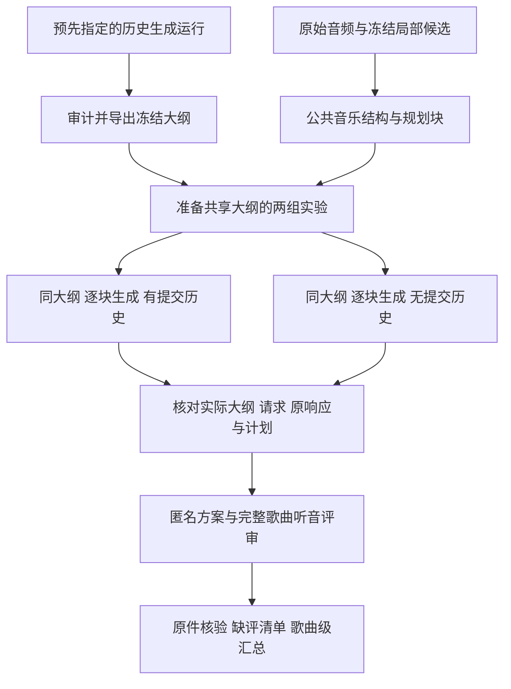

# 共享大纲历史对照与人评汇总

截至3c690c6，v11已完成三首歌曲、六条整曲方案的真实共享大纲对照，3/3内容控制通过；v12又增加评审名册完成率核验，实际人工评分仍为0。下一步是登记实际评审者并收回评分原件，再判断历史记忆和全曲组织是否有效。最新进度、具体安排与后续算法/编辑方向见 [进度与推进决策](PROGRESS_20261106_zh.md)。本文保留共享大纲的使用说明和各轮历史记录。

## v10背景与大纲混杂

拉取的 `b48b701` 只增加真实实验记录，生成代码仍为 `658ffe4`。其 v10 在原三首开发录音上运行 main/no_history，各自生成全曲大纲，再逐块编排。两组共6条合法完整计划，158次新增文本调用，新增局部音频调用0。详见 [真实验收第14节](VALIDATION_20261104.md#14-linux-真实历史配置对照-v10)。服务器原始响应和评分包不在本机工作树，以下真实数字来自该记录。

| 项目 | v10记录 | 当时的判断 |
|---|---|---|
| 完整合法计划 | 6/6；每组79次文本调用 | 整曲推理和日志链路已实际执行 |
| 时间覆盖 | 两组均1.0 | 来自公开完整排程，不能据此判断音乐贴合 |
| 事件数量 | 每组228；两组152/152块选满3事件 | 需要听音检查动作密度和机械分段 |
| 独立固定大纲配对 | 0/3；三首大纲内容均不同 | 无法单独识别历史模块的作用 |
| 实际质量评分 | 全部null，audio_seen=false | 界面验收完成，效果评价尚未完成 |
| 局部专家身份 | 原始Omni加任务prompt | 仍不能称为用户已训练编舞checkpoint的实测 |
| 正式benchmark | 三首反复使用的开发录音 | 来源分组、留出集与正式评审尚未完成 |

main输入558,772、输出35,803 tokens；no_history输入346,593、输出36,507 tokens。后者输入减少约38%，这只说明本轮输入负担降低，不能推出质量、费用或延迟更优。固定temperature和seed未使独立大纲输出完全相同，当前没有证据确定底层原因。

同一规划块在相同balanced菜单中，每种事件数量只有一种时间切法。因此两组都选3事件时，其时间边界应相同。比较时需要分别核对时间、轨道和正文，不能把“时间与轨道组合序列不同”解释为时间编排发生了改善。排程块也不等于真实音乐乐句：未审查拍号时仍用时间块，审查后按小节组织仍不证明语义乐句正确。

## 本轮新增能力



这是受约束的冻结模型推理harness：控制器管理上下文、预算、时间约束、提交前缀、证据和恢复。自动语义修复、模型训练及RSI仍未接通。

| 代码 | 作用 |
|---|---|
| [outlines.py](../outlines.py) | 从完成的原始生成run审计导出公共大纲，验证来源与内容 |
| [coordination.py](../coordination.py) | 实际读取共享大纲，跳过新大纲调用，向两组提供同一份设计 |
| [history_experiment.py](../history_experiment.py) | 准备main/no_history、复核准备输入、审计实际两组执行 |
| [review_analysis.py](../review_analysis.py) | 验证评审原件，核对完整歌曲分母，输出描述与受条件限制的比较 |

旧 `prepare-ablation` 仍保留独立生成大纲的四组实验语义。新的共享大纲对照使用独立入口，避免把旧结果重新解释成固定中间内容的实验。

## 先冻结公共大纲

选择来源run应在比较质量前明确，例如沿用v10的main运行，不根据哪个大纲效果最好反选。导出不调用模型；它要求来源run的完整选中歌曲均成功，并核对原合同、结果、调用记录和已发布大纲。原始大纲生成记录可以来自旧冻结代码，但不能来自占位大纲或已经导入共享大纲的运行。

```bash
python -m choreobench export-outlines \
  --run-dir /runs/v10/main \
  --out /data/choreobench/shared-outlines.json
```

sidecar绑定dataset字节、候选库字节、公共结构、有效歌曲和规划块；保留原生成请求、响应、代码及成本的身份。运行器在模型服务初始化前验证绑定，将同一snapshot写入合同，并在每次调用前、最终发布和完成恢复时复核共享文件。更改来源、配置或代码需要新目录。

导入后的大纲仍是模型曾经生成的设计；`generated_in_this_run=false` 与 `source=shared_import` 明确本轮没有生成它。原大纲成本单列，不能冒充本轮新调用，也不能从方法总成本中消失。哈希保证内部一致性，不替代对原模型与服务器的独立认证。

如果真实v10按歌曲分别使用dataset和run，应逐个原dataset导出与准备，保留原文件字节。不能将三首拼成新dataset后继续声称旧候选和大纲绑定仍然匹配。

## 准备并执行严格历史对照

```bash
python -m choreobench prepare-history \
  --dataset /data/choreobench/dataset.json \
  --candidates /data/choreobench/local-candidates.json \
  --config /data/choreobench/coordinated-grid.json \
  --outlines /data/choreobench/shared-outlines.json \
  --out-dir /runs/history-fixed-v1

python -m choreobench verify-history \
  --experiment /runs/history-fixed-v1
```

两个配置均启用大纲并引用同一文件，只改变 `use_history`。准备过程不加载模型、不访问服务；`ready_to_run`仅表示已知来源和调用预算满足条件。实际模型身份、上下文容量和服务可用性仍在服务器执行时核验。

按 `commands.json` 的argv数组执行；每组运行前重新preflight。下面先执行main，no_history用相同方式选择对应variant。运行这一步才会调用文本模型。

```python
import json
import subprocess
from pathlib import Path

root = Path('/runs/history-fixed-v1')
commands = json.loads((root / 'commands.json').read_text(encoding='utf-8'))
subprocess.run(commands['preflight_argv'], cwd=commands['cwd'], check=True, shell=False)
selected = next(row for row in commands['runs'] if row['variant_id'] == 'main')
if not selected['ready_to_run']:
    raise RuntimeError('Prepared inputs or budget are not ready')
subprocess.run(selected['argv'], cwd=commands['cwd'], check=True, shell=False)
```

已有三首共76个规划块。如果复用已生成大纲，两组新增文本调用预计 `76+76=152`，新增音频采样0；历史大纲的3次生成成本另列一次。若另行生成3份共享大纲，总新增调用为155。运行失败或中断按真实账目保留，不自动填补、重试或删除歌曲。

执行后检查实际消费，不能仅看配置相同：

```bash
python -m choreobench audit-history \
  --experiment /runs/history-fixed-v1 \
  --out /runs/history-fixed-v1/audit.json
```

审计核对两组合同、原请求/响应、实际大纲、提交前缀和计划，分别报告时间边界、轨道和正文是否相同。缺失run、失败、未决调用或内容控制不成立时不能标记对照通过。即使内容控制通过，也只说明具备比较历史配置的条件，不能代替人评或消除模型本身的输出波动。

## 先评现有方案 再做统计

现有v11六条方案已经可以用于发现问题。独立评审需实际听歌，分别评价音乐贴合、长程组织、计划可执行性与边界质量；评论记录具体时间和动作，区分有意主题回归与无意义复读。先由两名独立评审完成开发诊断并复核分歧；这不是正式样本量依据。

新入口直接读取公开包、私有绑定和原始评分JSON，重新调用 `import_reviews` 验证，而不是信任一份手工修改的汇总表：

```bash
python -m choreobench analyze-reviews \
  --dataset /data/choreobench/dataset.json \
  --public /runs/review/public/pack.json \
  --private /runs/review/private/bindings.json \
  --reviews /runs/review/reviewer-a.json /runs/review/reviewer-b.json \
  --method-a main --method-b no_history \
  --criterion musical_fit --split dev --origin human \
  --out /runs/review/musical-fit-analysis.json
```

统计分母来自指定dataset的整个split和两种方法。没有计划、没有评审、评分为空分别记录；不将缺评变0，也不让完全没有评分行的歌曲消失。重复的评审者/方案拒绝。同一大包可以按原逐歌dataset分析，其他歌曲/方法明确列为未纳入，不能把它们宣称为已核验当前dataset来源。

人工与模型裁判分开；选择 `--origin model_judge` 还需明确 `--judge-model-id`，其他裁判版本的行不混入。字段里的人工身份、听音声明和哈希并不证明实际听音发生。跨歌曲同一method标签的模型身份还需要原run合同审计，不能只凭标签认定相同模型。

未审查来源分组时仅做歌曲描述。分组已审查、ID完整、跨split无关联泄漏且配对评分完整后，才可请求 `--compare`。关联分组同时考虑歌曲、艺术家、近重复与相同音频身份，不能把同来源的多首歌或同歌多个事件当独立样本。三首反复使用的开发录音仍不足以支撑正式排行榜或稳健的泛化结论。

这里“目标维度评分完整”表示每个歌曲×方法至少有一条所选来源的非空评分。它不表示全部评审者均已填写或所有量表维度均完成；报告保留各格的待填评审者及评审者集合差异。原版本没有预登记名册，无法发现整位未提交者；后续已增加显式`--reviewer-roster`和独立完成率核验，使用方法见下节。ICC与真实评审者/听音认证仍未实现，不能声称评审一致性已经达标。

## 预登记评审名册与评分完成率

组织者在收取评分前指定实际参加者的匿名ID，按公开review_id列出任务；不要填写姓名、联系方式或把软件示例评审者当成实际参与者。名册单独保管，不把名单放进模型prompt或匿名评分页面。严格格式如下，示例只有一行，实际需要覆盖全部六方案和全部实际评审者：


~~~json
{
  "schema": "choreobench.reviewer_roster.v1",
  "pack_sha256": "REPLACE_WITH_OBJECT_SHA_OF_PUBLIC_PACK",
  "assignments": [
    {
      "review_id": "review_000001",
      "reviewer_id": "REPLACE_WITH_ACTUAL_ANONYMOUS_REVIEWER_ID",
      "origin": "human",
      "model_id": null,
      "criteria": ["musical_fit", "long_range_structure", "planned_executability", "planned_boundary_quality"]
    }
  ]
}
~~~

pack_sha256使用object_sha(public_pack)，不是文件名或音频哈希。每个reviewer/item仅一行，criteria为非空不重复的适用维度。生成任务不登记两个edit维度。名册声明不能证明真实参与或确在评分前登记，需组织者记录过程并冻结原件。

通用名册允许不同人承担不同任务，不自动保证本轮“两人各评六方案”。本轮需另核12条唯一分配、每人6条、每条4维；按原逐歌dataset分析时，每歌每维expected_assignment_count应为4。覆盖三首的单维CPU反例中，少登记一项而完成其余11项仍会得到11/11完成，不能当12项完成。网页为只读导出，原始评分JSON需由组织者收回。

~~~bash
python -m choreobench analyze-reviews   --dataset /data/choreobench/original-song.dataset.json   --public /runs/review/public/pack.json --private /runs/review/private/bindings.json   --reviews /runs/review/reviewer-a.json /runs/review/reviewer-b.json   --reviewer-roster /runs/review/reviewer-roster.json   --method-a shared-history-main-v11 --method-b shared-history-off-v11   --criterion musical_fit --split dev --origin human   --out /runs/review/musical-fit-with-roster.json
~~~

每个原逐歌dataset分别分析同包，四个criterion分别运行；未覆盖的其他歌曲/维度/裁判来源明确排除。source原件与名册哈希都在分析末尾复核。不删除缺评者、改为已提交者名单或把额外评审者分数补进未登记名额。

- coverage.complete_for_requested_criterion：每个歌曲×方法有至少一份当前维度非空评分，保留旧含义。
- reviewer_roster.complete_for_roster：所有登记的评审者×方案在当前维度均有非空分数，且完整歌曲×方法都已分配；否则false。
- reviewer_roster.entirely_unsubmitted_reviewer_ids：在当前分析范围，某评审者一条应有记录都没有提交。
- missing_review_record、pending_criterion_rating、未分配方案分别报告，不把空评分变0，不把缺整个方案移出歌曲分母。
- 未登记/未分配当前维度的评分保留排除原因，但不会改变登记群体的均值。有名册且未全部完成时，即使每方案已有一份分数，--compare仍blocked。来源分组门槛继续适用。

两位评审各六方案是12条item-review原件、四维共48项应有评分，不是48个独立样本。暂未提供真实名单时，仅准备匿名材料；本轮真实六方案上的零提交软件探针用了明确标为software-probe-not-human的示例ID，验证48项全部待评，不把这些ID注册为真实评审者。新评审准备页增加1/3/5分锚点和公开事件ID，点击事件只在评论末尾追加原样本半开范围/时间与ID，不自动填评分或生成错误判断；评论格式尚非结构化问题指标。

上述交互最初只在服务器工件中提供；后续已将review_page.py与真实Chromium交互回归纳入仓库。新环境可执行`python -m choreobench review-page --public /runs/review/public/pack.json --out /runs/review/public/index.html`，再用review_server服务。可选`--planning-music`接受全量匿名song_id→music映射作为单独公开视图；不读私有绑定/名单/已填写评分，不改原包身份。已有页面拒绝覆盖，请用新的目录，勿删除评分工件。生成器不下载/复制音频；review-pack产生的音频/模板仍需保留。详细安全/运行和验收边界见[README第10节](../README.md#10-内网公开盲评页面)与[验收第18节](VALIDATION_20261104.md#18-仓库公开页面生成器与可复现交互-v13)。

代码完整回归、实际网页验收及未取得人工评分的边界见 [验收第17节](VALIDATION_20261104.md#17-质量评审准备与名册完成率核验-v12)。

## 完整评审设计与名册独立核验

通用名册允许不均匀任务分配，不能从现有名册反推本轮预期是“两人各六方案”。在收取评分前另行冻结完整设计，列出组织者已确认参与者的匿名ID、来源及所有需要的维度，并绑定同一公开包object_sha；不要从评分已经返回的人数或缩水后的名册自动生成设计。

~~~json
{
  "schema": "choreobench.review_design.v1",
  "pack_sha256": "REPLACE_WITH_OBJECT_SHA_OF_PUBLIC_PACK",
  "reviewers": [
    {"reviewer_id": "REPLACE_WITH_ACTUAL_ANONYMOUS_ID_A", "origin": "human", "model_id": null},
    {"reviewer_id": "REPLACE_WITH_ACTUAL_ANONYMOUS_ID_B", "origin": "human", "model_id": null}
  ],
  "criteria": ["musical_fit", "long_range_structure", "planned_executability", "planned_boundary_quality"]
}
~~~

该文件定义“所有已声明参加者×绑定包的所有项目×适用维度”完整分配。六方案、两人、四维为48格；混合编辑/生成包的edit维度只适用于编辑项目，每个项目至少有一项适用维度。各人的来源和模型版本须与名册相同，不能用另一个模型版本或额外参加者补缺人。

~~~bash
python -m choreobench analyze-reviews \
  --dataset /data/choreobench/original-song.dataset.json \
  --public /runs/review/public/pack.json --private /runs/review/private/bindings.json \
  --reviews /runs/review/original-reviews.json \
  --reviewer-roster /runs/review/reviewer-roster.json \
  --review-design /runs/review/review-design.json \
  --method-a shared-history-main-v11 --method-b shared-history-off-v11 \
  --criterion musical_fit --split dev --origin human \
  --out /runs/review/musical-fit-with-design.json
~~~

对每个原逐歌dataset、每个criterion分别分析，仍用同一全包设计。review_design列出全包应有、实际、匹配、缺失和额外的分配维度格；complete_for_design仅在完全匹配时true。它不因选中单歌或musical_fit就忽略另歌或另维度的分配缺失。每份分析都报告同一48格设计，不可把12份分析中的48格累加为独立样本。

如果名册只分配11项，已收到的11项全有分数，reviewer_roster仍可准确报告11/11完成；设计为12项时review_design会报告缺1项，比较blocked。整位未列入名册的设计参加者也保留全部缺项。名册多列参加者、维度或来源/版本不一致同样列为额外项并阻断。当前分析的维度和来源必须出现在设计中。

**分配设计完成不等于评分完成。** 即使48格全部已分配，有人尚未提交或当前维度为空仍由名册/评分完成率阻断比较；分组未审继续阻断。设计不验证名单真实、事前登记或听音，不能通过事后删设计参加者/项目/维度“完成”评审。无design时保留通用接口，complete_for_design为null，不自动猜预期人数。

本轮在原六方案上只用明确标为软件探针的匿名ID及零提交原件检查48格完整分配与缺一维47/48；不是注册实际人员或产生人评。原评分、绑定、计划和页面均未改，详细回归与限制见[第20节](VALIDATION_20261104.md#20-完整评审设计核验-v15)。

## 独立编辑语义裁定

旧1–5分评分保留；一个整体4分不能转成多个编辑目标均通过。先将独立任务库存的task/method/seed格与现有匿名编辑包明确绑定，再让评审者逐目标记录。此接口不重跑编辑器、不改写任务或旧评分，也不向生成模型提供私有目标。

组织者准备一个私有mapping文件：schema为choreobench.edit_semantic_mapping.v1，inventory_sha256和attempts_sha256分别为原库存/尝试文件字节SHA，pack_sha256为object_sha(public pack)。cells每行含review_id、task_id、method_id、seed；必须一对一覆盖所选编辑包全部项目。原包method标签可能与库存不同，需明确指定，程序不从名字猜对应关系。私有任务、source/after与dataset身份不一致直接拒绝。

~~~bash
python -m choreobench prepare-edit-semantics \
  --inventory /runs/edit-study/inventory.json --attempts /runs/edit-study/attempts.json \
  --public /runs/edit-review/public/pack.json --private /runs/edit-review/private/bindings.json \
  --mapping /runs/edit-study/mapping.private.json --out-dir /runs/edit-semantic-review
~~~

输出requirements.json（匿名评价要求）、bridge.private.json（私有任务/方法/seed来源桥）、verdicts.template.json（空状态填写草稿）和verdicts.none-submitted.json（合法零提交原件）。已有输出目录拒绝覆盖。requirements保留原目标字符串、goal_index和目标object SHA；复合目标仍是原复合目标，不自动拆成多项或降低要求。原v17目标含机器标识式文字，评审需同时查看公开instruction中的具体要求；新任务由独立作者写清原目标，不能在评分后重写旧目标SHA。

每项要求绑定匿名review_id/item/source_plan/after_plan SHA。评审按原音乐sample_rate填写整数半开[start,end)已审范围，并检查编辑范围与邻近动作；所需范围保守覆盖before/after的允许事件及最近前后相邻事件，不依据结果好坏缩短。空范围不等于已审，区间重叠按并集计算覆盖。这里仅检查评价范围充分性，不计算问题发生率。

裁定原件schema为choreobench.edit_semantic_verdicts.v1，requirements_sha256是object_sha(requirements)，records每行包含：

- review_id、item_sha256、source_plan_sha256、after_plan_sha256：从对应requirement精确复制；不能拿同名event的另一方案代替。
- reviewer_id、origin、model_id：真实参与者的匿名声明；human的model_id必须null。模型裁判单独版本，不能冒充人评。
- reviewed_ranges：评审声明已查看的整数样本范围列表，不是程序推定的观看记录。
- goals：每行goal_index、goal_sha256、status、evidence；status必须pass/partial/fail/unknown，证据非空，无法判断也说明理由。
- boundary：status、evidence，明确相邻动作/编辑边界判断；不是生物力学验证。
- comments：原始文本说明。

草稿默认status=null、证据空、身份占位，必须经实际评价填写后才能分析，不能将它直接导入假装人评。无人提交时使用独立records=[]原件，保留所有缺评项目。

~~~bash
python -m choreobench analyze-edit-semantics \
  --inventory /runs/edit-study/inventory.json --attempts /runs/edit-study/attempts.json \
  --requirements /runs/edit-semantic-review/requirements.json \
  --bridge /runs/edit-semantic-review/bridge.private.json \
  --verdicts /runs/edit-semantic-review/reviewer-a.json /runs/edit-semantic-review/reviewer-b.json \
  --out /runs/edit-semantic-review/analysis.json
~~~

来源/目标/范围变化和重复记录被拒绝，原件SHA在分析结束复核。已知机械或字面失败优先；任意目标或boundary的fail/partial使该评审者联合状态为false。缺目标、unknown或已审范围不足保持null。全部必要目标和boundary明确pass、完整范围、无已知失败才是declared_joint_pass；没有目标不能靠boundary一项通过。结果是外部声明，不认证内容真伪或实际听音；多个评审意见分开保留，无自动多数票，也不把未登记额外分数填进缺评人名额。真实评审人数与完成率另按原名册设计检查。

失败/未入包的任务格仍保留在库存，语义报告列出未表示格，不由合法编辑包反推实验分母。同一个评审者/项目在多文件重复会被拒绝；第三人仲裁另存原件单独分析，不覆盖原两位独立记录。初版 v1 只裁定原 semantic_goals 与局部 boundary，不能单独成为完整 E4 成功。2026-11-11 新增下面的独立 protection、任务作者审核与双人联合合同；新来源正式任务及真实评分仍缺。

本轮原三编辑×editor/no-op六项的匿名要求和空原件已实际准备/核验；没有生成真实判断或登记参与者。详见[验收第24节](VALIDATION_20261104.md#24-独立逐目标编辑裁定与匿名绑定-v19)。

### E4 完整联合合同（v2，零模型调用）

prepare 另输出 joint-verdicts.template.json 和 task-authoring.template.private.json；模板为空/null，不是已提交评分。v2 裁定在 v1 的原件字段上增加 protection={status,evidence}，status 同样为 pass/partial/fail/unknown，证据不得空白。所有原目标、边界和必要邻接审阅范围均保留。目标库存为空时，即使字面规则通过，也不能替代人类语义目标判断；完整 E4 仍未决。旧 v1 原件可继续分析，但缺少独立 protection 时 e4_joint_success 不会因目标/边界通过而变成 true。

任务作者文档 schema=choreobench.edit_task_authoring.v1，绑定 inventory 字节 SHA，声明 author_id、human/model_judge、model_id 和 frozen_before_execution；tasks 必须覆盖全部注册 task_id，不得删掉难题。每项绑定 task/source-plan 内容 SHA，记录 category、validity、private_requirements_within_instruction 和非空 evidence：

- category：change_required / already_satisfied / ambiguous_or_conflicting / source_unavailable / unknown；
- validity：valid / invalid / unknown；只有明确类别且确认私有要求没有超出公开指令，才可声明 valid；
- 审核者声明与冻结时间不是程序认证。事后助手审核必须标记 model_judge、冻结 false，不伪造人工作者。

指定恰好两个 human reviewer_id，模型评审不能填人类槽位。每个方法/seed 使用**同一批作者确认 valid 的 change_required 任务**作为 N，按来源歌曲保留嵌套记录；两人一致完整通过为 S，机械/字面失败为 F，未知、缺项、审阅不足和未解决分歧为 U。两人均判失败但仍有维度分歧/unknown 时也保留 U，不能取多数票。输出 S/N、U/N 和 [S/N,(S+U)/N]；N=0 时率与界限为 null。作者 unknown/无效/原稿不可用槽位另列，不将其偷偷改名控制题或移出注册覆盖。

控制题与需修改任务分开；no_op 是可核对的文字事实，不自动代表合理保持。库存现支持 status=abstained：after 必须绑定**完全相同的原稿**，patch=null、error=null。它与 returned/空操作 patch 分开，因为执行空 patch 会写入编辑 provenance，而明确弃权不应篡改原稿以迁就审计。


默认分析命令不要求完整合同；明确需要 E4 汇总时增加两个参数：

```sh
python -m choreobench analyze-edit-semantics \
  --inventory /runs/edit-study/inventory.private.json \
  --attempts /runs/edit-study/attempts.private.json \
  --requirements /runs/edit-semantic-review/requirements.json \
  --bridge /runs/edit-semantic-review/bridge.private.json \
  --verdicts /runs/edit-semantic-review/reviewer-a.v2.json /runs/edit-semantic-review/reviewer-b.v2.json \
  --task-authoring /runs/edit-study/task-authoring.private.json \
  --reviewer-pair reviewer-a reviewer-b \
  --out /runs/edit-semantic-review/joint-analysis.json
```

若没有评分，继续提供 records=[] 的原件，不提交未填写模板。e4_joint_evaluation 记录联合合同和缺项；consensus 仍为空，formal_e4_completed/quality_verified 不由声明或机械通过自动开启。音乐适配下降和成本仍单独报告。

## 结构化时间观察与独立原件

页面的“结构化时间观察”用于记录具体时间问题，不替代四维评分。每次点击事件会填入其原音频整数采样起止点和公开event_id；评论仍保留。由评审者独立填写观察类型、程度、依据和理由，再点击保存，不预填问题或默认严重程度。可用逗号加入多个输出事件ID，但各事件必须与填写的非空半开样本区间相交。时间以当前公开Plan.sample_rate解释，不使用秒数或块内边界索引；不同方案的相同ID不能相互替换。

类型与程度须匹配：

| type | 用途 | severity |
|---|---|---|
| unintended_repeat | 非预期复读，须说明为什么不是合理回归 | minor / major |
| reasonable_recurrence | 合理主题回归的正向反例 | not_applicable |
| ambiguous_action / overdense_action / abrupt_transition | 动作含糊、过密或衔接突然 | minor / major |
| music_mismatch | 听取音频后的具体错配观察 | minor / major，需audio_seen声明 |
| uncertain | 无法据现有文字/音乐判断 | uncertain |

“另存时间问题JSON”只导出choreobench.review_issues.v1单独原件，评分按钮继续导出reviews.v1，不在严格评分记录中增加issue字段。记录绑定pack_sha256与item_sha256，包含匿名评审者声明、origin/model_id/audio_seen及issue_id/type/severity/start/end/event_ids/evidence/reason。所有字符串按文字显示，不作为HTML解析。原件由组织者另行收回并保留，服务器不接收POST或自动注册评审者。

~~~bash
python -m choreobench check-review-issues \
  --public /runs/review/public/pack.json \
  --issues /runs/review/review-issues.json \
  --out /runs/review/issues.checked.json
~~~

校验入口严格检查哈希、字段、整数时钟、事件引用相交、重复记录、类型/程度及人/模型来源身份，分析结束复核原文件字节；输出是新的独占证据文件，不覆盖原件。只核验公开引用与声明，**不验证依据是否真实、不计算分数/共识、也不将原件映射到私有方法标签**。本版仅支持引用当前输出Plan事件，源编辑计划引用或无事件的空白区间需后续明确任务，不做自动指代。

没有记录、空issues列表或uncertain均不表示质量合格。check报告的items_without_observer_record仅表示该公开项目没有原件记录，不检查所有预登记参加者；完整名册与四维评分仍由analyze-reviews单独核验。保留正向回归反例，不能把所有重复统一算坏，更不能以问题数量生成未经校准的质量指标。

v14复用原六方案验证新页面导出与原件校验，新增模型调用0、实际观察/评分提交0。浏览器中的问题示例明确标为软件探针并丢弃，不作人评或质量数据；两位实际匿名ID仍按用户选择稍后提供。验收见[第19节](VALIDATION_20261104.md#19-结构化时间观察与独立原件-v14)。

## 已审阅范围与问题并集

独立review_ranges.v1原件与观察文件配合使用，不在reviews.v1或review_issues.v1中加入未知字段。结构如下（仅为格式草稿，不是已登记人员或已审阅原件）：

~~~json
{
  "schema": "choreobench.review_ranges.v1",
  "pack_sha256": "REPLACE_WITH_OBJECT_SHA_OF_PUBLIC_PACK",
  "issues_file_sha256": "REPLACE_WITH_BYTE_SHA_OF_ORIGINAL_ISSUES_JSON",
  "records": [{
    "review_id": "REPLACE_WITH_PUBLIC_REVIEW_ID",
    "item_sha256": "REPLACE_WITH_ITEM_SHA",
    "reviewer_id": "REPLACE_WITH_ACTUAL_ANONYMOUS_OBSERVER_ID",
    "origin": "human",
    "model_id": null,
    "audio_seen": false,
    "checked_types": ["unintended_repeat", "reasonable_recurrence", "ambiguous_action", "overdense_action", "abrupt_transition", "uncertain"],
    "ranges": []
  }]
}
~~~

ranges必须由评审者实际查看后填写原音频整数采样半开区间，不自动预填全曲。明确声明检查过哪些类型；加入music_mismatch必须听取音频并在范围/观察原件中保持相同audio_seen声明。该声明不认证观看或听音。原问题文件的字节SHA发生变化需另立新绑定，不能将另一版观察原件静默合入已有审阅范围。

~~~bash
python -m choreobench analyze-review-ranges \
  --public /runs/review/public/pack.json \
  --issues /runs/review/original-issues.json \
  --ranges /runs/review/observer-a-ranges.json /runs/review/observer-b-ranges.json \
  --out /runs/review/range-diagnostics.json
~~~

一份问题原件可含多位独立观察者；范围文件可多个，但同observer/item不得重复，origin/model版本不能变化。多个问题原件需各自分析保留来源，不自动混成共识。缺整位参加者仍要由预登记名册核对，范围接口不能自己猜应有人数。

逐观察者统计A为已审区间并集，U为某类型问题区间并集，诊断为|A∩U|/|A|。保留原问题文本和范围，不将相隔两个相似动作之间的整段填成问题；超出审阅范围的片段计入outside_reviewed_samples说明，统计只取实际交集。缺范围记录、缺问题记录或|A|=0为null；未勾选checked_types的维度仍null。显式空issues加正的已审范围可给出零“声明问题”比例，不证明该方案没有问题。

合理主题回归和uncertain分别报告，不算病理重复或major。每种major各算并集；只有全部问题类型被声明检查时才给all_major_problem_union，类型之间重叠不重复计时。未知范围不自动当正确，不同评审范围不合并，不生成总体分数/排名或置信区间。短暂严重问题仍应阅读原件，不能仅按受影响时长判优。

原九计划与六编辑包本轮仍为零实际审阅/观察提交；软件合成校准使用预选事件的虚拟区间，只检验算术和格式，不是对真实动作的质量判断。实际三首计划、页面和评分不变，验收见[第25节](VALIDATION_20261104.md#25-已审阅范围与问题区间诊断-v20)。

## 推进次序与资源

1. 用已有v11六方案完成听音与评分导入。共享大纲导出与两组真实内容控制已经完成，不必原样重跑。CPU、原工件和评审者即可，不占推理GPU。
2. 根据具体质量问题选择一个新的对照。局部音频模型可以保持关闭，只有新增推理时才部署文本服务；历史VL32B BF16 TP=2配置见 [资源记录](RESOURCES_zh.md)，实际卡与上下文仍须重新确认。
3. 若主要问题是机械三段化，再比较基于公共拍点的非均分菜单；若是动作内容薄弱，确认已有训练checkpoint并比较候选；若是过渡不佳，优先设计局部状态与修复评价。不要仅靠增加事件上限制造多样性。
4. 冻结提示、排程和评分规则后，引入来源隔离的新歌pilot，完成分组/近重复审计和编辑任务。现有三首保持开发用途；正式规模根据pilot的分歧、方差和标注预算确定。

以上链路不需要新增SFT/DPO/RL。需要的新增数据主要是独立评价、编辑目标和来源分组记录；工程跑通不等于这些benchmark资产已经完成。

## 6a97eaa软件验收记录

本轮新增软件以合成模型响应测试共享内容、调用数量、来源变化、恢复、缺评及统计分母。真实v10仍归其原版本与原服务器回执；新增固定大纲对照与人评统计尚未在真实服务器上取得质量结论。

本地最终完整回归807通过、1因Windows符号链接权限跳过。180秒合成整曲复用旧大纲，两组共36次模拟文本调用、0次新音频/大纲调用，恢复新增调用0；空评分仍为待评。详细记录见 [验收第15节](VALIDATION_20261104.md#15-共享大纲与评审汇总的软件验收)。

## 服务器真实共享大纲对照 v11

指定分支在独立worktree快进到6a97eaa后，Linux完整软件回归808 passed、148 subtests passed。冻结完整choreobench源码与原双窗解析器，按原逐歌dataset/candidate bank/公共结构匹配导出三份大纲。来源提前指定为v10的三首main，不查看人评反选；导出检查原合同、完整结果、大纲原始请求/响应、已发布工件与成本。未重新生成大纲，源代码版本保留，不要求旧来源改成新版本。

两组每首共享同一大纲文件字节/内容，其他模型/候选/结构/时间菜单/seed/预算一致，仅use_history不同。本轮实际调用计划为27/26/23个块×两组，共152次；原v10的3次大纲调用历史成本只记一次，原局部278次采集也不重复计为本轮新调用。音频模型保持关闭，不启动训练、视频或新歌全量评测。

服务加载前一次核验同VL32B模型/tokenizer的权重快照。使用空闲holder节点中的2张卡进行BF16 TP=2纯文本推理；其他任务不终止。预登记目录、配置、代码/Python与来源通过prepare-history/verify-history，实际每组完成后使用冻结audit-history审计请求中的共同内容、history字段移除、原始响应与提交前缀。prepared与完整运行结果是分开的证据。

此轮独立评审包继续保留原dataset Song字节绑定；生成器消费的额外预测结构在页面作为匿名辅助视图明确展示，两组一致，不能改写原数据身份。新review_analysis使用reviews=[]的零提交原件核验完整歌曲×方法缺评分母，不填造评审者；未填写身份的模板被严格拒绝，原拒绝证据保留。公开模板听音声明false、评分null，不冒称有人已经提交，也不计算质量赢家或置信区间。最终真实结果与内容控制、人评状态见 [验收第16节](VALIDATION_20261104.md#16-服务器真实共享大纲历史对照-v11)。

服务器实际结果为6/6完整合法、3/3内容控制通过、152次新块请求。两组真实读取的大纲内容相同；共同候选、音乐信息、排程菜单和块seed一致，提交历史字段按开关实际提供/移除。main事件81/78/68，no_history事件81/78/69；前两首纯时间边界相同，第三首不同，三首轨道/正文均不同。这是可以进入独立评审的严格输入控制条件，不是历史质量判优。

实际新tokens：main输入490,835/输出33,953；no_history输入272,351/输出33,724。历史三份共享大纲71,614输入/2,437输出只保留一次，不作为本轮新调用；原局部采集成本也不重复。满覆盖仍为公开时间合同的结果，main75/76块/no_history76/76块取3事件，不能把饱和程度当音乐复杂度。

最终HTTP/Range/Chromium和实际GPU恢复验收通过，独立新3case页面保留。原评分模板缺评审者身份被正确拒绝；reviews=[]的无提交原件验证6个应有评分格均缺评，未计算比较或CI。当前质量仍pending：后续重点是完成现有六方案的听音/具体时间问题记录，而不是继续靠格式、满覆盖或更多调用选择赢家。
