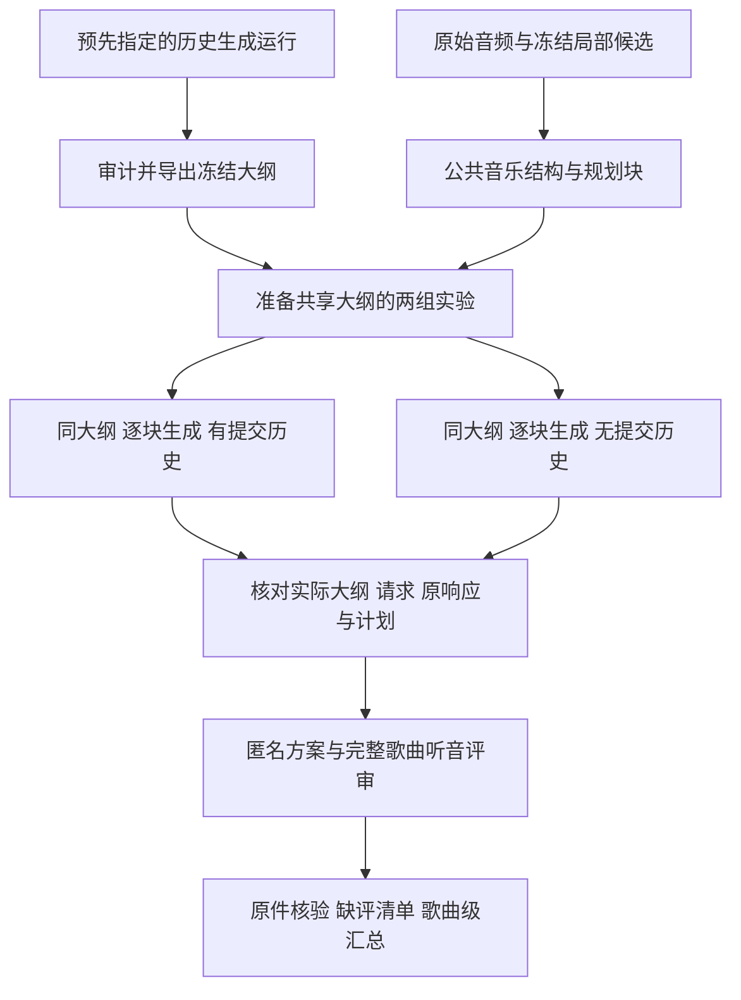

# 共享大纲历史对照与人评汇总

当前已经从软件验收推进到三首歌曲的真实整曲推理。下一步重点是固定实验中间内容、完成独立听音评审，再判断历史记忆和全曲组织是否有效。本轮增加共享大纲输入、两组实验准备与执行后审计，以及人评到歌曲级统计的转换；不更新模型权重。

## 最新真实进度

拉取的 `b48b701` 只增加真实实验记录，生成代码仍为 `658ffe4`。其 v10 在原三首开发录音上运行 main/no_history，各自生成全曲大纲，再逐块编排。两组共6条合法完整计划，158次新增文本调用，新增局部音频调用0。详见 [真实验收第14节](VALIDATION_20261104.md#14-linux-真实历史配置对照-v10)。服务器原始响应和评分包不在本机工作树，以下真实数字来自该记录。

| 项目 | v10记录 | 对当前进度的判断 |
|---|---|---|
| 完整合法计划 | 6/6；每组79次文本调用 | 整曲推理和日志链路已实际执行 |
| 时间覆盖 | 两组均1.0 | 来自公开完整排程，不能据此判断音乐贴合 |
| 事件数量 | 每组228；两组152/152块选满3事件 | 需要听音检查动作密度和机械分段 |
| 独立固定大纲配对 | 0/3；三首大纲内容均不同 | 无法单独识别历史模块的作用 |
| 实际质量评分 | 全部null，audio_seen=false | 界面验收完成，效果评价尚未完成 |
| 局部专家身份 | 原始Omni加任务prompt | 仍不能称为用户已训练编舞checkpoint的实测 |
| 正式benchmark | 三首反复使用的开发录音 | 来源分组、留出集与正式评审尚未完成 |

main输入558,772、输出35,803 tokens；no_history输入346,593、输出36,507 tokens。后者输入减少约38%，这只说明本轮输入负担降低，不能推出质量、费用或延迟更优。固定temperature和seed未使独立大纲输出完全相同，当前没有证据确定底层原因。

同一规划块在相同balanced菜单中，每种事件数量只有一种时间切法。因此两组都选3事件时，其时间边界应相同。比较时需要分别核对时间、轨道和正文，不能把“时间与轨道组合序列不同”解释为时间编排发生了改善。排程块也不等于真实音乐乐句：未审查拍号时仍用时间块，审查后按小节组织仍不证明语义乐句正确。

## 本轮新增能力



这是受约束的冻结模型推理harness：控制器管理上下文、预算、时间约束、提交前缀、证据和恢复。自动语义修复、模型训练及RSI仍未接通。

| 代码 | 作用 |
|---|---|
| [outlines.py](../outlines.py) | 从完成的原始生成run审计导出公共大纲，验证来源与内容 |
| [coordination.py](../coordination.py) | 实际读取共享大纲，跳过新大纲调用，向两组提供同一份设计 |
| [history_experiment.py](../history_experiment.py) | 准备main/no_history、复核准备输入、审计实际两组执行 |
| [review_analysis.py](../review_analysis.py) | 验证评审原件，核对完整歌曲分母，输出描述与受条件限制的比较 |

旧 `prepare-ablation` 仍保留独立生成大纲的四组实验语义。新的共享大纲对照使用独立入口，避免把旧结果重新解释成固定中间内容的实验。

## 先冻结公共大纲

选择来源run应在比较质量前明确，例如沿用v10的main运行，不根据哪个大纲效果最好反选。导出不调用模型；它要求来源run的完整选中歌曲均成功，并核对原合同、结果、调用记录和已发布大纲。原始大纲生成记录可以来自旧冻结代码，但不能来自占位大纲或已经导入共享大纲的运行。

```bash
python -m choreobench export-outlines \
  --run-dir /runs/v10/main \
  --out /data/choreobench/shared-outlines.json
```

sidecar绑定dataset字节、候选库字节、公共结构、有效歌曲和规划块；保留原生成请求、响应、代码及成本的身份。运行器在模型服务初始化前验证绑定，将同一snapshot写入合同，并在每次调用前、最终发布和完成恢复时复核共享文件。更改来源、配置或代码需要新目录。

导入后的大纲仍是模型曾经生成的设计；`generated_in_this_run=false` 与 `source=shared_import` 明确本轮没有生成它。原大纲成本单列，不能冒充本轮新调用，也不能从方法总成本中消失。哈希保证内部一致性，不替代对原模型与服务器的独立认证。

如果真实v10按歌曲分别使用dataset和run，应逐个原dataset导出与准备，保留原文件字节。不能将三首拼成新dataset后继续声称旧候选和大纲绑定仍然匹配。

## 准备并执行严格历史对照

```bash
python -m choreobench prepare-history \
  --dataset /data/choreobench/dataset.json \
  --candidates /data/choreobench/local-candidates.json \
  --config /data/choreobench/coordinated-grid.json \
  --outlines /data/choreobench/shared-outlines.json \
  --out-dir /runs/history-fixed-v1

python -m choreobench verify-history \
  --experiment /runs/history-fixed-v1
```

两个配置均启用大纲并引用同一文件，只改变 `use_history`。准备过程不加载模型、不访问服务；`ready_to_run`仅表示已知来源和调用预算满足条件。实际模型身份、上下文容量和服务可用性仍在服务器执行时核验。

按 `commands.json` 的argv数组执行；每组运行前重新preflight。下面先执行main，no_history用相同方式选择对应variant。运行这一步才会调用文本模型。

```python
import json
import subprocess
from pathlib import Path

root = Path('/runs/history-fixed-v1')
commands = json.loads((root / 'commands.json').read_text(encoding='utf-8'))
subprocess.run(commands['preflight_argv'], cwd=commands['cwd'], check=True, shell=False)
selected = next(row for row in commands['runs'] if row['variant_id'] == 'main')
if not selected['ready_to_run']:
    raise RuntimeError('Prepared inputs or budget are not ready')
subprocess.run(selected['argv'], cwd=commands['cwd'], check=True, shell=False)
```

已有三首共76个规划块。如果复用已生成大纲，两组新增文本调用预计 `76+76=152`，新增音频采样0；历史大纲的3次生成成本另列一次。若另行生成3份共享大纲，总新增调用为155。运行失败或中断按真实账目保留，不自动填补、重试或删除歌曲。

执行后检查实际消费，不能仅看配置相同：

```bash
python -m choreobench audit-history \
  --experiment /runs/history-fixed-v1 \
  --out /runs/history-fixed-v1/audit.json
```

审计核对两组合同、原请求/响应、实际大纲、提交前缀和计划，分别报告时间边界、轨道和正文是否相同。缺失run、失败、未决调用或内容控制不成立时不能标记对照通过。即使内容控制通过，也只说明具备比较历史配置的条件，不能代替人评或消除模型本身的输出波动。

## 先评现有方案 再做统计

现有v10六条方案已经可以用于发现问题。独立评审需实际听歌，分别评价音乐贴合、长程组织、计划可执行性与边界质量；评论记录具体时间和动作，区分有意主题回归与无意义复读。先由两名独立评审完成开发诊断并复核分歧；这不是正式样本量依据。

新入口直接读取公开包、私有绑定和原始评分JSON，重新调用 `import_reviews` 验证，而不是信任一份手工修改的汇总表：

```bash
python -m choreobench analyze-reviews \
  --dataset /data/choreobench/dataset.json \
  --public /runs/review/public/pack.json \
  --private /runs/review/private/bindings.json \
  --reviews /runs/review/reviewer-a.json /runs/review/reviewer-b.json \
  --method-a main --method-b no_history \
  --criterion musical_fit --split dev --origin human \
  --out /runs/review/musical-fit-analysis.json
```

统计分母来自指定dataset的整个split和两种方法。没有计划、没有评审、评分为空分别记录；不将缺评变0，也不让完全没有评分行的歌曲消失。重复的评审者/方案拒绝。同一大包可以按原逐歌dataset分析，其他歌曲/方法明确列为未纳入，不能把它们宣称为已核验当前dataset来源。

人工与模型裁判分开；选择 `--origin model_judge` 还需明确 `--judge-model-id`，其他裁判版本的行不混入。字段里的人工身份、听音声明和哈希并不证明实际听音发生。跨歌曲同一method标签的模型身份还需要原run合同审计，不能只凭标签认定相同模型。

未审查来源分组时仅做歌曲描述。分组已审查、ID完整、跨split无关联泄漏且配对评分完整后，才可请求 `--compare`。关联分组同时考虑歌曲、艺术家、近重复与相同音频身份，不能把同来源的多首歌或同歌多个事件当独立样本。三首反复使用的开发录音仍不足以支撑正式排行榜或稳健的泛化结论。

这里“目标维度评分完整”表示每个歌曲×方法至少有一条所选来源的非空评分。它不表示全部评审者均已填写或所有量表维度均完成；报告保留各格的待填评审者及评审者集合差异。当前没有预登记评审者名册或ICC，不能发现整位未提交者或声称评审一致性已经达标。

## 推进次序与资源

1. 用已有六方案完成听音与评分导入；同时在服务器审计并导出预先指定的大纲。CPU、原工件和评审者即可，不占推理GPU。
2. 按问题优先运行共享大纲的两组对照。局部音频模型可以保持关闭，只部署已验收的文本服务；历史VL32B BF16 TP=2配置见 [资源记录](RESOURCES_zh.md)，实际卡与上下文仍须重新确认。
3. 若主要问题是机械三段化，再比较基于公共拍点的非均分菜单；若是动作内容薄弱，确认已有训练checkpoint并比较候选；若是过渡不佳，优先设计局部状态与修复评价。不要仅靠增加事件上限制造多样性。
4. 冻结提示、排程和评分规则后，引入来源隔离的新歌pilot，完成分组/近重复审计和编辑任务。现有三首保持开发用途；正式规模根据pilot的分歧、方差和标注预算确定。

以上链路不需要新增SFT/DPO/RL。需要的新增数据主要是独立评价、编辑目标和来源分组记录；工程跑通不等于这些benchmark资产已经完成。

## 本轮验证边界

本轮新增软件以合成模型响应测试共享内容、调用数量、来源变化、恢复、缺评及统计分母。真实v10仍归其原版本与原服务器回执；新增固定大纲对照与人评统计尚未在真实服务器上取得质量结论。

本地最终完整回归807通过、1因Windows符号链接权限跳过。180秒合成整曲复用旧大纲，两组共36次模拟文本调用、0次新音频/大纲调用，恢复新增调用0；空评分仍为待评。详细记录见 [验收第15节](VALIDATION_20261104.md#15-共享大纲与评审汇总的软件验收)。
