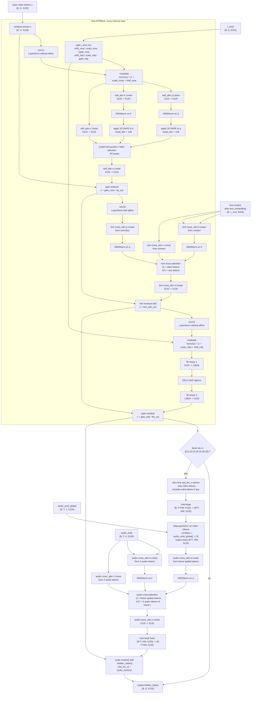

# 音频CrossAttention注入机制

> 适用模型：Wan2.2-TI2V-5B-Audio
> 最后更新：2026-03-22

---

## 0. 当前仓库 5B Audio 单层 Block + Audio Injector 图

> 基于当前代码配置：`dim=5120`、`num_heads=40`、`ffn_dim=13824`、`num_layers=40`、`audio_inject_layers=[0, 5, 10, 15, 20, 25, 30, 35]`
> 参考位置：`diffsynth/configs/model_configs.py`、`diffsynth/models/wan_video_dit.py`、`diffsynth/models/wan_video_dit_audio.py`



### 0.1 图的阅读方式

- `One DiTBlock` 本体只包含三段：`self-attn -> text cross-attn -> FFN`，其中 self-attn 和 FFN 前都有 `t_mod` 提供的 `shift/scale/gate` 调制。
- `Audio Injector` 不在 `DiTBlock` 内部，而是在 block 结束后、外层循环里按指定层号追加一次音频 cross-attention residual。
- 音频注入时会把整段视频 token 从 `(B, F*HW, C)` 改写成逐帧视角 `(B*T, HW, C)`，因此它做的是“每一帧空间 token 对该帧音频 token 的 cross-attn”。

### 0.2 工程对照版 Mermaid

```mermaid
flowchart LR
    IN["x
    source: WanAudioModel.forward()
    shape: (B, S, 5120)"]
    CTX["context
    source: self.text_embedding(context)
    shape: (B, L_text, 5120)"]
    TMOD["t_mod
    source: self.time_projection(t).unflatten(1,(6,self.dim))
    shape: (B, 6, 5120)"]

    subgraph B1["DiTBlock.forward(x, context, t_mod, freqs)"]
        TMS["shift_msa, scale_msa, gate_msa,
        shift_mlp, scale_mlp, gate_mlp
        source: (self.modulation + t_mod).chunk(6, dim=1)"]

        LN1["self.norm1(x)
        LayerNorm
        shape: (B, S, 5120)"]
        MOD1["modulate(...)
        shape: (B, S, 5120)"]

        Q1["self.self_attn.q
        Linear(5120, 5120)"]
        K1["self.self_attn.k
        Linear(5120, 5120)"]
        V1["self.self_attn.v
        Linear(5120, 5120)"]
        RQ1["self.self_attn.norm_q
        RMSNorm"]
        RK1["self.self_attn.norm_k
        RMSNorm"]
        ROQ1["rope_apply(q, freqs, 40)
        internal view: (B, S, 40, 128)"]
        ROK1["rope_apply(k, freqs, 40)
        internal view: (B, S, 40, 128)"]
        ATTN1["self.self_attn.attn(q,k,v)
        flash/sdpa
        out: (B, S, 5120)"]
        O1["self.self_attn.o
        Linear(5120, 5120)"]
        GATE1["self.gate(x, gate_msa, sa_out)
        residual out: (B, S, 5120)"]

        LN3["self.norm3(x)
        LayerNorm
        shape: (B, S, 5120)"]
        Q2["self.cross_attn.q
        Linear(5120, 5120)"]
        K2["self.cross_attn.k
        Linear(5120, 5120)"]
        V2["self.cross_attn.v
        Linear(5120, 5120)"]
        RQ2["self.cross_attn.norm_q
        RMSNorm"]
        RK2["self.cross_attn.norm_k
        RMSNorm"]
        ATTN2["self.cross_attn.attn(q,k,v)
        Q: video tokens
        K/V: text tokens
        out: (B, S, 5120)"]
        O2["self.cross_attn.o
        Linear(5120, 5120)"]
        RES2["x + text_attn_out
        shape: (B, S, 5120)"]

        LN2["self.norm2(x)
        LayerNorm
        shape: (B, S, 5120)"]
        MOD2["modulate(...)
        shape: (B, S, 5120)"]
        FFC1["self.ffn[0]
        Linear(5120, 13824)"]
        FFG["self.ffn[1]
        GELU(approximate='tanh')"]
        FFC2["self.ffn[2]
        Linear(13824, 5120)"]
        GATE2["self.gate(x, gate_mlp, ffn_out)
        block out: (B, S, 5120)"]
    end

    subgraph B2["Optional after_transformer_block(block_idx, hidden_states, audio_emb_global, audio_emb, seq_len_x)"]
        DEC{"block_idx in
        [0,5,10,15,20,25,30,35] ?"}
        SLICE["hidden_states[:, :seq_len_x]
        shape: (B, F*HW, 5120)"]
        RSF["rearrange
        (B, F*HW, 5120) -> (B*T, HW, 5120)"]
        AGL["self.audio_injector.injector_adain_layers[i]
        AdaLayerNorm
        cond: audio_emb_global[:, t, 0]
        out: (B*T, HW, 5120)"]

        AQ["injector[i].q
        Linear(5120, 5120)"]
        AKLIN["injector[i].k
        Linear(5120, 5120)"]
        AV["injector[i].v
        Linear(5120, 5120)"]
        ARQ["injector[i].norm_q
        RMSNorm"]
        ARK["injector[i].norm_k
        RMSNorm"]
        AATTN["injector[i].attn(q,k,v)
        Q: frame spatial tokens
        K/V: 4 audio tokens
        shape: (B*T, HW, 5120)"]
        AO["injector[i].o
        Linear(5120, 5120)"]
        RSB["rearrange
        (B*T, HW, 5120) -> (B, F*HW, 5120)"]
        ARES["hidden_states[:, :seq_len_x] += audio_residual"]
    end

    OUT["final hidden_states
    shape: (B, S, 5120)"]

    IN --> LN1 --> MOD1
    TMOD --> TMS --> MOD1
    MOD1 --> Q1 --> RQ1 --> ROQ1 --> ATTN1
    MOD1 --> K1 --> RK1 --> ROK1 --> ATTN1
    MOD1 --> V1 --> ATTN1 --> O1 --> GATE1
    IN --> GATE1

    GATE1 --> LN3 --> Q2 --> RQ2 --> ATTN2
    CTX --> K2 --> RK2 --> ATTN2
    CTX --> V2 --> ATTN2 --> O2 --> RES2
    GATE1 --> RES2

    RES2 --> LN2 --> MOD2 --> FFC1 --> FFG --> FFC2 --> GATE2
    TMS --> MOD2
    RES2 --> GATE2

    GATE2 --> DEC
    DEC -- no --> OUT
    DEC -- yes --> SLICE --> RSF --> AGL --> AQ --> ARQ --> AATTN
    AGL --> AV --> AATTN
    ASRC["audio_emb reshaped
    from (B, T, 4, 5120) to (B*T, 4, 5120)"] --> AKLIN --> ARK --> AATTN
    ASRC --> AV
    AATTN --> AO --> RSB --> ARES --> OUT
    GATE2 --> ARES
```



### 0.3 每次 Attention 时的张量形状

先记 5B Audio 的固定维度：

- `dim = 5120`
- `num_heads = 40`
- `head_dim = 5120 / 40 = 128`
- patchify 后视频 token 记为 `x: (B, S, 5120)`，其中 `S = F * H * W`
- 文本 token 记为 `context: (B, L_text, 5120)`

若按当前 5B Audio 常见 latent 尺寸举例：

- 输入 latent 约为 `(B, 36, 13, 60, 104)`
- patchify 之后空间尺寸变成 `F=13, H=30, W=52`
- 因此 `S = 13 * 30 * 52 = 20280`
- 单帧空间 token 数 `HW = 30 * 52 = 1560`

#### 0.3.1 Self-Attention in `DiTBlock`

输入：

- `input_x`: `(B, S, 5120)`

线性投影后：

- `q = self.self_attn.q(input_x)`: `(B, S, 5120)`
- `k = self.self_attn.k(input_x)`: `(B, S, 5120)`
- `v = self.self_attn.v(input_x)`: `(B, S, 5120)`

`RMSNorm` 和 `RoPE` 后，按 head 展开时的等价内部形状：

- `q`: `(B, S, 40, 128)` 或 attention 实现内部的 `(B, 40, S, 128)`
- `k`: `(B, S, 40, 128)` 或 attention 实现内部的 `(B, 40, S, 128)`
- `v`: `(B, S, 40, 128)` 或 attention 实现内部的 `(B, 40, S, 128)`

attention logits 和输出：

- `attn_scores`: `(B, 40, S, S)`
- `attn_output_per_head`: `(B, 40, S, 128)`
- merge heads 后：`(B, S, 5120)`
- `self.self_attn.o(...)` 后：`(B, S, 5120)`

若代入 `S=20280`：

- `q/k/v`: `(B, 20280, 5120)`
- head view: `(B, 40, 20280, 128)`
- logits: `(B, 40, 20280, 20280)`
- 输出: `(B, 20280, 5120)`

#### 0.3.2 Text Cross-Attention in `DiTBlock`

输入：

- query 侧 `norm3(x)`: `(B, S, 5120)`
- key/value 侧 `context`: `(B, L_text, 5120)`

线性投影后：

- `q = self.cross_attn.q(norm3(x))`: `(B, S, 5120)`
- `k = self.cross_attn.k(context)`: `(B, L_text, 5120)`
- `v = self.cross_attn.v(context)`: `(B, L_text, 5120)`

按 head 展开时：

- `q`: `(B, 40, S, 128)`
- `k`: `(B, 40, L_text, 128)`
- `v`: `(B, 40, L_text, 128)`

attention logits 和输出：

- `attn_scores`: `(B, 40, S, L_text)`
- `attn_output_per_head`: `(B, 40, S, 128)`
- merge heads 后：`(B, S, 5120)`
- `self.cross_attn.o(...)` 后：`(B, S, 5120)`

若文本长度记为 `L_text=512`，且代入 `S=20280`：

- `q`: `(B, 20280, 5120)`
- `k/v`: `(B, 512, 5120)`
- head view:
  `q -> (B, 40, 20280, 128)`
  `k/v -> (B, 40, 512, 128)`
- logits: `(B, 40, 20280, 512)`
- 输出: `(B, 20280, 5120)`

#### 0.3.3 Audio Cross-Attention in `after_transformer_block()`

先把视频 token 拆成逐帧视角：

- 原始视频 hidden states: `(B, F*HW, 5120)`
- `rearrange -> (B*F, HW, 5120)`

音频 token 也按帧对齐：

- `audio_emb`: `(B, F, 4, 5120)`
- `rearrange -> (B*F, 4, 5120)`

因此 audio injector attention 的输入是：

- query 侧视频空间 token: `(B*F, HW, 5120)`
- key/value 侧音频 token: `(B*F, 4, 5120)`

线性投影后：

- `q = injector[i].q(frame_tokens)`: `(B*F, HW, 5120)`
- `k = injector[i].k(audio_tokens)`: `(B*F, 4, 5120)`
- `v = injector[i].v(audio_tokens)`: `(B*F, 4, 5120)`

按 head 展开时：

- `q`: `(B*F, 40, HW, 128)`
- `k`: `(B*F, 40, 4, 128)`
- `v`: `(B*F, 40, 4, 128)`

attention logits 和输出：

- `attn_scores`: `(B*F, 40, HW, 4)`
- `attn_output_per_head`: `(B*F, 40, HW, 128)`
- merge heads 后：`(B*F, HW, 5120)`
- `injector[i].o(...)` 后：`(B*F, HW, 5120)`
- `rearrange back` 后：`(B, F*HW, 5120)`

若代入 `F=13, HW=1560`：

- 视频 query: `(B*13, 1560, 5120)`
- 音频 `k/v`: `(B*13, 4, 5120)`
- head view:
  `q -> (B*13, 40, 1560, 128)`
  `k/v -> (B*13, 40, 4, 128)`
- logits: `(B*13, 40, 1560, 4)`
- 输出: `(B*13, 1560, 5120)`
- reshape 回主干后：`(B, 20280, 5120)`

#### 0.3.4 三种 Attention 的对比

- self-attention：`Q/K/V` 全都来自视频 token，所以 logits 是 `(B, 40, S, S)`，最重。
- text cross-attention：`Q` 来自视频，`K/V` 来自文本，所以 logits 是 `(B, 40, S, L_text)`。
- audio cross-attention：`Q` 来自单帧空间 token，`K/V` 只来自 4 个音频 token，所以 logits 是 `(B*F, 40, HW, 4)`，明显更轻。

---

## 一、注入点与架构

### 1.1 8 个注入层的精确位置

**位置**：`wan_video_dit_audio.py:49-50` / `wan_video_dit_s2v.py:378`

```python
if audio_inject_layers is None:
    audio_inject_layers = [0, 4, 8, 12, 16, 20, 24, 27]
```

**在 30 层 DiT 中的分布**：

```
层 0  [音频] ← 浅层1
层 1-3  |
层 4  [音频] ← 浅层2
层 5-7  |
层 8  [音频] ← 中层1
层 9-11  |
层 12 [音频] ← 中层2
层 13-15  |
层 16 [音频] ← 中层3
层 17-19  |
层 20 [音频] ← 中层4
层 21-23  |
层 24 [音频] ← 深层1
层 25-26  |
层 27 [音频] ← 深层2（最后）
层 28-29   （无注入）
```

**分布策略**：
- 间隔均匀（每 4 层一个注入点）
- 覆盖浅、中、深层
- 浅层影响全局运动节奏
- 深层影响细节与纹理对齐

### 1.2 AudioInjector_WAN 的结构与映射

**位置**：`wan_video_dit_s2v.py:282-320`

```python
class AudioInjector_WAN(nn.Module):
    def __init__(self, all_modules, all_modules_names, dim=3072, num_heads=24,
                 inject_layer=[0, 4, 8, 12, 16, 20, 24, 27], enable_adain=False):
        super().__init__()

        # 核心数据结构：block_idx → injector_idx 的映射
        self.injected_block_id = {}
        audio_injector_id = 0

        # 遍历模型所有模块，找到目标 block
        for mod_name, mod in zip(all_modules_names, all_modules):
            if isinstance(mod, DiTBlock):
                for inject_id in inject_layer:
                    if f'transformer_blocks.{inject_id}' in mod_name:
                        self.injected_block_id[inject_id] = audio_injector_id
                        audio_injector_id += 1

        # 为每个注入点创建 CrossAttention 模块
        self.injector = nn.ModuleList([
            CrossAttention(dim=dim, num_heads=num_heads)
            for _ in range(audio_injector_id)  # 8 个实例
        ])

        # LayerNorm（特征规范化）
        self.injector_pre_norm_feat = nn.ModuleList([
            nn.LayerNorm(dim, elementwise_affine=False, eps=1e-6)
            for _ in range(audio_injector_id)
        ])

        # LayerNorm（向量规范化）
        self.injector_pre_norm_vec = nn.ModuleList([
            nn.LayerNorm(dim, elementwise_affine=False, eps=1e-6)
            for _ in range(audio_injector_id)
        ])

        # AdaLayerNorm（音频调制，仅当 enable_adain=True）
        if enable_adain:
            self.injector_adain_layers = nn.ModuleList([
                AdaLayerNorm(output_dim=dim * 2, embedding_dim=dim)
                for _ in range(audio_injector_id)  # 8 个实例
            ])
```

**映射示例**（对于注入层 [0, 4, 8, 12, 16, 20, 24, 27]）：

```
self.injected_block_id = {
    0: 0,     ← block 0 的音频处理由 injector[0] 负责
    4: 1,     ← block 4 的音频处理由 injector[1] 负责
    8: 2,
    12: 3,
    16: 4,
    20: 5,
    24: 6,
    27: 7,    ← 共 8 个 injector 实例
}

对应的模块：
  self.injector[0] = CrossAttention(...)      ← 处理 block 0
  self.injector_adain_layers[0] = AdaLayerNorm(...)
  self.injector[1] = CrossAttention(...)      ← 处理 block 4
  ...
```

---

## 二、WanAudioModel Forward 流程

### 2.1 音频 embedding 的初始化

**位置**：`wan_video_dit_audio.py:98-149`

```python
def forward(self, x, timestep, context, audio_input=None, **kwargs):
    # 步骤 1：计算音频 embedding（前置）
    if audio_input is not None:
        audio_emb_global, audio_emb = self.cal_audio_emb(audio_input)
    else:
        audio_emb_global, audio_emb = None, None

    # audio_emb_global: (B, T_audio, 1, dim) ← 全局表征，给 AdaIN
    # audio_emb:        (B, T_audio, 4, dim) ← 逐帧细节，给 CrossAttn
    # T_audio 通常为 T_30fps / 4，如 240/4 = 60
```

### 2.2 时间与文本嵌入

```python
    # 步骤 2：时间嵌入（与原始 WanModel 相同）
    t = self.time_embedding(sinusoidal_embedding_1d(self.freq_dim, timestep))
    # timestep: (B,) → (B, freq_dim=256) → (B, dim=3072)

    t_mod = self.time_projection(t).unflatten(1, (6, self.dim))
    # (B, dim) → (B, 6*dim) → (B, 6, dim)  ← 6个调制参数
    # 用于 DiTBlock 内的 AdaLN-Zero：shift_msa, scale_msa, gate_msa, shift_mlp, scale_mlp, gate_mlp

    # 步骤 3：文本嵌入
    context = self.text_embedding(context)
    # (B, seq_len, text_dim) → (B, seq_len, dim)
```

### 2.3 Patchify 与序列准备

```python
    # 步骤 4：视频 Patchify
    x, (f, h, w) = self.patchify(x)
    # 输入：(B, 3, 49, 480, 832)
    # 输出：(B, 49×240×416, 3072)  ← 若 patch_size=(1,2,2)
    # 实际：patch_size=(1,2,2) 则 (B, 49×240÷8×832÷8, 3072)
    # 计算：h=480÷2=240, w=832÷2=416
    # seq_len_x = (B, 49×240×416, 3072) = (B, ~4.8M, 3072) ← 太大！
    #
    # 重新理解：VAE latent 是 (B, 16, 13, 60, 104)
    # 进 patchify：patch_size=(1,2,2) 作用于 (f, h, w) = (13, 60, 104)
    # 输出：(B, 13×30×52, C)
    # 其中 C 是 patch embedding 维度

    seq_len_x = x.shape[1]  # 保存原始视频序列长度，用于后续音频注入
```

### 2.4 RoPE 频率预计算

```python
    # 步骤 5：为 3D RoPE 预计算频率
    freqs = torch.cat([
        self.freqs[0][:f].view(f, 1, 1, -1).expand(f, h, w, -1),  # 时间维
        self.freqs[1][:h].view(1, h, 1, -1).expand(f, h, w, -1),  # 高度维
        self.freqs[2][:w].view(1, 1, w, -1).expand(f, h, w, -1)   # 宽度维
    ], dim=-1).reshape(f * h * w, 1, -1).to(x.device)
    # 输出：(f×h×w, 1, rope_dim)
```

### 2.5 Transformer 循环与音频注入

```python
    # 步骤 6：遍历所有 30 个 DiTBlock
    for i, block in enumerate(self.blocks):  # i = 0, 1, ..., 29

        # 标准 block forward（梯度检查点可选）
        if self.training and use_gradient_checkpointing:
            x = gradient_checkpoint_forward(
                block,
                x, context, t_mod, freqs
            )
        else:
            x = block(x, context, t_mod, freqs)
        # 输出：(B, seq_len_x, dim)

        # **关键：音频注入（仅在有音频且该层是注入点时）**
        if audio_emb is not None:
            x = self.after_transformer_block(i, x, audio_emb_global, audio_emb, seq_len_x)
        # 若 i ∈ {0, 4, 8, 12, 16, 20, 24, 27}，执行音频注入
```

### 2.6 最终解码与返回

```python
    # 步骤 7：head + unpatchify
    x = self.head(x, t)
    # (B, seq_len_x, dim) → (B, seq_len_x, patch_channels)

    x = self.unpatchify(x, (f, h, w))
    # 反向 patchify
    # (B, f×h×w, channels) → (B, C, F, H, W) ← VAE latent shape

    return x  # (B, 3, 49, 480, 832) 形状的预测 latent
```

---

## 三、after_transformer_block 逐步详解

**位置**：`wan_video_dit_audio.py:74-96`

这是音频注入的核心函数，每个注入点都调用一次。

```python
def after_transformer_block(self, block_idx, hidden_states, audio_emb_global,
                           audio_emb, original_seq_len):
    """
    在第 block_idx 个 block 后插入音频 cross-attention。

    参数：
      block_idx: 当前块的索引，0-29
      hidden_states: 当前块输出 (B, seq_len_x, dim)，如 (1, 81120, 3072)
      audio_emb_global: (B, T_audio, 1, dim)，如 (1, 60, 1, 3072)
      audio_emb: (B, T_audio, 4, dim)，如 (1, 60, 4, 3072)
      original_seq_len: 视频 patch 序列长度，即 f×h×w
    """

    # **步骤 1**：检查该块是否是注入点
    if block_idx not in self.audio_injector.injected_block_id.keys():
        return hidden_states  # 不是注入点，直接返回

    # **步骤 2**：查询该块对应的 injector 索引
    audio_attn_id = self.audio_injector.injected_block_id[block_idx]
    # 例：block_idx=0 → audio_attn_id=0
    #     block_idx=4 → audio_attn_id=1

    # **步骤 3**：获取音频帧数
    num_frames = audio_emb.shape[1]  # T_audio，如 60
    # 保证视频序列长度能被音频帧数整除
    assert original_seq_len % num_frames == 0, \
        f"original_seq_len ({original_seq_len}) must be divisible by audio frames ({num_frames})"

    # **步骤 4**：提取视频特征部分（去掉可能的额外 token）
    input_hidden_states = hidden_states[:, :original_seq_len].clone()
    # (B, seq_len_x, dim) 中的前 original_seq_len 个 token
    # 如 (1, 81120, 3072)

    # **步骤 5**：按音频帧拆分
    input_hidden_states = rearrange(
        input_hidden_states,
        "b (t n) c -> (b t) n c",
        t=num_frames
    )
    # (B, T_audio, H×W, dim) → (B×T_audio, H×W, dim)
    # 例：(1, 60, 1352, 3072) → (60, 1352, 3072)
    # 含义：每个音频帧对应 1352 个视频 patch

    # **步骤 6**：AdaLayerNorm 调制（使用音频全局特征）
    if self.enable_adain and audio_emb_global is not None:
        # 拆分 audio_emb_global: (B, T, 1, dim) → (B×T, 1, dim)
        audio_emb_global_r = rearrange(audio_emb_global, "b t n c -> (b t) n c")
        # (1, 60, 1, 3072) → (60, 1, 3072)

        # 取第 0 维（唯一的全局 token）作为调制信号
        adain_hidden_states = self.audio_injector.injector_adain_layers[audio_attn_id](
            input_hidden_states,   # Query: (60, 1352, 3072)
            temb=audio_emb_global_r[:, 0]  # 调制向量: (60, 3072)
        )
        # 输出：(60, 1352, 3072)
        # 效果：音频特征调节视频特征的分布（如均值、方差）
    else:
        adain_hidden_states = input_hidden_states  # 无调制，直接用

    # **步骤 7**：重排音频 embedding
    audio_emb_r = rearrange(audio_emb, "b t n c -> (b t) n c", t=num_frames)
    # (B, T, 4, dim) → (B×T, 4, dim)
    # (1, 60, 4, 3072) → (60, 4, 3072)
    # 4 个 token 来自 CausalAudioEncoder 的输出

    # **步骤 8**：音频 CrossAttention
    # Query 来自视频，Key/Value 来自音频
    residual_out = self.audio_injector.injector[audio_attn_id](
        adain_hidden_states,  # Q: (60, 1352, 3072) ← 视频特征
        audio_emb_r           # K/V: (60, 4, 3072) ← 音频特征
    )
    # 输出：(60, 1352, 3072)
    # 逻辑：1352 个视频 patch × 4 个音频 token 的注意力交互

    # **步骤 9**：重排回原始形状
    residual_out = rearrange(
        residual_out,
        "(b t) n c -> b (t n) c",
        t=num_frames
    )
    # (60, 1352, 3072) → (1, 81120, 3072)
    # 恢复原始维度

    # **步骤 10**：残差连接
    hidden_states[:, :original_seq_len] = hidden_states[:, :original_seq_len] + residual_out
    # (1, 81120, 3072) += (1, 81120, 3072)
    # 融合音频信息到视频特征

    return hidden_states
```

---

## 四、AdaLayerNorm 音频调制

**位置**：`wan_video_dit_s2v.py:260-280`

```python
class AdaLayerNorm(nn.Module):
    def __init__(self, embedding_dim: int = 3072, output_dim: int = 6144, norm_eps: float = 1e-5):
        super().__init__()
        self.silu = nn.SiLU()
        self.linear = nn.Linear(embedding_dim, output_dim)  # 3072 → 6144
        self.norm = nn.LayerNorm(output_dim // 2, norm_eps, elementwise_affine=False)
        # LayerNorm(3072)

    def forward(self, x, temb):
        """
        参数：
          x: (B×T, H×W, dim)    视频特征
          temb: (B×T, dim)      音频全局特征（调制信号）

        返回：
          (B×T, H×W, dim)       调制后的视频特征
        """
        # **步骤 1**：投影调制向量
        temb = self.linear(F.silu(temb))  # (60, 3072) → (60, 6144)

        # **步骤 2**：拆分为 shift 和 scale
        shift, scale = temb.chunk(2, dim=1)  # 各 (60, 3072)

        # **步骤 3**：扩展维度以适配 x 的形状
        shift = shift[:, None, :]  # (60, 1, 3072)
        scale = scale[:, None, :]  # (60, 1, 3072)

        # **步骤 4**：规范化
        x = self.norm(x)  # (60, 1352, 3072) ← LayerNorm(3072)

        # **步骤 5**：仿射变换（AdaIN 风格）
        x = x * (1 + scale) + shift
        # (60, 1352, 3072) *= (1 + (60, 1, 3072))
        #                    + (60, 1, 3072)
        # 广播：将 (60, 1, 3072) 扩展为 (60, 1352, 3072)

        return x  # (60, 1352, 3072)
```

**调制机制**：
- **Shift**：平移视频特征分布的均值
- **Scale**：调整视频特征分布的方差（1+scale 形式保持稳定性）
- **效果**：音频特征通过 AdaIN 参数调制视频的特征表示

---

## 五、CrossAttention 的 Query/Key/Value 流程

**位置**：`wan_video_dit.py:164-200`

```python
class CrossAttention(nn.Module):
    def __init__(self, dim: int = 3072, num_heads: int = 24, eps: float = 1e-6):
        super().__init__()
        self.dim = dim
        self.num_heads = num_heads
        self.head_dim = dim // num_heads  # 3072 // 24 = 128

        # Query 投影（来自视频）
        self.q = nn.Linear(dim, dim)          # 3072 → 3072

        # Key/Value 投影（来自音频）
        self.k = nn.Linear(dim, dim)          # 3072 → 3072
        self.v = nn.Linear(dim, dim)          # 3072 → 3072

        # 输出投影
        self.o = nn.Linear(dim, dim)          # 3072 → 3072

        # 规范化
        self.norm_q = RMSNorm(dim, eps=eps)
        self.norm_k = RMSNorm(dim, eps=eps)

    def forward(self, x, y):
        """
        参数：
          x: (B×T, H×W, dim)  Query，来自视频（调制后）
          y: (B×T, 4, dim)    Key/Value，来自音频

        返回：
          (B×T, H×W, dim)     注意力融合结果
        """
        # **步骤 1**：Query 投影与规范化
        q = self.norm_q(self.q(x))
        # (60, 1352, 3072) ← Linear(3072→3072) ← RMSNorm

        # **步骤 2**：Key 投影与规范化
        k = self.norm_k(self.k(y))
        # (60, 4, 3072) ← Linear(3072→3072) ← RMSNorm
        # 仅 4 个音频 token

        # **步骤 3**：Value 投影
        v = self.v(y)
        # (60, 4, 3072) ← Linear(3072→3072)

        # **步骤 4**：Flash Attention
        # 计算：attention(Q, K, V)
        # Q: (60, 1352, 3072)
        # K: (60, 4, 3072)
        # V: (60, 4, 3072)
        #
        # 注意力权重：Q @ K^T / sqrt(d)
        # (60, 1352, 128*24) @ (60, 128*24, 4) / sqrt(128)
        # = (60, 1352, 4)
        #
        # 最终：attention_weights @ V = (60, 1352, 4) @ (60, 4, 3072)
        #                             = (60, 1352, 3072)

        out = self.attn(q, k, v)  # Flash Attention 或标准实现
        # 输出：(60, 1352, 3072)

        # **步骤 5**：输出投影
        return self.o(out)
        # (60, 1352, 3072) ← Linear(3072→3072)
```

**关键特性**：
- Q（视频）：1352 个 token（每音频帧对应的空间 patch）
- K/V（音频）：4 个 token（单帧音频表征）
- 交互规模：1352 × 4 的注意力矩阵（小而高效）
- 每帧独立：60 个音频帧各自与对应的视频 patch 互动

---

## 六、整体数据流可视化

```
block 0 后：
  hidden_states: (1, 81120, 3072)
     ↓
  after_transformer_block(block_idx=0, ...)
     ↓
  step 5: 拆帧 → (60, 1352, 3072)
     ↓
  step 6: AdaLayerNorm(audio_emb_global[:, :, 0])
          → (60, 1352, 3072)  [调制后]
     ↓
  step 8: CrossAttention(Q=(60, 1352), K/V=(60, 4))
          → (60, 1352, 3072)  [融合结果]
     ↓
  step 9: 合帧 → (1, 81120, 3072)
     ↓
  step 10: 残差相加 → hidden_states += residual
     ↓
  输出：(1, 81120, 3072)

block 4, 8, 12, 16, 20, 24, 27 同理...
```

---

## 七、关键代码位置汇总

| 功能 | 文件 | 行号 |
|------|------|------|
| 注入点列表定义 | wan_video_dit_audio.py | 49-50 |
| WanAudioModel forward | wan_video_dit_audio.py | 98-149 |
| after_transformer_block | wan_video_dit_audio.py | 74-96 |
| AudioInjector_WAN | wan_video_dit_s2v.py | 282-320 |
| AdaLayerNorm | wan_video_dit_s2v.py | 260-280 |
| CrossAttention | wan_video_dit.py | 164-200 |
