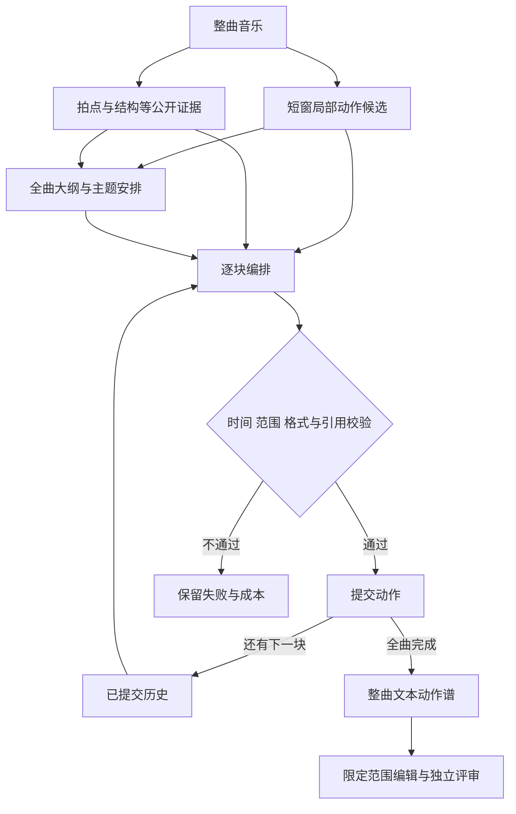

# Captioner 对比结论与 Harness 进度汇报

日期：2026年11月10日。实验进度基线：`codex/music-choreo-benchmark@c350213`，并记录本轮代码审查与来源声明冲突修复。面向项目组，说明当前模型比较结论、整曲编排流程、已完成实验及下一步验收。

**目前不能确认训练后的Captioner优于所有无需本任务微调的模型，也尚未形成充分证据证明它在编舞质量上稳定胜过强基线。Harness已经具备整曲编排、范围受限的编辑、匿名评审和任务审计能力，但编舞质量收益仍待真实评价。两条实验线可以并行，需分别验收。**

“不训练”在本文指不进行本项目的额外微调，相关基座本身已经预训练或指令训练。服务器结果按仓库验收记录陈述；本机同步并核对了代码和文档，未独立重跑其私有权重、音频与原始实验工件。

## 1 Captioner 现在能得出什么结论

最新训练复盘记录了标准SFT和EOS权重20两组实验：各使用193,278条训练数据，完成6,040次更新。完整生成诊断仍为固定三例，不能当作来源隔离的总体质量比较。详见[训练复盘34](34_music_caption_analysis_20261109_zh.md)。

| 现有证据 | 支持的判断 | 不能据此推出 |
|---|---|---|
| 标准SFT三例token加权NLL由第100步0.372157降至第6040步0.330727 | 对这些给定目标的拟合改善 | 生成动作更适合音乐，或胜过其他模型 |
| 第6040步同三例真音乐NLL为0.330727，错配0.333369，静音0.396873；其中2/3例错配略低于真音乐 | 对音频有响应，但具体音乐辨别优势需要进一步验证 | 模型完全忽略音乐，或训练无效 |
| 标准SFT greedy有一例循环到2048-token上限；EOS20的greedy三例均未完整 | 停止和动作推进仍有问题，EOS20没有已证实优势 | 所有训练配方无效，或应删除正常重复舞步 |
| 原生采样下，两组均有3/3正常EOS及完整时间覆盖 | 解码方式影响技术完成情况 | 动作语义、音乐贴合和可执行性已通过 |
| 已有同设置官方初始化对照，但未形成充分独立盲评结论 | 可以继续开展同基座和跨模型对比 | 已训练Captioner优于任何未微调模型 |

训练可能改善动作词汇和输出格式，也可能更强地拟合标注中的常见文字模式。下一步要检验这些变化是否转化为音乐贴合、合理动作及稳定生成。仅凭loss下降、格式一致或caption变长，不能回答这个问题。

音乐可以对应多种合理编舞。参考动作的侧别、次数、顺序适合用于保事实转换、记忆测试或参考一致性诊断；一般生成评价不能要求模型从音乐唯一还原原视频。错配音频也不自动等于语义负例，尤其相近节奏或风格可能支持同一编舞。

## 2 如何确认训练是否值得

先比较明确列出的模型，再把结论限制在实际测试的模型、输入和预算范围内。

| 比较 | 主要问题 | 公平性要求 |
|---|---|---|
| 已训练Captioner与官方未微调Captioner | 同一基座的任务微调带来什么变化 | 同一音乐、原生输入协议、明确解码与预算；格式适应和质量分别报告 |
| 已训练Captioner与Omni-Instruct加合理任务提示 | 专门训练能否胜过可实际使用的提示方案 | 使用各自支持的正确提示方式，不能用错误或缺失的任务指令削弱基线 |
| 与额外选定的强音频模型比较 | 在所测竞争方法中是否有优势 | 公开模型版本、可见信息和实际成本；不能将只读音乐摘要的模型与直接听音模型混作同输入消融 |

同一基座比较是必要消融，但不足以替代第二项强基线。官方Captioner与Omni-Instruct具有不同的原生任务和提示协议；不能因为前者不擅长直接输出编舞，就声称所有无需微调的方案都不行。

评价分成三层：

1. **技术完成**：原检查点加载、完整目标、EOS、预算截断、格式和时间范围。协议不同造成的格式差异单独记录。
2. **音乐条件诊断**：固定同一目标及有效token，比较正确音乐、随机候选、经审查的困难候选、静音。NLL差用于解释条件敏感性，不直接变成编舞质量分。
3. **独立生成评价**：实际听音后判断音乐贴合、动作清晰度、计划可执行性、病理循环与合理重复；允许不同但合理的动作方案。

已有[CaptionLab](../captionlab/README.md)可以准备冻结清单、可回溯转换目标、计算逐token NLL并保留缺失分母。真实检查点factory及恢复验收、动作信息token标记、原生cache一致性仍需在原环境完成。现有162项CPU测试不是30B模型效果结果；新的P0–P3训练合同也未因此自动接通。

## 3 Harness 当前怎样工作

Harness负责组织模型调用、维护已完成的计划、限制允许修改的范围、校验输出并记录结果。当前已记录的整曲实验使用：

- **局部候选模型**：原始Qwen3-Omni-30B-A3B-Instruct Thinker，加固定公开编舞提示，每次观察约5.0625秒音乐，每窗采集两个候选。
- **外层规划模型**：Qwen3-VL-32B-Instruct的纯文本模式，读取局部候选和音乐结构证据；这些调用不直接输入图像、视频或音频。
- **执行控制**：ChoreoBench代码维护时钟、事件、权限、历史、输出校验和请求日志。

这批整曲结果尚未验证接入最新训练Captioner，不能将它们归功于该训练。模型配置及原始采集见[验收记录第3节](../choreobench/docs/VALIDATION_20261104.md#3-模型输入与来源)。

**局部候选提供动作素材，大纲安排全曲意图，历史让下一块看到此前已经提交的动作。** 每块按当前合同调用一次生成并校验，只有合法输出才进入后续历史。出现失败会留下记录，没有把未知结果自动重试后只保留成功项。

当前有三个重要边界：

| 环节 | 实际实现 | 尚不能视为已完成的能力 |
|---|---|---|
| 规划分块 | 未核验拍号时使用通常约10.125秒的时间块；声明核验拍号后可聚合downbeat区间 | 准确乐句识别，或真实动作起止检测 |
| 动作计时 | 当前pilot菜单对每种可行事件数提供一套近均分排程，每块最多三事件 | 自由选择任意踩拍边界，或已验证的拍点分配收益 |
| 改进循环 | 状态、日志、校验、恢复及评审接口 | 自动判断质量并反复修复、更新模型权重的RSI闭环 |

这些边界可在[规划单元](../choreobench/planning_units.py)、[时间菜单](../choreobench/timing.py)和[编排循环](../choreobench/coordination.py)中核对。

编辑时，模型读取源计划、公开指令和权限，提出对既有事件字段的修改。控制器验证受保护字段和其他事件没有被改动，并支持精确撤销。现阶段没有验证任意事件插入、删除或全局重定时；合法patch也不意味着“降低动作幅度”等语义目标已经达成。

## 4 已完成实验与仍缺的证据

| 项目 | 截至c350213的进度 | 证据意义 |
|---|---|---|
| 整曲计划 | 三首歌，三种规划条件，共9份已有计划 | 全流程已真实执行；这三首仍属于开发数据 |
| 历史对照 | 三对计划使用实际相同的冻结大纲，比较有历史与无历史 | 可以评价历史作用；单次解码仍不能证明稳定因果效应 |
| 无大纲无历史基线 | 三首全部完整合法 | 覆盖率和合法性不能单独证明harness有质量优势 |
| 真实编辑 | 三次低幅度编辑，非目标字段保护及精确撤销通过 | 工程约束有效；编辑语义仍待评 |
| 三条件盲评材料 | 新九计划匿名包与三卡片页面已有服务器验收记录 | 可以直接收取真实评分，无需重新生成旧计划 |
| 多任务完整分母 | 新增task、method、seed库存与尝试审计，保留缺失、失败、非法返回及no-op | 多任务身份已实现；完整多任务语义评价尚未实现 |
| 实际质量评分 | 最新验收记录仍为0 | 尚不能宣布音乐贴合、结构或编辑质量改善 |

九计划包复用原结果，不增加歌曲或生成样本数。两名评审、九计划、四个生成维度对应72项维度评分，这是待完成的工作量，独立歌曲数仍为3。

真实编辑库存是原三任务×editor/no-op×一个seed，共6格：全部机械有效，其中3格没有修改，6格语义待评，联合成功均为null。no-op是否满足指令要看原计划是否已满足要求，不能预设成功或失败。当前库存是事后审计，多任务多seed的扩大覆盖主要来自软件测试，不是真实任务集已经扩大。

`c350213`已经完成了[双线安排36](36_harness_captioner_parallel_experiments_20261109_zh.md)中列出的任务库存第一项。后续代码重点应更新为**独立逐目标语义裁定、明确已审时间范围后的问题统计**，不重复建设库存，也不将整体评分自动转换成所有语义目标通过。

本节依据[最新进度](../choreobench/docs/PROGRESS_20261109_zh.md)、[验收第23节](../choreobench/docs/VALIDATION_20261104.md#23-最新规划执行九计划h0与多任务库存h2-v18)及[编辑库存合同](../choreobench/CONTRACT.md#independent-multi-task-edit-inventory)。

## 5 哪些结论可以用于论文

| 内容 | 当前可写的范围 | 需要新增证据的主张 |
|---|---|---|
| 任务与系统 | 整曲文本编舞、范围受限编辑、可复核执行和评价设计 | 正式benchmark已经完成并验证，或未经系统比较的首创性 |
| 格式与覆盖 | 三首开发案例中，受约束基线同样完整合法 | Harness因此生成了更好的编舞 |
| 历史成本 | 相同大纲对照中，无历史输入272,351 tokens，历史输入490,835；前者少约44.5% | 质量相同，或这是全部GPU/服务成本的节省 |
| 编辑控制 | 三次修改的字段保护和精确撤销 | 用户编辑意图已满足、任意编辑都有效 |
| 时间接口 | main有75/76块选满三事件，其他两种条件各76/76；说明当前输出受菜单约束 | 替代菜单已经改善踩拍或动作多样性 |
| Captioner训练 | 有限开发样本的拟合、停止和条件信息诊断 | 稳定胜过强基线或所有无需微调模型 |

论文应以任务、数据、评价有效性和baseline比较组织；harness作为可复核baseline，Captioner作为局部专家基线及诊断。独立评价可以得出中性或负面结论，不必以“每个模块都显著提升”为前提。软件测试数、页面验收和训练时长分别说明工程质量与资源投入，不能代替科学效果。

## 6 下一步执行与验收

项目方已确认可落实推理服务器和两名评审。资源安排仍需转化为真实运行回执和独立评分；目前记录中没有已完成的人评结果。

| 优先级 | 工作 | 完成交付与验收 |
|---|---|---|
| 并行A | 直接评价现有九计划和编辑包 | 原始评分、听音记录、具体事件/时间证据、分歧及缺失项；不将临时浏览器测试分数导入为人评 |
| 并行B | 核验训练Captioner与两个明确基线 | 原运行快照及权重加载回执；冻结音乐、目标协议、解码预算和评审规则；保留失败及原始输出 |
| 随后A | 补语义裁定接口并扩展新来源任务 | task和before/after身份绑定，逐目标pass/partial/fail/unknown及证据；新歌按来源隔离，开发歌不充当隐藏测试 |
| 随后B | 冻结模型的音乐配对诊断与局部生成盲评 | 正确/候选/静音的同目标分数，困难候选审查，生成合理性与音乐适配分开报告 |
| 条件进入 | 根据真实问题选择harness或训练消融 | 时间问题明确后再考虑9块最多18调用探针；新目标训练按实验35/36的合同和恢复验收推进 |

现有harness评价不必等待Captioner重训。Captioner比较先使用已完成的检查点，不因尚无优势就自动增加epoch、rank或新的loss。

确认局部专家收益后，再固定外层harness配置，仅替换候选来源；每个expert的候选bank由该组规划方法共享。新的输出协议需要显式适配和新运行身份，不能同时换专家、大纲、历史、时间菜单后把变化归给某一个模块。

近期最有价值的两份结果分别是：**带真实评审证据的harness比较表，以及带明确基线和独立评价的Captioner比较表。** 它们将决定后续改动是否值得投入资源。

## 7 最新代码核对后的推进清单

11月10日再次fetch确认：benchmark远端最新仍为`c350213`，main训练分支仍为`02f478a`。本地已从`9859c49`快进到`c350213`。该新增提交主要实现[编辑库存审计](../choreobench/edit_inventory.py)，并整合旧九计划评审材料；没有新增训练模型或真实质量评分。

本轮本机运行新增库存及原编辑评估专项：`tests/test_choreobench_edit_inventory.py`与`tests/test_choreobench_edit_eval.py`在修复后共118项通过，包括新增的六项跨dataset分组回归用例。这是定向软件核验，没有重跑全部服务器实验或启动训练。

代码审查发现一处来源汇总问题：同一Song对象可以分别绑定两个grouping声明不同的dataset，旧审计只比较Song对象，汇总采用第一个任务的grouping。因此改变任务顺序就可能改变报告中的来源分组声明。本轮`72fe44b`修复为同歌跨dataset必须具有一致的grouping声明，冲突直接拒绝；不由程序选择更有利的声明。该问题影响来源解释，原审计没有计算质量总分或置信区间，不能据此声称已有质量统计算错。

| 工作包 | 下一项具体交付 | 准入和完成条件 |
|---|---|---|
| H0 实际评审 | 登记两名实际评审；绑定新九计划包及既有编辑包；回收原始JSON和时间证据 | 同歌三方案匿名展示，缺评保留，旧包ID不混入新包；先取得逐歌比较，不在三首上包装总体排名 |
| H2 语义接口 | 独立裁定文件绑定inventory、attempts、task、method、seed及before/after身份；逐目标记录满足、部分满足、失败或未知，并附评审与证据 | 源身份漂移拒绝；硬约束失败优先；全部必要条件通过才算联合成功，未知不自动通过；独立原始判断和仲裁分别保存 |
| H2 审阅范围 | 单独声明评审看过的音频/计划范围，再统计范围内问题区间并集 | 空问题列表与未审阅区分，重叠问题不重复计时，合理主题回归不当病理重复 |
| C0 检查点接线 | 为实际训练快照提供CaptionLab原runtime factory与完整工件清单；先少量case验收 | 真实portable张量恢复、完整目标分词/EOS、音频快照与各条件目标一致；不能把factory中的声明字段当独立核验 |
| C0 对比执行 | 先冻结样本ID、候选、模型/解码和预算，再执行同基座与强提示基线对照 | NLL诊断与生成盲评分开；不为得到优势而反复换验证样本或只保留成功结果 |
| 新来源实验 | 在开发量表和方法冻结后，按来源隔离增加整曲与编辑任务 | 原三首留作开发；新增数据及任务的身份、权限、失败和待评项完整保留 |

上述为fe83e49时的设计要求。服务器后续v19已接通prepare-edit-semantics/analyze-edit-semantics，提供显式task/method/seed到匿名review_id绑定、目标index/SHA、逐目标裁定、必审上下文范围与硬失败优先；原三编辑六项已准备但实际裁定仍0。范围并集用于审阅充分性，不是已审范围问题率统计；后者及新任务/独立保持事实扩展仍未实现。详见[验收第24节](../choreobench/docs/VALIDATION_20261104.md#24-独立逐目标编辑裁定与匿名绑定-v19)。现有H0单歌评审可以先开展，不等待新接口才让评审开始听音。Captioner新目标训练仍需原训练器合同与JEV保存恢复验证，不能把CaptionLab数据转换当作训练接线完成。

H2最小实现可先覆盖现有三条编辑：用`goal_index`加目标文本SHA定位现有字符串目标，冻结必审事件及上下文/时间范围；裁定原件经匿名ID与私有task/method/seed绑定，避免向盲评者暴露方法。只有评审范围充分且全部必要目标明确通过，才能更新联合成功。新库存格与旧评审`review_id`的绑定桥也需显式实现，不能直接把旧song/method评分接口当作多任务语义裁定器。

建议按“已有结果可评价 → 真实质量反馈 → 单项改动验证”的顺序推进。只有听音证据明确指向时间安排问题，才投入独立冻结前缀与外部排程接口并运行最多18次局部探针；在此之前不重复生成旧三首，也不把增加代码量视为研究效果进展。
