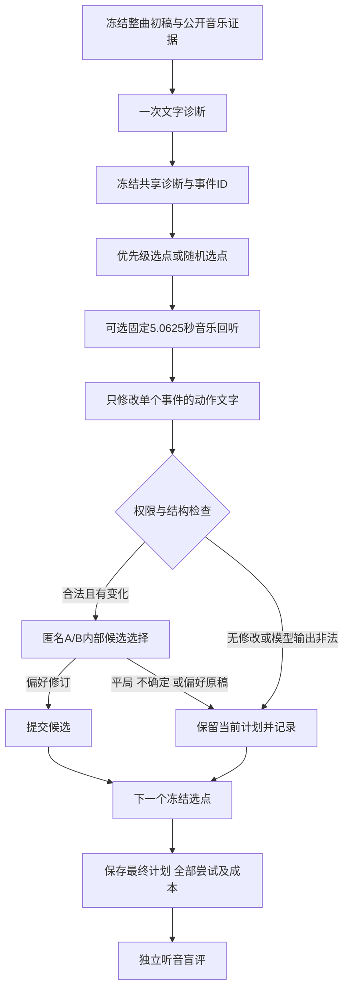

# 音乐证据复查与受限编舞修订

日期：2026年11月10日。开发期间再次拉取，已整合 `codex/music-choreo-benchmark@9c88a44`；main训练分支仍为 `02f478a`。

本轮将已有整曲初稿接入“疑似问题定位 → 可选音乐回听 → 局部动作修订 → 内部候选选择”的推理流程，并提供随机选点和纯文本修订对照。它是一个可执行、有限预算的修订基线。**本轮只进行了CPU软件验证，没有启动训练、真实模型调用或新的人工评审；收益仍需服务器实验确认。**

同步的上游 `1df4fe2` 已增加独立编辑语义裁定，`1b771ee` 又接通已审时间范围与问题区间并集诊断。任务库存、逐目标裁定、范围统计三项软件都已完成，下一步应收真实原件与做人工校准。这些外部评审接口与本轮模型内部选择候选分开；此前[进度汇报37](37_captioner_comparison_and_harness_progress_20261110_zh.md)中的相关待办应按这一更新理解。

最新 `9c88a44` 的[Captioner数值校准报告38](38_captioner_numeric_parity_20261109_zh.md)提供了更强的运行时证据：服务器记录中，冻结相同输入、FP32参数存储与对应计算精度后，三例、30个预指定logit位置、1,715个目标token的ZeRO/portable比较一致。当前单卡BF16基座存储路径仍有最大约0.470的逐目标log-prob差；小平均NLL差不能替代关键位置检查。该结果支持按已校准数值策略做后续比较，不代表修复复读、音乐条件理解或优于未微调强基线。上游是已有服务器前向证据，本机只审阅源码、脱敏结果及CPU测试，没有重跑30B。

由此更新两条推进线：harness评测的下一步是回收真实评分、逐目标裁定与范围原件，而非重复建设H2接口；Captioner应先固定输入feature、参数存储dtype、计算精度和cache协议，再比较已训练检查点与强基线。不能用单卡BF16路径的差异推断adapter恢复失败，也不能把严格前向一致推断为编舞质量更好。新增修订流程与该数值校准相互独立，第一轮仍使用明确身份的原始Omni观察模型。

## 1 为什么增加这一项

已有 coordinated 流程能生成大纲、携带历史并校验计划，但外层只读文字证据，不能找回局部caption遗漏的音乐信息。本轮允许在少量疑似问题位置重新观察音频，再决定是否值得修改。它既可能修复问题，也可能无效或引入新问题，因此保留原稿、失败、弃权及全部候选。

现有整曲生成器、时间菜单和训练配方没有参与本轮方法变化。这样可在同一初稿上比较修订策略。新流程目前每个选中事件最多尝试一次，最多选择八个事件；示例选择两个。它不是跨任务自动优化代码或更新权重的RSI。



基础设施、身份或未知结果异常会停止后续调用，未尝试的选点仍保留；已接受的先前修订不丢失。格式错误等已完成模型输出失败不会补抽位置或偷偷重试。

## 2 每一步怎样做

| 步骤 | 实现与输入 | 输出及限制 |
|---|---|---|
| 冻结输入 | dataset、原计划与规范PCM16 WAV；核对时钟和字节SHA | 同一初稿可供所有条件复用，来源声明不等于独立认证 |
| 一次诊断 | 已部署文本规划模型，读取去掉provenance/evidence的计划及公开音乐元数据 | 事件ID、1–3优先级、具体理由；仅疑似问题，模型并未听音；空列表合法 |
| 选择位置 | targeted按优先级选，random从全部事件抽样；数量都为min(上限,疑似问题数) | 两臂选好集合后都按原事件顺序执行；随机种子固定，失败不补抽 |
| 音乐复查 | 原始Omni-Instruct加固定音乐观察提示，只接收完整5.0625秒切片 | 节奏、能量、变化及不确定性的预测文字；不接收动作计划、诊断理由或私有目标 |
| 受限编辑 | 文本规划模型读取当前计划、同一初始诊断、公开音乐及可选观察 | 只可改一个事件的action；时间、track、主题、attributes、entry/exit和其他事件冻结 |
| 内部选择 | 同一文本服务比较A/B，位置由固定种子确定；模型不见哪个是修订稿 | prefer_revision / keep_original / uncertain；只作运行策略，不写成独立质量通过 |
| 发布与恢复 | 沿用不可变调用日志、SHA绑定、权限执行器 | plan.json、每步候选/patch/判定、成本与缺失状态；恢复不产生隐式新采样 |

两种选点条件的编辑提示、诊断内容、模型和权限相同，不向模型提供策略名称。纯文本条件去掉回听，其他机制保持相同；它的调用数量较少，不能称为等成本消融。

回听窗以事件中点为中心，歌曲边缘整窗平移，不padding或缩短。长事件可能只观察中间部分；工件明确记录原音频SHA、实际观察范围、与事件交集以及是否覆盖完整事件。短于5.0625秒的歌曲不能用于回听模式。

内部修订不会自动创建人工语义目标，`semantic_success`始终为null。动作文本即使保持JSON合法，也可能违背冻结状态或不适合音乐；模型内部比较不能证明其物理可执行性。零问题、no-op、失败或不确定均不能作为修复成功数。

## 3 代码入口

| 文件 | 用途 |
|---|---|
| [revision.py](../choreobench/revision.py) | 一次诊断、回听/编辑/内部选择、调用预算、工件与恢复 |
| [revision_protocol.py](../choreobench/revision_protocol.py) | 严格诊断格式、冻结选点、单事件action权限与判定绑定 |
| [music_recheck.py](../choreobench/music_recheck.py) | 固定音乐观察提示、PCM切片、native/常驻/回放身份检查 |
| [revision_experiment.py](../choreobench/revision_experiment.py) | 生成共享初稿和诊断的实验配置及命令，不调用模型 |
| [revision.json](../choreobench/examples/revision.json) | 真实运行模板；必须替换模型、路径和服务配置 |
| [edit_semantics.py](../choreobench/edit_semantics.py) | 上游独立编辑目标评审；不把内部judge判定导入为人评 |

新CLI为 `prepare-revision`、`diagnose-plan`、`revise-plan`。旧 `run-harness` 不会自动启用新修订，也不会改变旧运行身份。

## 4 服务器怎么运行

先准备三个输入：同一首歌的原dataset、已生成计划、填写好的revision配置。相对模型/回放路径按dataset目录解释，建议使用绝对路径。模板中的 `source_plan_synthetic=false` 是操作者对真实来源的声明，非来源认证；合成实验应设置true。已知合成输入和provider会继续污染为synthetic，不能通过配置洗掉。

在服务器仓库根目录执行以下命令，路径是需要替换的示意：

```bash
python -m choreobench prepare-revision \
  --dataset /data/song/dataset.json \
  --plan /data/song/original_plan.json \
  --config /data/config/revision.json \
  --out-dir /data/experiments/revision-song-a
```

此命令仅用CPU校验来源与声明预算，生成四份配置、manifest.json和commands.json，不加载模型，不连接服务。输出包含：

- 原始计划：零新增调用基线。
- diagnosis配置：只生成一次疑似问题诊断。
- targeted配置：针对性选点并回听。
- random配置：同数量随机选点并回听。
- text_only配置：针对性选点、不回听。

按commands.json中的argv数组，在记录的cwd运行。最小执行器如下；不使用shell拼接命令。某一条件失败时先检查记录，不通过重跑和换位置删掉失败。若继续其他条件，仍使用原初稿和已冻结诊断，并在最终比较中保留失败条件。

```python
import json
import subprocess

with open('/data/experiments/revision-song-a/commands.json', encoding='utf-8') as f:
    commands = json.load(f)
for step in commands['steps']:
    subprocess.run(step['argv'], cwd=commands['cwd'], check=True)
```

原始诊断位于 `diagnosis/diagnosis.json`。三种修订都绑定它和相同原计划，不能以某一条件的修订结果作为另一条件的输入。结果目录为 `runs/targeted`、`runs/random`、`runs/text_only`。

结果同时兼容既有 `export-submission` 和 `review-pack --run`。每个修订目录附带 `original.submission.json`，指向逐字保存的初稿；只导入其中一份，避免重复初稿。可复用原匿名评审页面生成器，例如：

```bash
python -m choreobench review-pack \
  --dataset /data/song/dataset.json --split dev --song-id ACTUAL_SONG_ID \
  --submission /data/experiments/revision-song-a/runs/targeted/original.submission.json \
  --run targeted=/data/experiments/revision-song-a/runs/targeted \
  --run random=/data/experiments/revision-song-a/runs/random \
  --run text_only=/data/experiments/revision-song-a/runs/text_only \
  --out-dir /data/experiments/revision-song-a/review --copy-audio
```

使用数据真实split与song ID，不为了命令通过改测试集标签。评审只分发public目录；分配名册、量表及缺失统计沿用原协议。发布为人评包不证明已有人评分。运行失败后保留的计划也可以进入比较，运行失败状态仍在原results中，不能从汇报中删除。

`results.json.complete`表示是否处理完选点清单；还要看failed_count、not_attempted_count、proposed_count、judged_count和accepted_count。accepted只表示内部模型选择了修订。CLI在任何选点失败或中止时返回2，即使保留下来的原计划仍然合法。

恢复用相同命令加 `--resume`。输入、模型身份或代码变化会拒绝恢复；未知调用结果不会自动重发。对新版本或新配置使用新目录。

## 5 需要哪些资源

| 资源 | 需求 |
|---|---|
| CPU与磁盘 | 来源校验、裁WAV、编排、JSON记录与测试；不需要训练数据 |
| 文本模型服务 | 可复用现有Qwen3-VL纯文本服务或兼容的明确版本指令模型，承担诊断、编辑及内部选择 |
| 音频观察模型 | 原始Omni-Instruct及固定音乐观察prompt；支持native和既有native_service协议；本轮未验证真实权重吞吐或显存需求 |
| 评审 | 独立听音比较原稿与三种输出，记录改善、无变化、新问题及无法判断 |

训练Captioner仍按原协议使用，不能直接当任意音频问答模型。本轮观察器要求base-only Omni；`music_recheck.MUSIC_OBSERVATION_PROMPT`会被native工厂自动注入。若常驻部署，服务端provider JSON必须使用完全相同的prompt，客户端填写健康接口的identity SHA。不同prompt的已有caption服务不能冒充观察服务。

常驻部署沿用 [README的服务说明](../choreobench/README.md)与 [native_service模板](../choreobench/examples/native_service_concat.json)中provider部分。客户端与服务端必须共享裁窗输出的绝对路径，服务audio_root覆盖该目录。启动音乐观察服务时，可在服务端读取常量写入provider JSON，再运行 `python -m choreobench serve-local`。这是独立服务身份；若另开模型进程，额外显存需实测，也可串行部署以减少同时驻留。

示例每首选择最多2个事件：一次诊断≤1调用，targeted≤6、random≤6、text_only≤4，完整四条件合计≤17次新增调用。先用每首1个事件验收时合计≤9。no-op可省去内部选择调用，实际输入token、输出token、延迟和未知计费都单列；原整曲生成及共享诊断成本不因复用而消失。调用上限不是总费用或显存上限。

## 6 最小验证与正式结论

先用一首开发歌、一个选点确认服务身份、音频切片和输出可恢复，再在冻结的开发案例上比较四条件。后续方法与量表冻结后，增加来源隔离的新歌及随机种子。不要根据修订是否成功挑选歌曲、位置或只展示被接受的修改。

主比较应问：针对性选点在相同修订数量和调用上限下，是否优于随机选点？辅助比较问：获得额外音乐观察是否优于同选点纯文本修订？后者成本不同，需报告实际质量与成本。最终原稿与所有条件都进入独立盲评；局部事件嵌套在歌内，不能把多个事件、模型调用或同歌seed当独立歌曲。

建议记录音乐适配、动作清楚程度、与相邻动作的衔接、合理重复与病理循环，以及新增错误。问题定位本身也可能误报：应评其依据是否成立，而非要求每个被选位置都必须变化。不能用内部judge偏好率或accepted_count作为主要质量指标。

本轮CPU覆盖包含：固定窗口与真实loopback HTTP协议、严格身份/格式反例、共享诊断与随机选点、action-only权限、A/B绑定、无问题与no-op、失败保留、预算、恢复和工件篡改。本机完整ChoreoBench回归为1,253项通过、4项跳过；随后补入的真实review-pack CLI集成测试另有1项通过。CaptionLab最终完整CPU回归为336项与35项subtest通过。跳过包括可选浏览器与本机符号链接条件，未当作已执行通过。真实模型效果、编辑语义收益与论文主张仍待独立实验。

## 7 最新代码审阅发现的校准工具问题

`9c88a44`的服务器数值观察与复现工具实现需分别看待。本轮发现并修复两个工具边界：

- [numeric_report.py](../captionlab/numeric_report.py)原先只检查有六条truthy等价记录，未要求三案例乘两精度的唯一完整覆盖。新版本核对实际源tensor快照、非空监督目标/位置、案例×精度清单、布尔声明与有限零差值的一致性；重复控制结论由已载指标导出。未独立核验的上游恢复、资源及运行行为保留为操作者声明或null，不再凭汇总器硬写通过。它仍没有重新运行候选模型，也不以比较JSON替代候选张量审计。
- [numeric_common.py](../captionlab/numeric_common.py)原先直接使用清单ID拼接数值工件路径。新版本在所有ID派生读写前整批拒绝路径分隔、保留字符/设备名和大小写冲突，保留合法Unicode，不偷偷重命名。原工具的独占输出目录规则继续有效。

这些修复不改已发布的数值结果JSON、检查点、原始训练数据或服务器记录。存在可复现的工具校验漏洞，不等于已证实原三例实验数字错误。后续服务器汇总应使用新校验并保留实际原件，缺失项不能伪造补齐。
