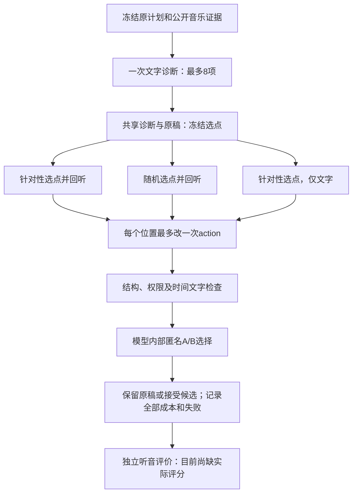

# 609c27e审阅与下一轮实验方案

日期：2026-11-10。审阅基线：`codex/music-choreo-benchmark@609c27ec1cac42ff66f4fdb96f08d64d49cf7234`。本轮已拉取并合入该提交；再次查询远端时，benchmark分支没有更新的提交，`main`仍为`02f478a`。本报告附带一项诊断读取校验修复，不启动训练或真实模型推理。

**当前的主要缺口已经从“修订流程能不能运行”转为“诊断是否成立、候选是否有益、选择器是否选对”。优先评价已有产物，再修时间表达接口，最后扩展新来源；Captioner另做冻结模型对照，不因harness已跑通而追加训练。**

证据边界：本机审阅了源码、测试及仓库内服务器报告。v21/v22的音频、原始调用和评审包在服务器私有目录，本机没有独立重算其模型输出。下文真实运行数字来自[验收记录](../choreobench/docs/VALIDATION_20261104.md)和[修订报告39第8节](39_bounded_music_reinspection_and_revision_20261110_zh.md#8-服务器真实执行v21失败与v22有界修订)；实验建议均尚未执行。浏览器验收使用的临时评分不属于独立人评，目前记录的真实评分仍为0。

## 1. 609c27e实际推进了什么

前一版已有编排代码和CPU测试。609c27e补上了原始Omni-Instruct音乐观察器、Qwen3-VL-32B文本模型的真实运行、失败记录与成本，并针对实际失败加入诊断边界和时间文字检查。没有新增Captioner训练。

当前修订流程如下，整曲初稿沿用此前已经生成的结果：



回听使用固定5.0625秒音频窗，只观察音乐，不读取编舞或私有目标。编辑冻结时间、其他事件、属性及出入状态，只能改选中事件的动作文字。这是有限预算的推理harness，尚不是自动改代码、更新权重或跨任务自我提升的RSI。

| 项目 | v21 | v22 |
|---|---|---|
| 数据 | 原v11三首开发歌初稿 | 同三首，另立版本重新预登记 |
| 诊断 | 两首完成，分别49/18项；一首4096-token截断 | 三首均8项，输出940/916/893 tokens |
| 三策略运行 | 两首完成；失败歌三臂未尝试 | 三首×三策略均处理完成 |
| 实际模型调用 | 17 | 24 |
| 输入/输出tokens | 311,024 / 12,767 | 438,947 / 8,719 |
| 新音乐观察 | 4 | 6 |
| 可展示计划位置 | 9，预登记12 | 12＝3原稿＋9策略输出 |
| 独立质量结论 | 尚无 | 尚无 |

两轮共41次调用、749,971输入tokens、21,486输出tokens。其中10次音乐观察、31次文字调用；历史278个局部提案和初稿等成本另计，不能因复用算成免费。

v22内部情况更具体如下：

| 策略 | 非空候选数 | 内部接受 | no-op | 实际调用 |
|---|---:|---:|---:|---:|
| targeted/listen | 3 | 1 | 0 | 9 |
| random/listen | 0 | 0 | 3 | 6 |
| targeted/text_only | 3 | 1 | 0 | 6 |
| 共享诊断 | — | — | — | 3 |

这里“非空候选”专指动作确实改变，不等于运行记录中可能包含no-op的`proposed_count`。九个策略输出中，七个最终保留原稿，两个最终改了正文；独立歌曲仍只有三首。12个展示位置、6个非空候选、2个最终修改，不能混为12个独立成功作品。

v21/v22同时改变诊断约束、提示、时间单位说明与guard，诊断及选点也可能不同，因此只能分别汇报开发观察，不能把它们当作单变量消融。targeted和random有相同选点数量与调用上限，实际调用和成本不同；listen对text_only也不是等成本比较。

## 2. 当前最重要的问题与可解决方向

### 2.1 内部接受不等于正确，时间接口需要改变

v21内部judge接受过把640采样点写为640ms的候选；在16kHz下640采样点实际是40ms。v22两个内部接受候选仍添加裸downbeat数字，其中text_only写在54400处结束，而固定事件结束为52000。最新源码对两个原v22候选的离线复检均拒绝。

这支持两个结论：真实模型会混淆时钟；模型内部选择未能稳定挡住错误。它**不支持**“加入最新guard后，真实新输出质量已经改善”：尚未跑第三轮模型实验，也没有独立评分。原v22的accepted仍保留其历史含义，不能事后改成零再算新成绩。

当前[时间检查](../choreobench/revision.py)是正则提取新时间字面的检查，不是语义证明。代码审阅可复现`at 640-ms`、`downbeat #54400`、`at 00:00.640`等表达未被现规则拦截；旧文本已有`over 2 seconds`时，新加`ending exactly at 2 seconds`也可能因字面集合未增加而通过。匹配到相同数字不能证明它指同一个时间角色。

建议保留整数采样点作为控制器唯一权威时钟，由控制器生成模型可读、单位统一的秒数视图，明确局部/全曲时间；相关音乐锚点按事件/上下文范围筛选。若以后允许精确锚点，使用结构化anchor ID，验证其来源成员关系和范围，再由控制器渲染文字。自由文本中的身体动作合理性和音乐贴合仍需外评。不要依赖不断增加正则来宣称语义问题已解决。

当前发现的是时间**文字解释**错误，尚未证明原排程切点本身不好。因此现在不直接触发18-call时间菜单重排探针，也不强迫所有事件边界贴拍。

### 2.2 已修复：复用诊断时遗漏当前边界

609c27e生成新诊断时调用`_bounded_diagnosis`，限制最多8项、每理由400字符；读取已保存诊断的`_diagnosis_record`仍仅调用通用`parse_diagnosis`。正确绑定并封存的历史超限记录可以绕开当前运行边界。

本轮让读取路径也调用`_bounded_diagnosis`。通用协议解析器保持兼容，历史原件不被截断、改写或重新封存；当前运行遇到超限记录，在创建provider和派发调用之前明确拒绝。因此v21的大诊断不能直接用于当前修订器；查阅旧结果仍保留原版本和身份，不能用删项冒充旧实验恢复。

新增测试覆盖401字符、9问题，以及9事件原稿上合法8项×400字符的读取/no-op。源码与回归位于[revision.py](../choreobench/revision.py)和[test_choreobench_revision.py](../tests/test_choreobench_revision.py)。

### 2.3 现在还不知道误诊、错改与误拒绝各有多少

诊断把合法相邻边界当作问题，说明“被选中”不代表“应当修改”。random三次no-op可能是合理保持，不能预设为失败。另一方面，四个非空候选被内部判为uncertain而未进入最终计划；它们可能无益，也可能是被错过的好修改。

只看最终12项无法区分上述原因。下一轮须同时评价最终策略输出、全部六个非空候选，以及原选点是否值得改；将定位、编辑、选择三个环节分开测量。

## 3. 下一步harness实验：按信息价值排序

### H1：先评价现有材料，零新增模型调用

| 材料 | 要回答的问题 | 具体执行 |
|---|---|---|
| v22已有12项最终输出包 | 整个修订策略是否比原稿有益 | 两名评审独立听音，保留原稿与全部九个策略格；允许相同、平局、无法判断 |
| 新组织六个非空候选对 | 内部选择有没有误接受/误拒绝 | 每个candidate与各自before匿名对比，隐藏2 accepted/4 uncertain标签；全部纳入 |
| 三个targeted位置与最多三个random位置 | 原稿是否确有修改必要 | 记录需要/无需/不确定、可核查理由和实际审阅范围；再分析诊断，不把模型诊断当答案 |
| 既有三条件九个整曲计划 | 大纲与历史是否有整体作用 | 作为独立问题分析，不能与局部修订效果混算 |

主评价包括音乐适配、动作清楚/可执行性、相邻衔接、合理重复与机械循环、新增错误。候选校准记录“更好/相当/更差/无法判断”及原因，按真实reviewer分别保留；争议不自动变成一致。对比策略时审阅各策略选点范围的并集及相邻上下文，避免不同策略只展示各自有利片段。还可审阅全部24个诊断条目，但它们嵌套在三首歌内，不能当24首独立歌。

先报告逐歌/逐位置结果及缺失，不凭三首开发歌给出总体赢家或看似精确的显著性结论。若匿名包中保留重复原稿，要明确这些不是新增独立作品；不能把一次评分复制成多份独立意见。后续若做内容去重，应建立新的匿名包与私有映射，保留原包及所有策略的分母。

现有代码可直接复用`review-pack`、`review-page`、`review-import`、`analyze-reviews`、`check-review-issues`和`analyze-review-ranges`，具体合同见[CLI](../choreobench/cli.py)及[评审说明](../choreobench/README.md)。工具处理记录与范围，不会自动证明评分正确。

**尚需补的组织工作：**`review-pack --run`只读最终`plan.json`，不会自动收集步骤candidate。六个候选位于原targeted/text_only运行的`steps/00/`，需核对before、candidate、task、verdict、decision及原SHA，再用独立组织脚本生成匿名配对材料。可复用`reviews.build_review_pack`或显式submission，但当前没有专用`candidate-export`命令。普通candidate submission只产生生成评价项；若需展示before/instruction并使用编辑维度，须给API显式传`source_plan/edit_task`。现有独立评分格式是分维1–5/null与时间观察，专用成对偏好导入格式也尚未实现：可先用分项评分及原始观察，新增结构化偏好时另立格式，不能复用内部revision verdict冒充独立人评。不能把四个uncertain候选遗漏后声称完成选择器校准。

### H2：旧候选离线审计与时间视图开发，不重跑原模型

对原六个候选，用当前guard输出一个新审计文件：原件SHA、检查代码SHA、检查结果、理由。原v21/v22记录不可覆盖。当前只有内部纯CPU函数`_no_new_timing_literals`，没有独立审计CLI；需要小脚本先核验原件绑定。**不能用`revise-plan --resume`冒充离线审计**，新旧代码身份不同，恢复还涉及模型调用协议。

随后开发统一时间视图，保持底层时间、权限和最终JSON合同不变。时钟变换须覆盖结构化事件、音乐证据和范围，而非只在裸samples旁附一句说明；保留原始动作正文与诊断原件，对其引用的时钟作明确标识，不能悄悄修原稿。先用整数/秒换算、边缘事件、跨事件拍点和合法相邻边界做确定性验证。

这一步仍是接口可靠性改进。通过检查不等于模型理解音乐，也不等于舞蹈可执行。

### H3：如需要模型开发实验，只改变时间呈现

在H1/H2明确问题后，以三首已知开发歌的相同targeted事件做最小探针：A为当前samples视图，B为统一带单位的时间视图。冻结原稿、诊断、选点、既有音乐观察、模型/种子、预算和同一最新guard，仅改变模型看到的时间表示；编辑与内部比较均使用对应视图。

上限为`3事件 × 2视图 ×（1编辑＋1内部比较）＝12次文字调用`，不新增音频观察和诊断。no-op或非法候选可减少实际比较调用，失败仍保留。评价保存下来的原始候选中的单位/越界错误、语义收益和新增错误，不能只看通过guard后的接受率。

这个配对视图开关及观察复用实验入口**尚未实现**，不能把当前`prepare-revision`当成已有此消融。若使用人工核验后的诊断，这是另一个oracle诊断条件，必须独立命名，不能混入主对照。已知三首只用于开发，不进入新方法的未见来源效果表。

### H4：接口冻结后再做新来源效果实验

最小问题是“同一个预选疑似问题位置，额外听音是否有用”。先在新来源上比较原稿、targeted/listen、targeted/text_only；共享原稿、诊断和选点，每歌1位置，最多`1诊断＋3 listen＋2 text_only＝6调用`。加入random/listen后每歌总上限9调用，但只有需要验证选点策略时才增加该臂。全部条件保留no-op、失败和弃权。

可先冻结12首来源隔离的新歌曲：6首用于协议/量表验证，另6首在冻结方法后做首次小测。这是可操作的小规模起点，不是统计充分性保证，也不是最终benchmark规模。两臂方案含诊断共上限72调用＝12次共享诊断＋60次修订调用；若三臂全做则108调用，同样包含12次诊断。**这些预算不含生成新歌曲初稿、局部caption、大纲或历史的成本**，应先测一首实际耗时和tokens再扩展。不能把开发集中反复看过的三首换个split名称当新测试。

报告逐来源的质量差、胜/平/负/无法判断、完整失败率，以及真实tokens/延迟/观察秒数。来源与近重复关系作为抽样单位，同歌多个seed或多个事件不扩大独立样本数。对外推广需要之后扩充来源、校准量表与强基线。

不会把一次读全曲证据的弱`global`条件作为主要胜负对象。优先使用已有独立分块、带大纲/历史等可用基线，并给强指令模型合理任务提示、相同可用证据与预算；有训练分布限制的Captioner维持原5秒合同。

## 4. Captioner并行实验：先推理诊断，不追加训练

609c27e没有新增训练结果。[数值报告38](38_captioner_numeric_parity_20261109_zh.md)证明的是标准SFT@6040、原三例、同输入feature和匹配FP32存储/计算策略下的前向一致性，不能自动推广到EOS20、新案例或单卡BF16存储。它也没有证明复读消失，更没有证明训练模型普遍优于未训练模型。

| 阶段 | 执行方案 | 数量/产物 |
|---|---|---|
| C0 运行核验 | standard6040、EOS20、官方同基座逐个核对权重、原训练快照、输入feature、目标/EOS、数值策略 | 每profile先最多3例；保留各自回执，校准调用额外记账 |
| C1 条件NLL | 从原固定256验证来源中事先选最多64个不同已知来源组件；三个同基座profile均用相同目标 | true/random/silence：上限576次完整无cache前向；全64例均有已审hard时再加192次，上限768 |
| C2 实际生成 | 从上述val事先选8个来源，三个profile加正确编舞提示的Omni-Instruct | 主解码32条输出；不因结果坏补抽 |
| C3 独立评价 | 两位评审听音盲评上述32条，关注适配、动作清楚、循环与停止 | 64份判断；分析单位仍为8个来源 |

C0未通过时先解决恢复或协议问题，不进行训练来补偿未解释的数值差。旧三例仅作历史回归，若原来不属于val，不改变其split。C1不足64个独立来源、random/hard不可用或某profile失败时保留实际分母与缺失，不能凑数。random不自动等于语义错误，hard须有已审错配依据。

NLL主读数为同一目标下`NLL(candidate music) - NLL(true music)`，辅以相同目标/有效token支持下的模型差异。整段、EOS及可核验动作子集分别报告；没有可靠action mask时动作子集为NA，不用整段文字冒充动作分数。EOS需从末尾逐token记录后处理，当前`summarize`没有独立EOS聚合scope。此测量反映条件依赖，不要求音乐唯一决定某个动作的侧别或次数，也不能代替生成质量。

NLL表与生成表分开。Omni-Instruct使用合理的音乐到编舞任务提示作为生成强基线，不把不同输入/分词合同下的绝对NLL硬排在同基座Captioner表中。v22常驻服务的提示是“描述音乐”，不能直接拿其输出当编舞基线；可复用同权重，但必须建立新提示/服务身份并记录真实调用。

**数值策略要写到执行配置，而非只写模型名称。**[runtime.py](../captionlab/runtime.py)按首个参数dtype决定BF16 autocast；直接`model.float()`后，正常评分路径不会自动继续BF16 autocast。因此C1优先选择已校准的FP32参数存储/FP32计算路径，并确认实际输入与模型没有混合的未声明策略。若要FP32存储/BF16计算，需原factory/评分路径显式实现、核验并记录，不能只改标签。C2若采用单卡BF16部署，也可评价其实际表现，但与严格ZeRO等价性结论分开。不得把依赖参考完整序列的固定MoE route诊断干预用于生成。

现有`captionlab prepare/run/summarize`可完成冻结清单和NLL测量，factory仍须连接服务器上的原代码与完整工件。`captionlab run`没有自由生成入口；C2沿原native生成代码另记profile、提示、解码及输出，不能假装NLL runner已自动完成生成。参考[CaptionLab合同与命令](../captionlab/README.md)。本轮不启动P0–P3、短窗、rank或其他新训练。

## 5. 资源与交付清单

| 工作 | 需要的资源 | 结束时应交付 |
|---|---|---|
| H1/H2旧产物审查 | 原服务器音频/调用目录、CPU、两名实际评审 | 只读匿名包、原始评分/范围、六候选校准记录、新guard审计 |
| H3时间视图开发探针 | 现有文本模型；复用既有观察 | 新版本配置、最多12调用及所有原始输出；配对单位/语义错误表 |
| H4新来源试验 | 真实音频、文本与音频模型服务、两名评审 | 冻结来源/split、所有条件结果与成本、独立评价 |
| C0/C1 | 原checkpoint、原代码/处理器、冻结输入及匹配多卡环境 | 每profile加载/精度回执、逐token分数、缺失与条件差异 |
| C2/C3 | 逐个加载模型的推理环境、两名评审 | 32条预定输出及64份评价，包含截断/循环/失败 |

真实v22采用两卡文本服务加一卡音乐观察服务；这是该环境已跑通的布局，不是其他服务器的固定最低显存承诺。H1/H2无需驻留模型。C1沿数值报告已核验的多卡FP32路径或原world8 ZeRO，不能用单卡BF16显存估计推断FP32可装下；每次只驻留一个30B profile。先测最长目标、峰值显存与单例耗时，再定并发。模型可以常驻，但不同prompt/权重/数值策略必须保持明确身份，不能借常驻省略加载核验。

C1优先使用已校准的单进程、多卡FP32 portable。当前`captionlab run`没有world8多rank单writer编排，不能直接`torchrun`八个进程写同一输出目录。若使用原ZeRO，沿原分布式诊断driver协调所有rank参与前向，由rank0导出符合合同的记录，再用`summarize`汇总；显式factory不自动补齐这些分布式执行工作。

执行顺序建议：先同步服务器原件并收H1评价，同时完成C0；之后并行做C1和候选/时间视图工具。依据H1结果决定H3/H4是否值得运行，C2按冻结清单做实际生成。先计时一首评审和一个最长输入，不在缺少吞吐数据时承诺GPU小时或当天收敛。

现有单歌评审包命令可直接使用，以下均为需替换路径/ID的示例：

```bash
python -m choreobench review-pack \
  --dataset /data/song/revision_dataset.json --split dev --song-id ACTUAL_SONG_ID \
  --submission /data/v22/song/runs/targeted/original.submission.json \
  --run targeted=/data/v22/song/runs/targeted \
  --run random=/data/v22/song/runs/random \
  --run text_only=/data/v22/song/runs/text_only \
  --out-dir /data/review/new-song-pack --copy-audio
```

使用真实split与原件路径，只分发public部分。单次CLI接受一个dataset；不能把三个不同逐歌dataset下的九个run直接混进同一调用而假定自动拼成12项。已有服务器12项包可复用，新的组织脚本需保留各输入绑定。候选校准和H3仍属待写工具，没有虚构的一键命令。

## 6. 当前哪些可以写论文

可以写：音乐到文本编舞的任务/表示、整曲与受限编辑的分离合同、可追踪推理harness、同初稿策略对照、真实调用/失败/恢复/成本、内部judge接受时间错误的开发案例，以及限定条件下Captioner数值一致性诊断。

暂不能写成已验证结论：harness提高音乐适配、回听优于文字修订、targeted优于random、训练Captioner优于任何未训练模型、已拥有校准完毕的正式benchmark、已实现跨任务RSI。方法章节可以完整，效果章节仍需要真实独立评价和新来源。

论文价值应落实在任务与评测的可复用定义、可靠的基线及有证据的失败/改善分析；不能只用循环调用LLM或内部accepted数支撑新颖性与有效性。

## 7. 本轮代码验证

- `test_choreobench_revision.py`与`test_choreobench_revision_protocol.py`：134 passed，包括新增三个读取边界回归。
- `test_choreobench_music_recheck.py`与`test_choreobench_revision_experiment.py`：80 passed。
- 合计本轮相关CPU专项214项通过，`git diff --check`通过。没有重跑30B、没有产生新训练/真实模型质量结果、没有改写历史实验原件。
- 609c27e服务器记录的全套1264 passed、3 skipped、148 subtests属于上游验收，不冒称为本机重跑。

后续实验必须保存执行代码SHA和新目录。当前修复改变了诊断读取合同，旧运行身份不能静默替换为新代码后继续计入同一实验。
