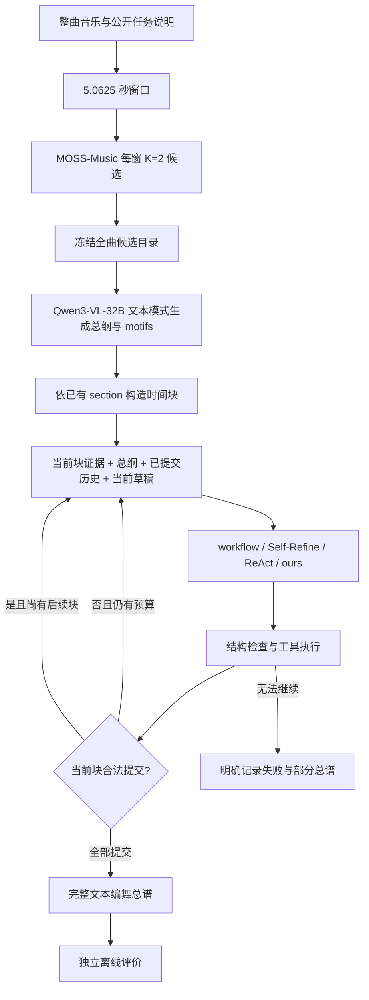

# 整曲编舞 harness：现状、控制器 v2 与开发验证

日期：2026-11-14。本文记录现有 E3 整曲实验的实际行为、已确认的问题和本次控制器修改的验证方案。历史结果来自 TX 归档，不代表新控制器的结果；本次没有新增 GPU 生成实验，也不需要训练模型。

## 1. 当前 harness 实际做什么

它将一个只能描述短音乐片段的专家模型，接入整曲证据、总谱规划、逐块写作、合法性检查和预算控制，输出覆盖全曲的文本编舞总谱。编舞内容由模型生成，harness 负责组织信息、执行工具、维护状态和记录可复核的过程。



实际 E3 专家是 **MOSS-Music**，四种方法共享 1,127 个窗口的 2,254 条候选；尚未换成正在交付的 SFT captioner。外层模型是 Qwen3-VL-32B-Instruct，但这里使用文字接口，不在循环中重新听音或观看视频。评价侧的独立音乐观察不会进入生成循环。

当前不是按已经确认的“乐句”切分。配置为 `meter_status='unverified'`、`fallback_seconds=10.125`、`max_unit_seconds=20`；虽然保留 `bars_per_block=4`，实际使用 section 内的时间切分回退。每块最多 3 个事件，时间网格 0.25 秒，最短事件 0.5 秒，并要求覆盖当前块。覆盖完整说明时间约束满足，不能据此宣称动作与节拍对齐。

NLF、MotionScript、VLM 润色属于数据构建或其他流程；它们不是这次 E3 循环实时调用的工具。这里也没有 H3 视频生成、在线权重更新或已经实现的递归自我改进。E4 用户编辑是另一套实验，本次控制器修改不等于已优化 E4。

### 工具的真实能力

| 工具 | 实际作用 | 不应误解为 |
|---|---|---|
| `read_evidence` | 读取已冻结候选与时间块 | 重新听音乐、增加新的音乐证据 |
| `read_history` | 读取已经提交的总谱 | 重新生成历史、检索额外训练知识 |
| `propose_block` | 保存当前块草稿 | 已经推进到下一块 |
| `check_block` | 检查格式、时间、轨道、证据引用等结构约束 | 可靠的音乐适配或舞蹈质量评审 |
| `revise_block` | 修改当前未提交草稿 | 可以回头改已经提交的块 |
| `commit_block` | 验证草稿并追加至总谱 | 验证舞者一定能执行、质量一定提高 |
| `submit_block` | 提交给定草稿并立即验证、追加 | 绕过验证或修订次数限制 |
| `finish` | 声明结束；未完成全部块时不能算成功 | 用一句“已完成”代替真实提交 |

`submit_block` 存在于实际 TX 归档版本；当前仓库原有默认版本未包含它，本次 v2 恢复此能力。其余工具也由各版本的执行器定义，不能只看提示词就认定约束已强制执行。

### 四种方法如何使用同一套证据

| 方法 | 基本流程 | 外层调用量，理想情况 |
|---|---|---:|
| workflow | 总纲；每块生成一次，程序验证并提交 | `1 + U` |
| Self-Refine | 总纲；每块生成、反馈、修订，程序提交 | `1 + 3U` |
| ReAct | 总纲；模型自由选择工具 | 由工具轨迹决定 |
| ours（`choreography`） | 总纲；工具循环加入编舞策略及领域状态 | 由工具轨迹决定 |

`U` 是歌曲规划块数。四方法共享证据与权限，但分别生成总纲，因此不是总纲文本逐字相同的受控比较。历史可见性也不是 ours 独有；归档 ours 的区别主要是编舞策略提示与显式状态，不能写成只有 ours 拥有长期记忆。

## 2. “预算”具体指什么

预算是单首歌曲允许花费的外层模型资源上限，不是训练 epoch，也不是显存大小。相同预算比较不同控制策略能否及时交付；单纯增加 GPU 不会改变这些上限。

| 项目 | 实际 TX E3 配置 | 说明 |
|---|---:|---|
| 外层最大调用次数 | `1 + 4U` | 总纲也占一次；解析失败、被拒绝或截断的返回也计费 |
| 总纲单次最大输出 | 4,096 tokens | 一次性全曲总纲 |
| 其余单次最大输出 | 1,024 tokens | 包括工具选择、草稿与修订 |
| 累计输入上限 | 2,000,000 tokens/歌 | 反复发送的历史与观察也累计 |
| 累计输出上限 | 150,000 tokens/歌 | 不是每次都可输出这么多 |
| 单次序列化请求字符上限 | 300,000 | 包含请求相关内容；原根目录默认值为 200,000，复现时必须显式设置 |
| 模型服务上下文容量 | 原服务配置 64k | 与累计输入预算是两个不同约束 |

派发前另用 `messages` 的 UTF-8 字节数加 1,024，保守检查剩余输入 token 预算；它并不是精确 tokenizer 计数。实际 token usage 回来后继续核算。缺失 usage 不能当作零成本成功。K=2 本地专家候选、离线评价的成本另外报告，不能只报外层成本就称为端到端总成本。

例如一首歌有 24 块，总调用上限为 97；workflow 通常用 25 次，Self-Refine 用 73 次。如果 agent 每块恰好使用 4 次工具调用，再额外调用 `finish`，就需要 98 次。这说明即使内容已完成，结束协议也可能吃掉最后一次预算。v2 在全部合法提交后自动完成，避免额外结束调用。

## 3. 已有结果说明什么

来源：[机械统计](../experiments/tx_a800_20261113/results/e34/mechanical/summary.json)、[最终完整性与质量审核](../experiments/tx_a800_20261113/results/e34/final_integrity_summary.json)。24 首歌、四方法共 96 个槽位已经全部有终态；失败也属于终态。

| 整曲方法 | 合法完成/24 | 停滞 | 预算失败 | 平均调用/歌 | 平均输入 tokens/歌 |
|---|---:|---:|---:|---:|---:|
| workflow | 24 | 0 | 0 | 24.54 | 397,211 |
| Self-Refine | 24 | 0 | 0 | 71.63 | 1,215,833 |
| ReAct | 19 | 2 | 3 | 74.88 | 1,457,553 |
| ours | 20 | 0 | 4 | 76.08 | 1,526,376 |

ours 调用量约为 workflow 的 3.10 倍，输入量约为 3.84 倍，完成率却更低。**ours 的 1,826 次外层调用中，有 500 次是内容完全相同的草稿重提，占 27.4%。** 此项只统计 `draft_retained_no_content_change`，不包含正常的读证据、读历史或检查；不能用“这些只是合法检查”解释掉。

### 为什么复杂 harness 可能更差

1. **工具调用不自动产生内容收益。** 固定流程直接交稿；agent 还需判断是否读取、检查、修订、提交。对不增加新证据的工具重复调用，会占用相同的调用和上下文预算。
2. **归档控制器有已确认的进度漏洞。** 提示层禁止继续修订某个未改变的草稿，执行层没有强制检查同一限制。停滞签名还包含自由文字 `reason`，因此仅换解释文字就可能被当成不同动作。
3. **上下文重复增加成本。** 已提交总谱已进入请求，读历史的返回又保存一份快照；读全曲证据的返回也可能继续重发。更多文字并不意味着更多独立证据。
4. **结构检查不能决定语义上何时该改。** `check_block` 可以确认格式合法，却不能可靠判断音乐贴合、重复是否合理、动作是否有发展。模型可能在无质量依据时反复润色。
5. **更多反思也可能改坏内容。** 当前质量评测尚不能证明这里发生了多少；这是待验证的假设，不能把完成率下降直接解释成所有已完成文本都更差。

只读 CPU 反例已确认：归档状态中，同一草稿连续修订 5 次、仅改变 `reason`，仍可得到内容未变返回，规划游标始终不前进，停滞计数却保持 0。这证明控制规则有漏洞；尚不能据此断言历史 4 个预算失败全部由它造成。具体触发了调用、累计输入还是其他上限，仍要看逐歌原始轨迹。

### 质量结论的边界

| 已有信号 | 可以得出的结论 | 不能得出的结论 |
|---|---|---|
| 音乐证据均分约 3.80–3.84 | 已产生可用于审查的音乐适配评分 | 四方法有效歌曲数为 24/24/19/20，直接按均值排优劣 |
| 与 ours 比较的 CLAP 配对区间均跨 0 | 尚无明确的指标差异证据 | ours 更优，或四方法严格等效 |
| 87 个完整总谱长程评分均为 5/5 | 当前长程指标饱和，需要修订协议 | 长程编舞已经完美 |
| 复读 44 个有效评审，43 个基础设施 unknown，9 个生成失败 | 只能报告有效子集与覆盖 | 低复读覆盖了所有歌曲 |
| 边界 16 冲突、1,906 无冲突、242 unknown | 可以分析显式边界案例 | unknown 全部视为无冲突 |
| E4 需改题 ReAct 21/40，ours 20/40 | 编辑能力有初步结果且覆盖受限 | 已建立 ours 编辑优势或完整的保护能力 |

结果原件：[音乐评分](../experiments/tx_a800_20261113/results/e34/music_metrics/summary.json)、[CLAP](../experiments/tx_a800_20261113/results/e34/clap_metrics/summary.json)、[复读](../experiments/tx_a800_20261113/results/e34/repeat_metrics/summary.json)、[编辑](../experiments/tx_a800_20261113/results/e34/edit_metrics/summary.json)。长程评分必须先在开发材料上检验能否识别取消主题发展、机械重复、明确冲突等破坏，再作为主质量指标；不能按 ours 是否获胜挑指标。

## 4. 本次控制器 v2 的修改范围

入口是 `run_composition(..., controller_version='v2')`，CLI 为 `--controller-version v2`。默认仍为 v1；历史 TX 归档代码与结果保持冻结。v2 对 **ReAct 和 ours 同时生效**，保持相同模型、证据、结构约束与总预算，避免把通用的程序修复只施加在 ours 上。

三个版本必须分清：

| 版本 | 已知控制行为 | 用途 |
|---|---|---|
| `experiments/tx_a800_20261113/code/` | 含 `submit_block` 和 ours 领域状态；存在同草稿/停滞漏洞 | 解释、重建历史正式实验 |
| 根目录原有 v1 | 已有每块一次修订限制、最近两条观察；无 `submit_block`，无归档 ours 的领域状态 | 保持当前默认调用行为 |
| 本次可选 v2 | 恢复直接提交和领域状态，并增加下表控制约束 | 新开发验证，独立版本与输出目录 |

因此“v2 相对 v1”的开发结果不是单因素复现“v2 相对 TX 历史版本”；论文表与配置都应明确版本。冻结运行的恢复依赖代码、配置与输入合同，新版本不能直接恢复旧合同。

| 修改 | 如何执行 | 预期作用与限制 |
|---|---|---|
| 硬执行可用工具 | 根据当前状态生成允许集合，执行器再次检查 | 提示与 schema 之外仍有程序约束 |
| 合法草稿直接提交 | `submit_block` 在一次响应内验证、追加 | 减少“提出后再提交”的开销，不降低验证要求 |
| 每块最多一次修订 | 修订计数由状态机维护；换成 `submit_block` 也不能绕过 | 防止反复改写；无效首稿仍允许一次修复 |
| 合法同草稿自动提交 | 原样重提且通过验证时，控制器推进当前块 | 消除完全相同的草稿循环；不是宣称内容优质 |
| 完成后自动结束 | 最后一块合法提交后直接生成完整结果 | 不再需要额外一次模型 `finish` |
| 停滞与 reason 无关 | 用提交游标、草稿内容 hash 判断进度 | 连续 3 次无进度时，已有合法草稿则程序提交，否则明确失败并保留部分结果 |
| 为未完成块保留调用 | 剩余调用不多于剩余块时，进入强制推进策略 | 有合法草稿就提交；后续要求直接合法提交。只能减少浪费，不能保证坏输出成功 |
| 紧凑观察 | 已提交历史保留一份；新读出的全曲证据先完整呈现一次，随后压缩旧观察；磁盘保留完整轨迹 | 不把尚未被模型看见的读证据结果提前删掉，不声称增加了检索式长期记忆 |
| 暴露剩余预算 | 模型可见剩余调用、累计输入/输出额度 | 帮助选择动作，但真实限额仍由程序执行 |
| ours 编舞状态 | 保留当前块、约束、近期动作、拒绝信息与草稿状态 | 使领域策略有明确输入，不把未知物理状态编造成事实 |

预算保留并不预留真实音频质量，也无法保证剩余 token 足够覆盖后续请求。所有失败仍需保留部分总谱与真实原因；不把回退文本、占位事件或未验证草稿记为成功。控制器提交只有结构意义，没有新的质量评分器。

本地已完成 CPU 回归：以下命令共 **57 项通过**（原有工作流 34 项、新增 v2/CLI 23 项）。覆盖四方法运行与精确恢复、非法草稿、单次修订、停滞、工具权限、输入/输出预算超限、基础设施 unknown、观察压缩及原始记录保留。实际 usage 超预算时不能通过自动提交误记为成功。测试采用构造输入与替代模型响应，没有调用真实模型。

```bash
python -m pytest tests/test_choreobench_composition_controller_v2.py tests/test_choreobench_composition_workflows.py -q
```

## 5. 服务器运行：先做三首开发歌

### 所需资源与冻结项

- 使用现成的外层模型服务；保持原模型权重、tokenizer、服务配置、温度/解码合同和种子。原实验使用 Qwen3-VL-32B-Instruct BF16、TP2；可以复用已部署服务，不需要训练或重新部署 captioner。
- 复用每首开发歌已完成的 MOSS-Music K=2 候选目录、原音频证据和 section 信息。v2 只改变控制器时，不重新采样候选，不换专家。
- 从开发划分预先指定 3 首不同长度/结构的歌曲，记录 ID、source view、候选 SHA 和选择规则。不要根据正式 24 首的输赢挑歌，也不要把测试歌改称开发歌。没有合规开发候选时先构建开发候选，不能使用虚构 ID。
- 先跑 ReAct-v2 与 ours-v2，共 6 个生成运行。可用现有合同一致的开发 v1 结果对比；否则对同 3 首补跑 ReAct-v1 与 ours-v1，共额外 6 个运行。TX 历史 24 首只作背景参照，不与 3 首开发均值拼接成配对实验。
- 输出存入全新目录。保留调用原始响应、token usage、contract、逐步工具轨迹、总纲与总谱。服务错误和缺失 usage 必须单列。

### 执行示例

以下命令在仓库根目录执行；`/srv/...` 和歌曲 ID 都是部署占位值，替换为真实开发文件后再运行。`source` 是该歌的完整候选 view JSON；`provider.json` 复用已核验的外层服务配置。环境变量/API 凭据继续使用部署环境管理，不写入文档或输出目录。

```bash
python -m choreobench run-composition \
  --source /srv/choreobench/dev/catalog/views/DEV_SONG_ID.json \
  --song-id DEV_SONG_ID \
  --provider /srv/choreobench/config/provider.json \
  --out-dir /srv/choreobench/runs/controller-v2-dev/DEV_SONG_ID/react \
  --method react --controller-version v2 --seed 42 \
  --max-request-characters 300000 \
  --max-input-tokens 2000000 --max-total-output-tokens 150000

python -m choreobench run-composition \
  --source /srv/choreobench/dev/catalog/views/DEV_SONG_ID.json \
  --song-id DEV_SONG_ID \
  --provider /srv/choreobench/config/provider.json \
  --out-dir /srv/choreobench/runs/controller-v2-dev/DEV_SONG_ID/choreography \
  --method choreography --controller-version v2 --seed 42 \
  --max-request-characters 300000 \
  --max-input-tokens 2000000 --max-total-output-tokens 150000
```

对另外两首开发歌重复。需要 v1 对照时改为 `--controller-version v1` 并使用新的 `controller-v1-dev` 目录；不在已有目录上覆盖重跑。调用上限仍由 `1+4U` 决定，无须人为加大。仅同一代码、输入、配置合同的中断恢复才使用 `--resume`，不要向旧 TX 或 v1 目录使用 v2 恢复。基础设施状态 unknown 需先诊断，不能通过恢复偷偷替换原始失败响应。

### 每首先验收什么

| 检查 | 记录方式 | 通过条件 |
|---|---|---|
| 完整交付 | `results.json`、`plan.json` 或 `partial-plan.not-success.json` | `full_song_succeeded=true` 且所有块真实提交、结构合法；`complete` 不是内容成功标志，部分结果不计成功 |
| 资源使用 | 原始 calls 与累计 tokens | 不突破同一预算，比较相同歌曲的调用/输入成本 |
| 进度控制 | `steps/` 中游标、草稿状态和执行结果 | reason 变化不绕过停滞；无重复草稿循环；末块无需额外结束调用 |
| 修改次数 | 每块修订/提交轨迹 | 提交新内容不能绕过一次修订上限 |
| 内容保持 | 总谱与冻结候选、边界、开发评价 | 没有为完成率引入占位文本、明显截短、证据错配或可见冲突 |
| 评价覆盖 | 有效数、unknown、失败分别列出 | 不把缺失评审当好结果，不仅比较成功子集均值 |

开发目标是 6 个 v2 运行都完整交付、没有可复现的空转漏洞，并在配对运行上减少浪费；这只是目标，尚未完成验证。检查完整交付后仍需逐歌查看内容。先用已有独立音乐适配和边界评价做诊断，再对少量盲化开发样本进行人工复核；当前饱和长程分不用于宣称质量提升。

建议给本轮开发设置 6–8 小时窗口：先通一首两方法，核实轨迹和费用；再跑剩余两首；最后做配对内容与预算审查。CPU 回归只能说明状态机在构造输入上遵守约束，不能证明真实模型生成质量、音乐理解或论文优势。若 v2 没有稳定改善交付与成本，先保留 workflow 作为可靠基线，不继续增加复杂工具。

## 6. 进入正式结果的条件

先通过开发验证，再冻结代码、配置与版本。若新增正式 v2 行，对 ReAct-v2 与 ours-v2 同时执行同一套评测；原 24 首结果原样保留。报告全部歌曲的完成率、调用与 tokens，同时在共同有效歌曲上报告内容质量及配对区间，并明确覆盖限制。

本次最直接可验证的贡献是“控制器保证有界修订、真实进度和可审计预算”，不是已经证明编舞更好。想主张更好的音乐编舞，还需要独立有效指标与实际生成结果。SFT captioner 主表接入继续独立推进；本轮不要同时换专家、增加总预算和修改控制器，否则无法判断改善来自哪里。

代码入口：[composition_workflows.py](../choreobench/composition_workflows.py)、[v2 状态控制器](../choreobench/composition_controller_v2.py)、[CLI](../choreobench/cli.py)。历史依据：[TX 冻结执行器](../experiments/tx_a800_20261113/code/choreobench/composition_workflows.py)、[上一轮结果审查](52_main_sol61_results_review_20261113_zh.md)。
