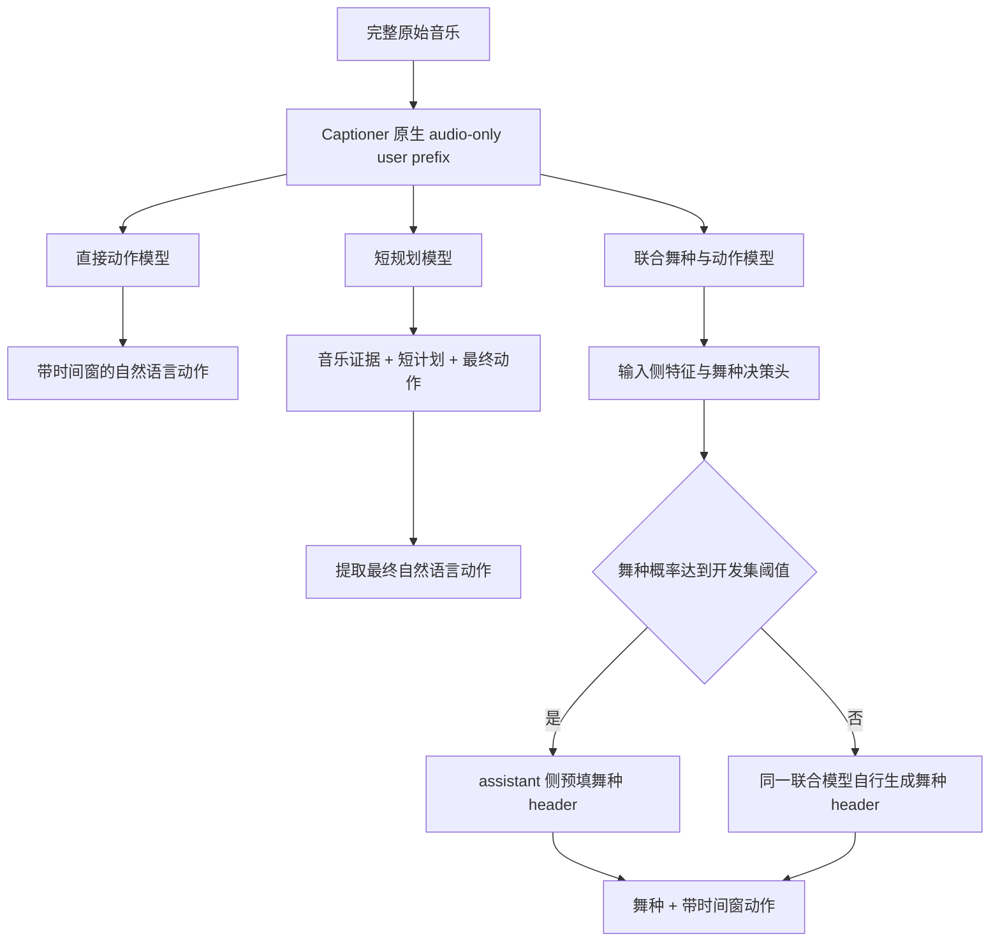

# Captioner 优先的规划器训练与生成路线

用户目前倾向采用 `Qwen/Qwen3-Omni-30B-A3B-Captioner`。本轮以该模型为主要工程目标，三个实验仍独立保留，原生 user 输入保持 audio-only。本文对应上游 `236d4221039647bd2a229ba28a211d88eb5ab844`，实际命令与字段以各分支 README 为准。

## 为什么当前可以优先研究 Captioner

仓库的[匿名文本审阅](../../results/music_planner_blind_val_text_review_summary_20261025_v1.json)记录了 32 条/模型的审阅：审阅者对 Captioner 的局部动作承接和动作分化略有倾向，但没有听音频、没有看视频，置信度为中低。[弱参考 F1 配对区间](../../results/music_planner_val_reference_F1_bootstrap_20261025_v1.json)中 Captioner 与另外两模型的差值区间均含零。它们支持把 Captioner 作为优先实验对象，尚不能证明音乐理解、舞种控制或最终视频最优。

上游已记录三模型完整训练预算完成。这里新增的联合舞种、短规划等协议仍需单独训练和验收，旧动作 checkpoint 不会因为名字相同就自动具备这些能力。本轮本地没有完整预训练权重或服务器 GPU，只执行代码与 CPU 回归。

## 保持原生音乐输入，明确区分三种输出协议



直接动作、短规划和联合舞种是不同训练协议。Captioner 的 audio-only user prefix 不提供一个已验证的 system prompt 开关；同一个 checkpoint 不能仅靠改命令中的 mode 就变成另一种模型。

最终交给渲染器的文本保持连续自然语言。例如：

```text
Dance style: hip hop.
[0-2s] The dancer shifts weight to the left while lifting the right forearm across the chest.
[2-5.062s] Continuing the weight shift, the dancer steps right and opens both arms before settling into a small knee bend.
```

这只是格式示例，不是某段真实音乐的标注。舞种、手势和动作需来自实际监督或实际生成；不能把示例写进训练集充当观测事实。

## 先用已有数据建立直接动作对照

`codex/planner-cot-multitask` 的 direct-caption 路径可使用现有弱动作 caption，不强迫为所有样本先生成音乐证据和短计划。它仍检查原始音频身份、固定时间窗、训练/验证隔离及弱标签契约。

短规划路径要求已审核的 music_evidence 和 short_plan。比较短规划是否有帮助时，两种模式使用同一批审核来源、同一初始化和相同源曝光，并开启该分支的共享标注要求；否则数据子集或标签质量变化会混入结果。两个模式独立训练、独立 run 和 checkpoint。

训练 NLL 用于各模式内部检查点选择。短规划的 caption NLL 以金标音乐证据和金标计划为条件，直接模式没有这些金标前段，因此两者数值差不能证明短规划收益。实际对照应从音乐直接生成全部内容，不输入目标动作或人工计划。

分块 CE 优化只减少额外 FP32 loss 中间量；原生模型仍可能输出完整词表 logits。CPU 的 loss/梯度一致性不能当作 30B 模型的显存测量，多卡训练能力也需独立实现和验证。

## 舞种控制需要联合 SFT 和匹配的决策头

原先的 genre head 能从输入侧特征预测舞种，但不会自动让 Captioner 跟随舞种。新增联合协议在 assistant 目标中显式监督舞种 header 和动作。高置信条件生成预填的是 assistant 输出侧 header；原生音频 user prefix 不变。

header 与动作的 token 协议需要在训练和推理中逐 token 一致。若采用显式分段编码，就应在两端使用同一分段编码，不能假设“分别编码再拼接”等于“全文一次编码”。这里没有新增未经训练的风格 token，也没有把文本前缀包装成 Captioner 原生指令能力。

推荐顺序：

1. 准备真实舞种词表和独立舞种标注，关联已有动作样本；在联合 SFT 之前按歌曲/近重复分组留出 cal/test，cal 不参与联合模型训练或验证选择。保留来源、版本及音频身份；手势舞可作为需要单独评估的类别。
2. 完成联合舞种与动作 SFT，并验证保存、恢复、EOS 和双窗动作输出。旧公平动作 checkpoint 可以是经过核验的初始化来源，不能当作已经完成联合训练。
3. 使用这个实际完成的联合 checkpoint 导出 input-only 特征，再训练舞种决策头和拟合温度。决策头 val 不与 joint train 重叠；cal/test 不与 joint train/val 重叠。代码检查 ID、source group 和精确音频 SHA，歌曲近重复仍需上游审计。
4. 条件生成核验决策头特征身份与联合 checkpoint 内容一致，再根据概率和分差路由。

更换联合 checkpoint 会改变输入表示。旧模型导出的特征、旧决策头和新联合模型不能只靠相同的 model-id 字符串混用。身份应绑定实际权重/adapter 内容，而非仅目录、训练配置 fingerprint 或显示名称。

当前决策特征来自 decoder 上下文化的音频 token，提取时仍需运行 Captioner 的输入 prefill；小分类头本身的成本不能当成整条决策链成本。分类与条件生成的实际耗时、是否重复 prefill，应在服务器实测后报告。

低置信时由同一个联合模型自行生成舞种，这是 joint self-style 路径。它与旧动作基线的无指定舞种生成不同，应分别报告。两路都保留真实生成的 header、动作原文、token 和停止原因。格式正确不能证明舞种适合音乐，舞种头概率也不能代替动作质量。

## 用可恢复搜索采集候选，再做独立评审

`codex/planner-search-rsi` 为 Captioner 的直接动作候选保留原生输入和缺失 EOS 修复。采集前核对实际基座、完成的 portable checkpoint、导出 adapter 内容和输出协议。短规划或联合舞种 checkpoint 需要对应协议入口，不能当作普通直接动作模型静默读取。

采集中断后复用已验证的完整候选记录，未完成项才重新执行；候选 seed、采样参数、来源音频、模型和运行时代码共同绑定。最终完整 pool 与中间 journal 分开，未完成 journal 不冒充完整结果。旧 raw 输出不得被覆盖或整理成“正常输出”。

搜索与 RSI 仍只接受 train/dev，不进入 test。歌曲和近重复分组未知时允许生成与评审，训练导出保持阻断。盲评材料只发公开包，私有候选映射留在内部；同评审选优后的均分提高存在选择偏差，质量结论需独立第二评审。

## 推荐执行次序与文档入口

优先顺序为：现有 Captioner 直接动作 checkpoint 的小规模候选与盲评；直接动作训练/生成对照；小规模审核数据上的短规划消融；有真实舞种标注后的联合舞种 SFT 和匹配决策头。

- [直接动作、短规划与 teacher-free 评测](https://github.com/Anachronism-N/H3-posttrain/blob/codex/planner-cot-multitask/notes/README_MUSIC_PLANNER_SHORT_PLAN.md)
- [舞种决策与 Captioner 联合输出](https://github.com/Anachronism-N/H3-posttrain/blob/codex/planner-genre-decision/notes/planner_ideas/genre_decision/CAPTIONER_ASSISTANT_HEADER.md)
- [候选采集、断点恢复与盲评](https://github.com/Anachronism-N/H3-posttrain/blob/codex/planner-search-rsi/scripts_omnidance/exp/ms/README_music_planner_search_zh.md)

当前实验仍输入完整 5.0625 秒音乐，输出 `[0-2s]`、`[2-5.062s]` 两个固定动作窗。小节动态切分、额外音乐 encoder 融合、在线 RL 与自动权重更新需要后续独立实验。RSI 的数据循环范围保持为规划器。
